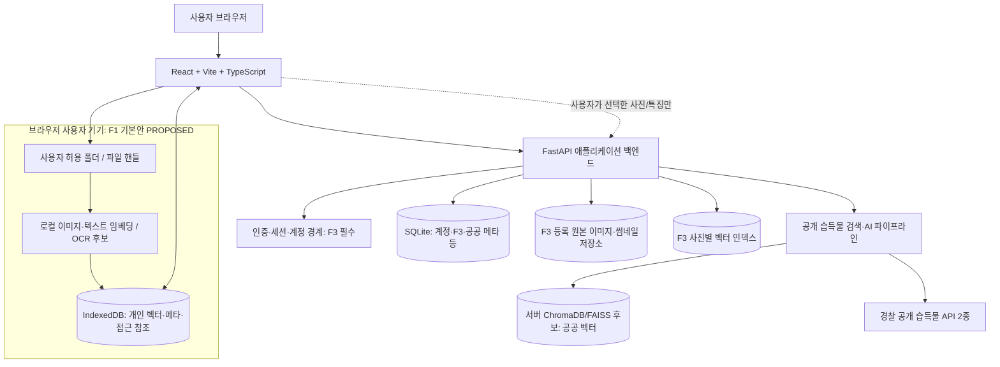

# 상세 기획안 — 그거어디? (브랜드 적용·기획 개정본)

> 로컬 통합본: 2026-11-17 · 첨부 개정판과 최신 사용자 UI 지시를 병합. 변경·구현 상태는 `README_최신설계_및_작업순서.md` 참조.
> **최신 카피 기준:** `06_UI_최신_카피.md`. 사용자용 기능명은 `갤러리에서 사진 찾기 / 분실물 찾기`, 실제 F2 데이터 출처는 `경찰청 공개 습득물 정보`다. 두 검색 기능은 헤더 직하단 전환 영역과 모바일 메뉴에서 제공한다. 홈 복귀는 로고로 하고 로그인은 별도 계정 액션으로 유지한다.


**공식 프로젝트 주제:** AI 기반 개인 사진 탐색 및 유실물 검색 웹서비스

**서비스 비전:** 소중한 순간과 물건을, 기억나는 단서만으로 다시 찾을 수 있도록.

> 최초 작성일: 2026-11-13 · 최근 개정일: 2026-11-16 · 개정판: Brand/UX·Search v1.4 · 상태: **탐색·검증 진행 중(Pre-PRD)** · 문서 목적: 최종 PRD 확정 전 합의된 방향과 검증할 가설을 분리하고, 사용자 여정·UI·아키텍처·검증 결과를 축적한다.
>
> **본 문서는 최종 구현 명세·확정 기술 스택·실제 성능 검증 결과가 아니다.** 브랜드명 `그거어디?`는 작업용 우선 채택안이며 KIPRIS/도메인/사용자 이해도 검증 전에는 법적 확정 명칭으로 간주하지 않는다. 숫자는 명시하지 않는 한 실험 목표안이다. 외부 API의 사용 가능 여부는 인증키를 이용한 실제 호출 전까지 확정하지 않는다. **F1·F2 로그인 없이 검색, F3 로그인 필수·원본 사진과 벡터 동시 저장, 인증 없는 검색 중심 첫 화면, 채팅형 검색 입력, 별도 로그인 버튼은 합의된 제품 정책이다.** F1 브라우저 추론·IndexedDB 지속성, F3 인증 공급자·저장소의 구체 구현, 검색 AI 모델과 채팅형 후속 검색 방식은 검증할 설계안이다.

**F2 입력·검색·결과 계약 [AGREED · 2026-11-16 최신]:** `자연어만 / 사진만 / 자연어+사진` 모두 **종합·이미지·맥락 3개 검색 결과 채널**을 지원한다. 검색 모집단은 F2 공개 습득물로 한정한다. `종합`은 이미지·맥락 경로 후보의 **OR 합집합**을 확보한 뒤 여러 근거로 재정렬하는 기본 탐색 채널이며, 사진 없는 기록도 포함 가능하다. `이미지`는 실제 유효 습득물 사진이 있는 기록을, `맥락`은 사진 유무와 관계없는 전체 공개 기록을 대상으로 한다. **각 채널은 독립된 정렬/페이지네이션을 유지하며, 동일 레코드의 채널 간 중복 노출을 허용한다. 같은 채널 내부의 중복 레코드는 제거한다.** 초기 UI는 **각 최대 3건 미리보기 + 해당 채널 더보기**(3+3+3)이며 실제 후보가 적으면 그만큼만 보여준다. 더보기에서 같은 채널의 4위 이후로 연속 탐색할 수 있고, 다른 채널에서 이미 봤다는 이유로 건너뛰지 않는다. 3건 수는 사용성 검증 후 변경 가능하다.

**AI·검색 경계 [AGREED: 목표 / OPEN: 구현 성능]:** 자연어만 입력해도 공개 유효 사진의 **VLM 사전 해석 맥락**과 텍스트↔이미지 임베딩으로 이미지 후보를 찾고, 사진만 입력해도 **VLM이 검색 설명·조건을 추출**해 맥락 검색을 수행한다. 자연어+사진은 두 단서를 함께 반영한다. LLM 질의 구조화·OCR·객체 탐지·크롭·임베딩은 독립 모듈이며, F2는 **LangChain+LangGraph 중심의 조건부 워크플로**를 설계 방향으로 채택한다(MCP는 MVP 불필요). 모델의 파인튜닝은 필수가 아니지만 **평가용 정답셋**은 반드시 만든다. 이미지·맥락 점수의 단순 평균이나 `동일 물건 확률` 표시 금지. RRF 등 결정적 랭킹 모듈을 비교 실험하고, 채널별 부분 오류·검색 상태는 분리한다. F1 로컬 개인정보·F3 등록 원본+사진별 벡터 계정 저장·F4 명시적 일시 전달 원칙은 변경하지 않는다.

## 개정 요약 (2026-11-16 · 브랜드/연계 문서 패키지)

| 변경 | 반영 범위 | 결정 상태 |
|---|---|---|
| 브랜드 작업안 **그거어디?** | 홈 워드마크, 기능 설명, 브랜드 철학, `EXP-23` | **작업용 우선 채택 / 상표·실사용자 검증 전** |
| 헤더 설명 **내 사진 · 내 물건 찾기** | 데스크톱·모바일 브랜딩, 카피 A/B | **디자인 기준안**, 긴 문구 비교 필요 |
| Calm & Meaningful 디자인 토큰 | 별도 `01_Figma_디자인_실행가이드.md`와 연결 | **제안**, 대비/사용성 승인 전 |
| 지도는 **F2 개별 상세 하단의 보조 섹션** | `FR-LOS-10~15`, `EXP-22` 유지 | **제품 요구 합의**, 기술 검증 전 |
| API 및 아키텍처 실험 | 외부 API 목록, F1 로컬·F2 공공·F3 계정 서버 분리 | **미실행 실험/기술 후보** |
| 설계 순서 | P0에서 **소규모 스타일·핵심 UX 시안 탐색 허용**, 확정 UI 핸드오프는 P3 | **2단계 설계 원칙** |
| **F2 세 입력×세 결과 채널 (두 원천 검색 + 종합 재랭킹)** | 자연어만·사진만·혼합 모두 VLM 기반 이미지 맥락 이해를 사용. 종합/이미지/맥락 각 최대 3건 미리보기 + 채널별 더보기 | **제품 요구 AGREED**, 실제 관련 후보 부족은 0~2건. 3개 표시 수·모델·품질·운영 구현은 검증 전 |
| **화면 설계 단일 기준 문서** | `05_페이지구성_와이어프레임_UIUX_통합설계.md` 신설. 기존 상세기획안과 Figma 가이드의 UI 세부 중복 최소화 | **문서 운영 원칙** |

**중요:** 원본 파일의 기존 요구사항, 실험 ID, F1 로컬 전용/비로그인, F2 로그인 불필요, F3 사용자 등록 원본+사진별 벡터의 서버 저장 원칙을 삭제하지 않고 유지한 개정본이다. Figma 파일이나 코드/API 실연동을 이미 만들었다는 뜻이 아니다.

## 0. 기획 기준, 합의 사항 및 의사결정 정책

### 0.0 프로젝트 정체성 및 언어 규칙 [AGREED]

| 구분 | 채택한 표현 | 활용 기준 |
|---|---|---|
| **기획서 공식 주제** | **AI 기반 개인 사진 탐색 및 유실물 검색 웹서비스** | 문서 제목·과제 제출용 주제·PRD 공식 표기 |
| **서비스 비전** | **소중한 순간과 물건을, 기억나는 단서만으로 다시 찾을 수 있도록.** | 제품 철학, 디자인·UX 판단 기준 |
| **핵심 가치** | 소중한 것을 더 쉽게 찾도록 돕는다 | 브랜드 방향(감성적 상위 개념) |
| **사용자용 기능명** | **갤러리에서 사진 찾기 / 분실물 찾기** | 탐색 메뉴, 홈의 모드 선택, 도움말 |
| **보조 기능명** | **소중한 것들** | 분실 전 물품(사진) 사전 등록·관리 공간 |
| **사용자용 설명** | 내 사진과 잃어버린 물건을 찾는 AI 서비스 | 간결한 온보딩·서비스 소개 |
| **기술적 설명** | 개인 사진·공개 습득물에 대한 멀티모달 이미지/텍스트 유사도 검색 | 아키텍처 및 AI 기법 설명에 한해 사용 |
| **서비스 브랜드(우선 채택안)** | **그거어디?** | 작업·디자인 기준 이름. 상표·유사서비스·도메인·앱스토어 검증과 최종 승인 필요 |
| **브랜드 옆 기능 설명** | **내 사진 · 내 물건 찾기** | 헤더/로그인 없는 홈의 짧은 디스크립터. 요구안 `내 사진 내 물건 그거찾기`는 비교 카피로 검증 |
| **캠페인·보조 카피** | **내 사진도, 내 물건도. 그거찾기!** | 선택형 마케팅 카피. 기능 메뉴명과 혼용하지 않음 |
| **브랜드 감성 방향** | **Calm & Meaningful** | 따뜻한 뉴트럴 배경과 차분한 틸 강조; 사진·물품이 주인공 |

**용어 금지/주의:** '통합 검색'이라는 워딩 표현을 단독 서비스명·유저 화면 카피로 쓰지 않는다. 포털형 **일반 인터넷 검색**, 모든 웹사이트 검색, 경찰 내부 시스템 직접 검색, 경찰과의 공식 제휴를 암시하기 때문이다. 두 검색 기능이 한 사이트에 존재한다는 의미의 '통합'은 내부 설명에서만 제한적으로 가능하나, 사용자에게는 **검색 범위**를 반드시 적는다.

**비전과 기능의 관계:** F1은 추억·여행뿐 아니라 실무 스크린샷·참고자료 등 *유용한* 이미지도 찾는다. '소중한 것'은 가치 철학이지 모든 파일이 감성적 추억이라는 전제가 아니다. F2는 물건을 **찾는 데 도움이 되는 유사 습득물 후보를 제시**할 뿐 실제 회수·소유권 인증을 보장하지 않는다.

**서비스의 세 가지 약속:** (1) 어디를 찾는지 명확하다—`내 사진`과 `경찰 공개 습득물`; (2) 기억나는 **문장이나 사진**이 검색 단서가 된다; (3) 개인 사진은 사용자가 직접 허용·선택한 범위에서만 처리되며, F1→F2 전달도 사용자 선택이다.


### 0.0-A 브랜드 아이덴티티·디자인/카피 가드레일 [AGREED: 운영안 · EXPERIMENT: 최종검증]

- **브랜드명:** `그거어디?` (서비스 운영·Figma 콘셉트 검토의 기준명). **공식 과제 주제와는 분리**하며, 상표·도메인 검토·시장 조사 통과 전에는 상용 등록 확정으로 단정하지 않는다.
- **로고 옆 기능 설명:** `내 사진 · 내 물건 찾기`. 사용자가 제시한 긴 문구 `내 사진 내 물건 그거찾기`와 마케팅형 `내 사진도, 내 물건도. 그거찾기!`는 첫인상/가독성 A/B 후보로 남긴다. **F2를 물건 실제 위치 GPS 추적이라고 설명하지 않는다.**
- **브랜드 언어:** 사용자가 묻는 `그거 어디 있지?` → 검색 경험 `기억나는 말이나 사진으로 찾아보기` → F1 실제 사진 발견 시 `아, 여기 있네!`. F2는 **`비슷한 습득물 후보를 찾았어요`**, **`보관기관 정보를 확인하세요`**만 사용한다.
- **브랜드 성격:** 따뜻함/발견의 기쁨과 데이터 신뢰/차분한 기능성을 균형 있게 표현한다. 과장된 ‘AI가 찾아드립니다/100% 일치/물건을 돌려드립니다’ 금지.
- **현재 웹 디자인 기준:** 기존 홈의 뉴트럴 `#FAFAF8`, 흑연 `#222322`, 옐로 `#E5DB72`를 상속한다. 실제 토큰은 `frontend/src/styles/tokens.css`와 01을 참조한다. 웜화이트·차콜·번트오렌지는 07에 보존한 과거 Figma 제작 이력이며 현재 웹의 기본 팔레트로 되돌리지 않는다. 대비·사용성의 최종 검증은 별도다.
- **타이포/로고:** Pretendard 또는 SUIT 후보, 여백과 명확한 정보 위계, 워드마크 우선. 돋보기+사진 프레임/발견점의 **단순한 상징**을 비교하되 일반적인 확대경 아이콘만으로 정체성을 확정하지 않는다.
- **홈에서 가장 먼저 설명할 것:** ① 내 폴더의 사진(F1)인지 ② 공개 습득물(F2)인지, ③ 로그인 없이 검색 가능, ④ 이미지 첨부 가능. F3는 등록한 원본 사진·벡터가 **계정 서버에 저장**된다는 사실을 개별 동의 화면에서 정확히 고지한다.
- **반증해야 할 브랜드 리스크:** `그거어디?`가 물건 GPS/위치 추적 서비스로 오해되는지, `내 물건`이 소유권 확인을 암시하는지, `그거찾기` 카피가 F2 회수 확정을 암시하는지 (`EXP-23`).

### 0.1 사용자와 합의한 방향 [AGREED]

- **공식 주제는 'AI 기반 개인 사진 탐색 및 유실물 검색 웹서비스'로 합의**, 서비스 비전은 '소중한 순간과 물건을, 기억나는 단서만으로 다시 찾을 수 있도록.'를 채택한다. 이는 가치·포지셔닝 결정이며 모델 성능 검증을 뜻하지 않는다.
- 두 기능을 합쳐 하나의 검색 결과 풀을 만드는 **범용 통합 검색**을 설계하지 않는다. 각각 검색 대상·권한·결과 의미가 다르다.

- **하나의 웹사이트에 독립된 두 핵심 검색 기능을 구현:** (F1) 자연어·이미지 기반 개인 갤러리·폴더 이미지 검색, (F2) 자연어·이미지 기반 경찰 습득물 검색.
- **F2 결과 3개 독립 채널 [AGREED: 제품 UX]:** `종합 / 이미지 / 설명·조건(맥락)`을 표시한다. 각 채널의 **독립 순위·전용 더보기·채널 간 중복 허용**이 필수다. `종합` 후보는 이미지·맥락 후보를 OR 합집합으로 확보해 재정렬하고 사진 없는 기록도 포함할 수 있다. `이미지`는 실제 사진 검증 기록만, `맥락`은 사진 유무와 관계없는 전체 공개 기록을 대상으로 한다. 첫 화면은 채널별 **최대 3건씩(3+3+3)**이 기본 제안이며 3건이 미만이면 있는 만큼만 표시한다. 채널 간 동일 후보를 지우거나 다른 채널에서 봤다는 이유로 더보기의 4위 이후 후보를 건너뛰지 않는다. 알고리즘 세부와 미리보기 개수의 최종 값은 `EXP-05/19/25`로 검증한다.
- **F2 습득물 상세 페이지에 보관기관 위치를 보조적으로 안내한다 [AGREED: UX 범위].** 검색 결과는 기본적으로 목록/카드이며, 사용자가 후보를 열었을 때 상세 설명 **하단**의 `보관기관 및 위치` 영역에 작은 지도, 확인된 주소, 연락처, 지도 열기·길찾기·공식 출처 CTA를 배치한다. **독립 지도 탐색 화면, 전체 화면 지도, 다중 후보 지도 마커 비교는 MVP에서 제외**한다. 좌표·주소가 검증되지 않으면 지도 미표시 + 공식 원문·문의 경로로 대체한다.
- F1만 또는 F2만 각각 독립적으로 사용할 수 있어야 한다. 사용자가 원할 때만 F1의 사진을 F2로 **다운로드·재업로드 없이 전달**한다.
- **'소중한 것들' 개인 사전 등록/관리** 기능을 추가한다. 로그인 후 물건 촬영·등록 → **등록한 원본 사진과 각 사진의 이미지 임베딩 벡터를 계정별 서버 저장소에 모두 보관** → 상태 확인 → 분실 시 F2 검색을 지원한다. 사전 등록은 경찰 신고와 무관하다. F1 전체 갤러리가 자동 업로드되는 것은 아니다.
- F1과 F2 모두 **텍스트만, 이미지만, 텍스트+이미지**로 검색할 수 있어야 한다. 관련 이미지가 있으면 업로드하거나 선택해 유사 이미지 검색에 활용한다. 자연어 검색에서는 사진의 장면·물체와 스크린샷 속 **텍스트(OCR)**도 함께 고려하며, 한 사진에 여러 물체가 있을 때 다수 객체를 검출·선택할 수 있어야 한다.
- 원본 이미지와 객체별 크롭 이미지를 **서로 다른 검색 단위**로 다룰 수 있도록 설계한다. 하나의 벡터로 무조건 합치지 않는다.
- YOLO는 목표가 아니라 **속도·정확도 향상을 위한 후보**다. 사용자 선택·직접 라벨·영역 지정으로 오류를 보완하며 모델은 실험 후 결정한다.
- 경찰 습득물 API의 **기존 물품 대/중분류**를 활용하고, AI 카테고리는 *우선순위 신호*로 활용한다. 강제 필터로 정답을 탈락시키지 않는다.
- 구현 흐름: **상세 기획 → 확정 PRD → 개발 계획 및 문서 관리 → Figma 디자인 → Codex 코딩**.
- **구현 구조 원칙:** 프론트엔드, 애플리케이션 백엔드, SQL·DB 관리 계층, AI 백엔드를 논리적으로 분리하고, F1~F5 기능도 기능별 모듈·파일로 나눈다. 웹 레이아웃과 UI는 재사용 가능한 컴포넌트 단위로 구성한다. MVP에서는 같은 PC·저장소·프로세스에서 실행하더라도 코드 책임과 의존성 경계는 분리한다.
- **논리적 사고 원칙:** 기능을 바로 코딩하지 않고 먼저 목적·입력·출력·상태·실패·권한·의존성·검증 기준을 정의한 뒤, 데이터 계약 → API 계약 → AI 처리 계약 → UI 흐름 → 테스트 순서로 설계한다. 한 파일에 여러 책임을 섞는 거대 파일과 순환 의존성을 피한다.
- 웹 MVP는 **로컬 PC 실행, 프론트/백엔드 분리, Python 가상환경, SQLite, 환경변수**, 무료/오픈소스 기술 우선. API와 라이선스는 사전 검증한다.
- 할 일 목록·요구사항 매핑·개발 로그 등을 **하나의 폴더 아래 각자 Markdown 파일**로 관리하고, 필요할 때 역할별 에이전트/전문 검토를 수행한다.

### 0.1.0 첫 화면·탐색·로그인 UX에 관한 추가 합의 [AGREED: UX 원칙 / PROPOSED: 구체 배치]

- **첫 진입 URL `/`은 비로그인 방문자도 바로 접근하는 검색 홈**이다. 로그인·회원가입 폼, 인증 모달, 개인 폴더 접근 허용 팝업을 선행 조건으로 띄우지 않는다.
- **채팅형 이미지 첨부 검색 UI가 화면의 중심**이다. 자연어 입력창·사진 첨부 버튼·선택한 사진 미리보기·전송/검색 동작을 한 영역에 배치한다. 채팅형은 *검색 대화처럼 보이는 입력·진행·결과의 표현*을 뜻하며, 범용 챗봇/무제한 멀티턴 LLM 대화를 필수로 뜻하지 않는다.
- 입력 전후에 **검색 대상 `갤러리에서 사진 찾기(F1)` / `분실물 찾기(F2)`가 반드시 명확**해야 한다. 한 번의 검색으로 두 검색 범위를 섞거나 인터넷 전체를 검색하지 않는다. 첫 진입 기본 선택·선택 기억 방식은 사용성 검증 후 결정한다.
- **전역 네비게이션**에 `갤러리에서 사진 찾기 / 분실물 찾기 / 소중한 것들 / 설정`을 둔다. 검색 이력은 권한·보관 정책에 따라 추가 배치한다. **로그인 버튼은 네비게이션 기능과 분리하여 헤더/계정 영역에 표시**한다(모바일은 별도 계정 액션 확보). 로그인 상태에서는 계정 메뉴/로그아웃으로 변한다.
- **F1·F2 검색 시작은 비로그인 상태에서도 즉시 허용**한다. F1의 폴더 접근은 실제로 `갤러리에서 사진 찾기`를 이용하려 할 때 사용자에게 권한을 요청한다. F2는 회원가입 없이 텍스트만으로도 검색할 수 있다.
- **F3는 목록 메뉴를 숨기지 않고 진입 시 로그인 게이트**를 보여 준다. 인증·동의 후 원래 F3 목적지/작업으로 돌아가며 취소 시 검색 홈이나 이전 페이지로 돌아갈 수 있다. URL을 직접 열어도 서버 접근 제어는 유지한다.
- **로그인 편익은 F3에만 연결한다.** `소중한 것들`에서 선택해 등록한 **사진 원본·검색용 특징 정보·벡터를 계정에 보관하고 다시 불러오는 기능**만을 안내한다. F1·F2는 로그인 없이 동일하게 검색하며, F1 로그인 시 속도 향상·인덱스 백업·계정 동기화 혜택은 제공하거나 홍보하지 않는다.
- 로그인 유도는 **강제 모달이나 F1/F2 검색 차단 수단이 아니다.** 홈의 F3 보조 안내·F3 로그인 게이트처럼 물품 등록의 맥락에서만 제공한다. 실제 제공하지 않는 보호·복원·속도 편익은 약속하지 않는다. 구체 문구·배치는 Figma/EXP-18~20 검증 전 `PROPOSED`다.

### 0.1.0-A F2 후보 상세의 위치 안내 범위 [AGREED: 기능/화면 위치 · PROPOSED: API 구현]

- **화면 위계:** `F2 검색 결과 카드 목록` → `F2 개별 습득물 상세(사진·설명·습득정보·유사 후보 고지)` → **하단 보조 섹션 `보관기관 및 위치`** → 외부 `지도에서 보기/길찾기`, `보관기관에 문의`, `공식 상세 확인`.
- **지도 목적:** 지도가 가리키는 것은 분실 추정지나 습득 지점이 아니라 **확인된 현 보관기관의 위치**다. `습득 장소`, `접수 장소`, `보관기관/보관장소`를 서로 다른 필드와 라벨로 다룬다.
- **현재 위치 여부:** 보관기관 주소·상태는 공공 데이터의 최근 갱신 및 기관 조회 기준 정보이며, 실시간 물건 위치 GPS가 아니다. 물건 이동·반환·정보 지연 가능성을 안내하고 방문 전 전화 확인을 권한다.
- **지도 데이터 게이트:** 좌표가 원본 응답에 없을 수 있으므로, 정규화한 기관 식별자/주소를 확보하고 지도 제공자 주소→좌표 변환 결과를 확인한 경우에만 마커를 보여 준다. **단순 보관소 문자열, 다의적인 기관명, 지오코딩 첫 번째 결과만으로 확정 금지.** 보관기관 데이터의 공식 출처, 주소 확인일, 지도 변환 상태를 별도 관리한다.
- **MVP 범위 외:** 검색 결과 전체 지도보기, 근처 물건 탐색, 지도 기반 랭킹, 주변 분실물 히트맵, 사용자 GPS 권한 요청, 경로를 서비스 내부에서 직접 계산하기. 외부 지도 앱의 길찾기 링크만 허용(확인된 목적지에 한해).
- **기술 후보:** 카카오맵 JavaScript SDK(+ `services` Geocoder/Places) 또는 공식 지도/길찾기 딥링크. 최종 공급자·키/도메인 등록·무료/유료 쿼터·약관·좌표 캐시 허용·접근성은 실제 검증 후 결정한다. 사용자의 현재 위치 권한은 MVP 필수 조건이 아니다.
- **명칭·브랜딩:** 브랜드 운영안은 `그거어디?`, 기능 설명은 `내 사진 · 내 물건 찾기`. ‘어디?’가 GPS/실시간 물건 위치추적이라는 의미로 오해되지 않도록 F1·F2 검색 범위를 홈에서 명확히 알린다. 상표·도메인·사용자 오인 검증 전 법적 확정 명칭으로 표현하지 않는다.

### 0.1.1 기능별 로그인·저장 정책 [AGREED: 제품 정책 / PROPOSED: 세부 구현]

| 기능 | 로그인 정책 [AGREED] | 원본·벡터 저장 [AGREED] | 주요 제약 |
|---|---|---|---|
| **F1 갤러리에서 사진 찾기** | **로그인 불필요**. 로그인 상태여도 기능·검색 성능 혜택은 동일 | 사용자가 선택·허용한 **원본은 사용자 기기에 유지**, 분석한 임베딩·OCR·파일 참조는 **브라우저 로컬 인덱스**(후보: IndexedDB)에 저장·재사용. **F1 계정 백업·클라우드 동기화 기능은 제품 범위에서 제외** | 브라우저 사이트 데이터 삭제·폴더 권한 만료 시 재연결·재색인 필요. F3 계정과 자동 연결하지 않음 |
| **F2 분실물 찾기** | **로그인 불필요** | 경찰 공개 습득물 데이터는 허용 범위 내 서버 검색 인덱스에 보관. 사용자가 입력한 개인 사진은 검색 처리 후 **장기 보관하지 않음** | 습득물 유사 후보 조회; 사용자 이미지를 경찰 API에 자동 제출하거나 F3에 저장하지 않음 |
| **F3 소중한 것들** | **로그인 필수** | 사용자가 **명시적으로 등록한 원본 이미지 전체(각 촬영본)**와 **각 이미지에 연결되는 임베딩 벡터**를 **계정별 접근통제 서버 저장소**에 모두 저장. 물품 ID·사진 ID·설명·특징·모델 버전도 함께 관리 | 원본이 사용자 PC에서 삭제되더라도 등록해 둔 F3 원본을 계정에서 다시 볼 수 있도록 설계. 서비스 운영 시 지속 보관할 서버/스토리지와 보안·백업·삭제 정책 필요 |
| **F4 F1→F2 연계** | 로그인 불필요 | 사용자가 선택한 이미지/영역만 F2에 일시적으로 전달. **F3에 등록하는 행동은 별도 명시적 승인** | 자동 저장·자동 전송 금지. F2 검색용 업로드와 F3 보관용 업로드를 혼동시키지 않음 |

**인증·인덱싱·저장의 차이:** `로그인`은 계정 식별·F3 접근권한 관리, `인덱싱`은 사진을 AI 특징으로 처리하는 과정, `F3 저장`은 사용자가 등록하기로 선택한 **원본 파일과 해당 벡터를 함께 지속 보관**하는 작업이다. F1 분석 속도는 로그인 여부가 아니라 유효한 로컬 인덱스가 있는지에 좌우된다. F1에 로그인만을 위한 추가 사용자 편익을 만들지 않는다.

**F3 저장 경계:** F3는 **사진 원본을 반드시 보관**하므로 이미지 ID와 벡터만 저장하는 설계는 채택하지 않는다. 원본은 서버의 계정 보호 파일 저장소(초기 로컬 개발 환경의 비공개 서버 디렉터리 또는 향후 운영용 스토리지)에 보관하고, 각 `photo_id`가 **원본의 저장 위치와 임베딩 벡터·모델 버전**을 연결한다. DB에는 원본 대용의 대용량 BLOB을 일괄 적재하지 않아도 된다. 썸네일은 표시 성능을 위한 파생 파일이며 원본을 대체하지 않는다.

**F3 이미지 안내:** 등록 확정 버튼 전 사용자에게 **원본 사진과 검색용 이미지 특징 정보가 내 계정에 저장됨**을 부담 없이, 그러나 빠뜨리지 않고 설명한다. 예: **“소중한 물건의 사진과 특징을 내 계정에 보관해 둘게요. 나중에 다시 확인하거나, 잃어버렸을 때 바로 찾아보는 데 사용할 수 있어요.”** 보조 고지: **“등록한 사진 원본과 AI 검색용 정보가 저장되며, ‘소중한 것들’에서 확인하고 삭제할 수 있어요.”** 비공개·안전성 문구는 서버 권한·운영 검증 후에만 확정한다.

**F1→F3는 별도 행동:** F1에서 발견한 사진을 F3에 등록하는 기능을 추가한다면 **사용자가 `소중한 것들에 등록`을 별도로 선택하고 로그인 및 저장 범위를 확인한 뒤** 해당 선택 사진 원본만 서버에 저장할 수 있다. F1 폴더의 다른 사진은 서버에 업로드하지 않는다. F1→F2의 일시 검색은 F3 영구 등록과 무관하다.

**저장 기술·운영 범위:** F1 로컬 분석과 F2 공개 검색만 이용하는 사용자에게 계정은 불필요하다. F3는 클라우드 이미지 서비스 브랜드를 사용하지 않더라도 **사용자가 재접속할 수 있는 백엔드·계정별 파일 저장 공간·DB·백업 수단**이 필요하다. 로컬 서버 1대로 시연하는 것과 실제 다른 기기에서 상시 이용하는 서비스는 별개다. 이미지 보존·삭제 기간, 백업 삭제 SLA, 저장 용량·비용, 암호화·접근 권한 세부 사항은 PRD 확정 전 검증한다.

**제품 정책과 실구현 구분:** F3가 사진 원본과 벡터를 모두 저장해야 한다는 제품 요구는 확정했지만, 실제 서버 저장·백업·계정 접근통제의 구현과 검증은 아직 수행되지 않았다.

### 0.2 아직 확정하지 않은 사항 [OPEN]

- **브랜드명 `그거어디?`의 상표·도메인·기능 오인 검증 및 최종 등록/승인**·공개 배포 시점, 최초 타깃의 우선순위, 초기 사진 수 규모, **홈 첫 검색 모드의 기본값·대화형 후속 질의 범위·로그인 유도 UI 카피의 최종 문안**, **로그인 공급자/방식·F1 로컬 인덱스 보존·삭제·재연결 정책·F3 원본 파일 저장소/벡터 인덱스 구체 기술·서버 배포·보관 기간 및 백업 삭제 기준**. 로그인 필요성의 **제품 정책**은 0.1.1에서 합의 완료. **공식 과제 주제와 서비스 비전은 합의 완료.**
- 임베딩 모델(CLIP/SigLIP2 등), 검출·분할 모델(YOLOE/SAM3/Grounding DINO/VLM), OCR 엔진, 검색 가중치, 벡터DB의 최종 선택.
- 경찰청 API의 **실제 응답량·사진 포함율·이미지 URL 접근성·이용 조건·호출 제한·변경/삭제 동기화 주기**.
- 별도 모델 학습이 필요한지, 학습 데이터의 양과 출처, 정확도와 속도의 합격 기준.
- 브라우저 로컬 추론의 실현 가능성(성능·지원 모델), F1 인덱스 지속성·원본 파일 재접근 UX, F3 원본+벡터의 동시 저장·재색인·삭제·복원 및 계정 인증/서버 운영 방식, 모바일/HEIC 지원 범위, 이미지 외부 VLM 전송 허용 여부.

### 0.3 판단 원칙

- **결정 상태:** `AGREED`(합의), `PROPOSED`(권장안), `EXPERIMENT`(실험), `BLOCKED`(선결 조건 미충족), `DECIDED`(검증 후 확정), `DEFERRED`(차기).
- 성능 향상 주장은 반드시 A/B 실험과 재현 가능한 로그로 확인한다. '가능하다'와 '실제로 구현·검증했다'를 분리한다.
- 조회 결과는 **유사 후보**이지 '동일 실물 확정'이나 '소유권 인증'이 아니다. 보관기관 연락 및 공식 확인 프로세스를 우선한다.

## 1. 프로젝트 개요

### 1.1 공식 정의·비전·개발 목적

- **공식 주제:** **AI 기반 개인 사진 탐색 및 유실물 검색 웹서비스**.
- **서비스 비전:** **소중한 순간과 물건을, 기억나는 단서만으로 다시 찾을 수 있도록.**
- **한 문장 정의:** 사용자가 **자신이 선택한 갤러리·폴더의 사진**을 자연어 또는 관련 이미지로 탐색하고, **잃어버린 물건의 사진 또는 설명**으로 경찰청 **공개 습득물 정보**에서 유사 후보를 찾아보도록 돕는 컴퓨터 비전 AI 기반 웹서비스.
- **사용자용 소개:** **내 사진과 잃어버린 물건을 찾는 AI 서비스.**
- **핵심 메시지(초안):** "소중한 순간부터 잃어버린 물건까지, 기억나는 단서로 찾아보세요." (카피 문안은 Figma 사용성 검증 후 최종 결정)

**공식 서비스 개요:** 서비스는 **① 갤러리에서 사진 찾기(F1)**와 **② 분실물 찾기(F2)**라는 독립적인 기능으로 구성된다. F1은 기억나는 장면·사물·문자·상황을 입력하거나 관련 이미지를 제공해 본인 갤러리의 사진과 스크린샷을 찾는다. F2는 사진·자연어 설명을 이용해 경찰청 공개 습득물 데이터의 **유사한 후보를 우선순위로 제시**한다. 원하는 경우 F1에서 발견한 사물 사진을 F2에 **선택적으로 전달**하고, **'소중한 것들'(F3)**에 미리 등록한 물품으로도 F2 검색을 시작한다. **일반 인터넷 검색, 공식 경찰 신고 또는 소유권 자동 확인 서비스는 아니다.**

**핵심 사용자 가치:** 단순히 'AI가 객체를 검출한다'가 아니라, **사용자가 기억하는 단서와 관련 이미지를 연결해 원하는 사진·물품 후보를 찾는 시간과 탐색 부담을 줄인다.**

- **브랜드 운영안:** `그거어디?`(작업용 우선 채택), 옆 설명 `내 사진 · 내 물건 찾기`. 정확한 기능을 명시하는 F1/F2 메뉴를 병행한다. 최종 상표/도메인/사용자 인식 검증 전 공식 등록 확정 아님. 과거 `FindFrame`은 폐기된 예시다.
- **핵심 기능:** F1 내 갤러리 자연어·이미지 검색 / F2 공개 습득물 자연어·이미지 검색.
- **보조 기능:** F3 '소중한 것들' **원본 사진·벡터 동시 보관**(**로그인 필수**) / F4 F1→F2 선택적 연계 / F5 검색·분석 이력 및 설정. **F1·F2는 로그인 불필요, F1 인덱스 계정 백업 없음.** 홈은 로그인 없이 접근하는 이미지 첨부형 채팅 스타일의 검색 화면이며 로그인 버튼은 F3 계정 이용을 위한 별도 진입점이다.
- **해결하려는 문제:** (a) 수많은 개인 사진 속 원하는 장면·업무자료·물건 사진을 파일명/위치 없이 찾기 어렵다; (b) 공개 습득물 목록에서 외관이 비슷한 물건을 반복 비교해야 한다; (c) 유실물 검색에 사용할 과거 물건 사진을 찾지 못하거나, 분실 전 사진을 준비하지 않았다.
- **개발 목적:** **PC Chrome/Edge 우선**의 로컬 실행 환경에서 F1 로컬 우선 검색, F2 공개 습득물 검색, F3 계정 기반 사전 등록의 MVP 실현 가능성을 검증. **로컬 개발 서버 실행**은 프로덕션의 계정·원격 저장 서비스와 같지 않으므로, F3 인증·계정 보관은 공개/원격 배포에 필요한 서버 요구사항을 별도로 정의한다. UI는 반응형으로 설계하되 모바일 전체 갤러리 접근을 보장하지 않는다.
- **개발 방식:** PRD 승인 후 Codex 기반 단계적 바이브 코딩 + 자동 테스트 + 사람 검수. 생성된 코드를 무검증으로 수용하지 않는다.
- **비목표:** 일반 인터넷/포털 통합검색·모든 클라우드 갤러리 자동 수집·공식 경찰 분실신고 대행·습득물 소유권 자동 판정·실제 분실물 회수 보장·무단 공공 데이터 재배포·개인 사진의 무단 AI 학습.

### 1.2 대상 사용자·페르소나·Pain Point와 여정

**여정 A/B는 완전히 독립적이다.** A의 최초 인덱싱은 비로그인에서도 가능하며, 같은 브라우저에 인덱스가 남아 있으면 재방문에 재활용할 수 있다. C는 선택적 연결, D는 **로그인 후** 사전 준비/관리 여정이다. 비전 메시지는 공통이지만 검색 공간·저장·결과 책임을 하나로 혼합하지 않는다.

| 코드 | 사용자/상황 | 문제(Pain Point) | 핵심 가치 | 사용자 여정 |
|---|---|---|---|---|
| A | 30대 여성. 20대 여행의 추억을 떠올림 | 날짜·폴더를 잊어 사진 탐색에 시간이 많이 듦 | 장면·상황 또는 관련 이미지로 찾기 | 비로그인 검색 홈→갤러리에서 사진 찾기 선택→폴더 허용→최초 로컬 인덱싱(재방문 시 재활용)→“여름 제주 바닷가 노을” 검색→사진 열기 |
| A-2 | 27세 남성. 기술자료를 스크린샷으로 수집 | 필요한 순간에 스크린샷 텍스트·키워드를 기억 못함 | OCR+의미 검색 | 폴더 선택→필수 로컬 OCR 인덱싱(구현 검증 전)→“Pandas 결측치 처리” 검색→스크린샷 보기; 로그인 불필요 |
| B | 40대 남성. 지갑 분실, 물건 사진 보유 | 현행 목록 검색에서 외관 특징을 반복 확인해야 함 | 유사 이미지로 후보 탐색 | 비로그인 검색 홈→분실물 찾기 선택→직접 사진 첨부+설명(선택)→공개 습득물 후보→보관기관 확인 |
| C | 30대 여성. 가방을 분실, 과거 사진 속 가방이 있으나 위치를 모름 | 유실물 검색에 입력할 사진을 먼저 찾아야 함 | F1에서 사진을 찾아 F2로 전달 | “내 검은 가방”→사진 후보 선택·가방 영역 지정→“이 물건으로 찾기”→F2 |
| D | 20~40대 사용자. 중요한 이어폰·지갑 등 분실 예방 | 분실 당시 비교 가능한 사진이나 고유 특징이 없음 | 사전 등록·검색 준비 | 비로그인 홈에서 소중한 것들 선택→로그인 게이트→로그인 후 등록 흐름 복귀→물건 촬영→계정 보관 범위 안내 및 저장 동의→별칭·특징 승인→등록→분실 시 선택→F2 |
| B-2 | 분실한 물건 사진이 없는 사용자 | 이미지 입력 없이는 탐색 불가 | 텍스트 검색 대체 경로 | “검정 가죽 반지갑, 금색 로고”→카테고리·색상·지역·기간 입력(선택)→후보 |

**주의:** “내 지갑”이라는 말만으로 시스템이 소유자를 알아내는 것은 아니다. 사용자가 별칭으로 등록했거나 유사한 이미지 후보를 제시하고 사용자가 선택해야 한다.

### 1.3 서비스 가치·차별점(검증할 가설)

- F1은 파일명·날짜에 의존하지 않는 **자연어 검색과 이미지 검색**을 제공한다. 관련 이미지가 있으면 이미지를 업로드·선택해 개인 갤러리에서 시각적으로 유사한 사진을 찾을 수 있고, 자연어와 이미지를 함께 입력해 검색 범위를 보완할 수도 있다.
- F2는 공개 습득물의 *물품 분류·메타데이터 + 이미지 유사도*를 함께 사용하여 후보 탐색을 단축한다.
- F1→F2 연계와 F3 사전 등록으로 **검색에 사용할 원본 사진을 확보하는 전단계 문제**를 해결한다.
- **제품 철학과 실용 가치 구분:** '소중한 것을 찾는다'는 브랜드 비전이지만 F1의 업무 스크린샷처럼 감성적이지 않은 질의도 동등하게 성공시켜야 한다.
- **검증할 가치 가설:** 기억나는 단서만으로 파일명/폴더 탐색보다 **더 빠르게 사진을 발견**하고, 유실물 목록 직접 탐색보다 **유사한 후보를 더 수월하게 확인**할 수 있다. 탐색 완료율·후보 도달 시간·검색 실패율로 평가한다.
- 객관적 차별성은 기존 서비스 비교, 사용자 인터뷰, 검색 소요시간 및 검색 성공률 검증 후 주장한다. 단순 자연어 사진 검색은 기존 시장에 이미 존재한다.

### 1.4 범위 정의

| 범위 | MVP에 포함(후보) | 조건부/차기 |
|---|---|---|
| 홈/네비게이션 | **인증 없는 검색 홈**, 자연어+사진 첨부 중심의 채팅형 검색 화면, F1/F2 대상 선택, F3/설정 메뉴 및 **별도 로그인/계정 버튼**, F3 로그인 후 목적지 복귀 | 자유대화형 LLM 채팅, 검색 간 복잡한 문맥 유지·세션 자동저장 |
| F1 | **로그인 불필요**, PC 파일/폴더 선택, 브라우저 로컬 인덱스 저장·재사용(성능 검증 전제), 원본 이미지 임베딩, 자연어·이미지·혼합 검색, OCR·증분 색인 | 모바일 전체 갤러리·클라우드 포토 자동 연결; **F1 계정 백업·동기화는 비목표** |
| F2 | **로그인 없이** 이미지·텍스트·혼합 입력, **종합/이미지/맥락 3개 독립 순위·각 3개 미리보기+더보기(채널 간 중복 허용)**, 공개 습득물 후보 검색, 공식 출처 링크, 메타데이터 필터, 질의 이미지 비영구 처리, **개별 후보 상세 하단에 검증된 보관기관 주소·연락처 및 소형 보조 지도/외부 길찾기 링크(검증된 경우에만)** | 실제 CCTV, 경찰 내부 시스템, 자동 신고, 자동 반환 보장, **독립 지도 탐색/다중 마커 화면/GPS 추적**; 검색 랭킹·텍스트/VLM 모델의 구현은 실험 후 결정 |
| F3 | **로그인 필수**, 계정별 **물품 원본 사진 1~다수 + 사진별 임베딩 벡터** 동시 저장, 별칭/특징/상태, 원본 열람·조회·수정·삭제, F2 연계 | 구매증빙/시리얼 고급 관리, 알림·보험 연계 |
| F4 | F1 선택 결과를 F2로 직접 전달, 사용자 확인 후 실행 | 검색 결과 자동 공유, 무동의 이미지 업로드 |
| AI | 원본 임베딩 기본선, **F2 필수 VLM 이미지 이해 + 세 입력×이미지/맥락 두 원천→종합/이미지/맥락 세 결과 채널**, 텍스트/사진 혼합, 객체 선택·크롭 실험 | 매 질의마다 공공 사진 전부에 대형 VLM을 재실행하는 구성·무검증 모델 재학습은 기본안 아님 |

## 2. 서비스·시스템 아키텍처 및 기술 스택

**아키텍처 해석 원칙:** **홈과 F1/F2 공개 검색 라우트는 인증 없이 렌더링하고**, F3·계정 영역만 필요한 시점에 서버 인증 경계를 통과한다. 홈의 로그인 버튼은 별도 진입점이며 인증 여부가 첫 화면 표시를 결정하지 않는다. 하나의 UI·코드베이스 안에 두 검색 영역이 있으나 **검색 범위는 합치지 않는다.** F1은 허용된 개인 사진 인덱스에서 검색하며, F2는 공개 습득물 인덱스에서 검색한다. F1→F2는 사용자의 명시적 액션으로만 연결한다. '소중한 것들'은 F1이나 경찰 자료를 자동 통합하는 저장소가 아닌 사용자 개인 물품 보관함이다.


### 2.1 논리적 아키텍처(권장 초안, 검증 전)



**다이어그램 해석:** F1 브라우저 로컬 추론·IndexedDB는 **검증 전 기본 설계 후보**이며, **F1 계정 백업·동기화 경로는 없다**. F2 공유 공공 인덱스와 F3 **계정 보호 원본 파일 및 사진별 벡터 인덱스**는 분리한다. F3에 사용자가 등록한 사진만 서버에 보관하며, 로그인했다고 F1의 전체 갤러리를 업로드하지 않는다.


- **책임 경계:** 프론트엔드는 화면·사용자 상호작용·상태 표현과 **F1 로컬 권한·인덱스·선택적 로컬 AI 워커**를 관리한다. 브라우저 로컬 추론은 기능 경계를 통해 호출하는 특수 사례다. 애플리케이션 백엔드는 **F2 검색·F3 인증·권한·원본 파일 저장·사진별 벡터/서버 데이터 관리**를 조정한다. SQL·DB 관리 계층은 스키마·마이그레이션·트랜잭션·저장소(Repository)·삭제 전파를 담당하며, AI 백엔드는 임베딩·OCR·객체 탐지·재순위화 등 추론만 담당한다.
- **합치는 지점:** 모듈을 나눈 뒤 `API Router/Controller → Use Case/Service → Repository·AI Client → 결과 조합`의 명시적인 조정 흐름에서 합친다. 라우터가 SQL을 직접 실행하거나, UI가 AI 모델을 직접 호출하거나, AI 모듈이 사용자 DB를 직접 수정하지 않는다.
- **계약 우선 통합:** 프론트엔드↔백엔드 API 스키마, 백엔드↔DB Repository 인터페이스, 백엔드↔AI 추론 요청·응답 스키마를 먼저 정의한다. 합쳐지는 지점마다 정상 결과·빈 결과·실패·타임아웃·재시도·권한 오류를 계약에 포함한다.
- **논리적 분리와 배포 분리 구분:** MVP에서는 세 계층을 한 PC에서 실행하거나 백엔드가 AI 백엔드를 내부 호출해도 된다. 다만 디렉터리·모듈·인터페이스는 분리해 두고, 추후 AI GPU 서버·별도 DB·비동기 작업 큐로 옮길 수 있게 한다. 초기부터 서비스 수를 늘리는 것이 목표가 아니다.
- **데이터 소유권:** **F1 로컬 인덱스는 브라우저/로컬 인덱스 계층이 소유**하며 앱은 사용자가 허용한 파일 접근·재색인·삭제를 조정한다. 서버 DB/공공 인덱스/F3 계정 보관은 애플리케이션 백엔드 권한 경계 안에 둔다. **F1 인덱스 계정 백업 경로는 구현하지 않는다.** F3 등록 요청에 대해서만 인증된 사용자 계정의 원본·벡터 저장/수정/삭제 계약을 적용한다. 브라우저 저장소와 서버 DB는 서로 별개다.
- **데이터 영역 분리:** `personal_gallery`(브라우저 로컬 전용), `valuables`(로그인 계정별 **원본 이미지+사진별 벡터** 서버 저장), `public_found_items`(서버 공유 인덱스)는 물리적/논리적으로 분리. 개인 갤러리 원본은 공공 인덱스·F3 저장소에 자동 복제하지 않는다.
- **최초 인덱싱과 검색 시 추론 분리:** 수천 장 갤러리를 매 질의마다 재분석하지 않고 유효한 로컬 인덱스가 있으면 이미지 추가·수정분만 재처리. 브라우저 저장소·파일 접근권·모델 버전 유효성을 먼저 확인한다.
- **텍스트 임베딩과 이미지 임베딩은 정렬된 모델**(같은 모델 계열·차원·버전)로 생성해야 직접 유사도 비교 가능. 임의의 서로 다른 모델 벡터를 직접 비교하지 않음.
- **범용 자유 대화는 필수 아님:** F2 자연어 조건 구조화에 **LLM을 사용하는 설계 방향**을 채택하되, 매 요청 LLM 호출을 강제하지 않는다. 사진의 공공/질의 특징 해석을 위한 **VLM은 제품 필수 요구**다. `LangChain+LangGraph`로 F2 질의별 경로를 분기하고 검색 점수 계산은 결정적 코드로 처리한다. F1 로컬 검색을 이 서버 워크플로에 강제 연결하지 않으며 MCP는 MVP에서 제외한다.
- **외부 API 인증키·OAuth 서버 측 비밀값은 백엔드 보안 설정/환경변수에 보관**하고 브라우저·Git 저장소에 노출하지 않는다. 로컬 개발에서 가능한 기능과 실제 원격 인증·서버 보관 기능은 동일하다고 간주하지 않는다.

### 2.1.1 세션·데이터 영역별 동작 규칙 및 제약 [AGREED / PROPOSED]

| 상황 | 원본 사진 위치 | 이미지 벡터·메타데이터 저장 | 재방문·다른 기기 |
|---|---|---|---|
| **F1 첫 사용(로그인 무관)** | 사용자에게 허용받은 **원본 PC/기기** | IndexedDB 등 **해당 브라우저 로컬 인덱스**(기술 후보) | 최초 분석 필요. 다른 기기로 자동 전달되지 않음 |
| **F1 재방문(로그인 무관)** | 기존 사용자 기기 | 저장소·폴더 권한·모델 버전이 유효하면 로컬 벡터 재사용 | 변경분만 재처리 가능. 브라우저 데이터 삭제·권한 상실 시 재연결·재색인 |
| **F2 검색(로그인 무관)** | 질의 이미지는 검색 처리용 임시 데이터. 경찰 공개 자료는 이용 조건에 따른 서버 접근 | 공공 습득물은 **공유 검색 인덱스**에 사전 색인. 개인 질의는 원칙적으로 비영구 | 누구나 공식 후보와 출처 확인 가능 |
| **F3 사용자 등록(로그인 필수)** | **서버의 계정별 비공개 원본 파일 저장소에 등록한 모든 원본 촬영본 보관** | `valuable_id`·`photo_id`별 **이미지 벡터·모델 버전·설명·특징·썸네일** 관리 | 인증된 동일 계정에서 원본 열람과 F2 재검색 가능하도록 목표 설정. 실제 다기기 사용은 서버 배포·가용성 검증 필요 |

**F3 저장 일관성:** 사진 등록 완료는 원본 저장과 벡터 저장의 성공·연결관계가 확인된 상태를 뜻한다. 임베딩 실패 시 무조건 등록 완료로 응답하지 않고 처리 중/재시도 또는 롤백 정책을 명시한다. 원본은 모델 변경 후 재임베딩의 입력이므로 `model_id`·`preprocess_version`을 사진별로 보관한다. 사진 ID 자체만으로 검색하거나 이미지를 복원할 수 있다고 가정하지 않는다.

**초기 인덱싱 비용은 로그인 비용이 아니다.** 첫 인덱싱은 선택된 폴더·모델·장치에 따라 걸리고, 재검색은 보유한 인덱스 사용 여부에 따라 빨라진다. `localStorage`에 대량 벡터 저장을 기본으로 하지 않으며, IndexedDB 및 인덱스 관리 방법(브라우저 내 직접 검색·WASM/ANN 라이브러리 포함)은 별도 성능 실험으로 결정한다.

**폴더 참조의 유효성:** `showDirectoryPicker()`는 일부 데스크톱 브라우저만 지원하고 사용자 권한이 필요하다. 핸들을 저장한 경우에도 재방문 시 재허용이 필요할 수 있다. 일반 `<input type=file>`로 다중 업로드한 파일은 동일한 영구 폴더 참조를 제공한다고 가정하지 않는다. 폴더 이동·삭제·브라우저 데이터 삭제 시 인덱스와 원본 연결을 재확인하고 필요하면 재연결한다.

**브라우저 저장 안정성:** IndexedDB는 사이트 출처(origin)·브라우저 프로필별로 격리되고, 저장공간 압박·사용자 삭제·시크릿 모드 등에 따라 사라질 수 있다. `navigator.storage.persist()` 요청도 자동 승인이 아니며, 로컬 복구·재색인·데이터 삭제 UX가 필요하다. F3는 원본과 벡터를 모두 서버에 저장하므로 계정별 접근통제·삭제·보존 정책이 필요하다.

**공유 기기·계정 경계:** 브라우저 IndexedDB는 **브라우저 프로필/사이트 출처**에 연결되므로 F1 로컬 인덱스에 로그인 기반 비밀 저장을 약속할 수 없다. 공용 PC에서는 로컬 검색 기록·인덱스를 삭제할 수 있는 설정과 주의를 제공한다. F3 서버 계정 자료는 세션·사용자별 접근 제어로 F1 로컬 데이터와 분리한다.

**로그인 UX:** F1·F2에는 로그인 모달을 요구하거나 로그인 편익을 권유하지 않는다. F3 진입·등록·목록·원본 열람·수정·삭제는 서버의 로그인 세션 확인이 필수다. 로그인하거나 F3를 사용했다는 이유만으로 F1 인덱스·폴더 전체를 서버에 업로드하지 않는다. 공유 PC에서 F1 로컬 인덱스가 남을 수 있음을 설정·삭제 안내로 알린다.

**원격 서버와 로컬 MVP 구분:** 구글·카카오·네이버 같은 OAuth/OIDC 로그인과 F3 장기 보관을 실제 사용자에게 제공하려면 계정별 격리, 서버 인증·스토리지·배포·백업·삭제 절차가 필요하다. `localhost` 한 대에 SQLite를 설치한 것만으로 다기기 F3 서비스가 된 것은 아니다. 초기 P0에서는 인증 공급자와 배포·보관 방식을 결정하고, P4에서는 로컬 목(Mock) 인증을 실제 인증인 것처럼 표현하지 않는다.

### 2.1.2 모듈·파일 분리 및 통합 원칙 [AGREED]

**목표:** 파일을 많이 만드는 것 자체가 목표가 아니라, **높은 응집도와 낮은 결합도**를 유지하면서 필요한 곳에서만 명확하게 조합하는 것이다. 하나의 파일은 하나의 주된 책임을 갖고, 여러 모듈을 연결하는 코드는 별도의 조정 계층에 둔다.

권장 논리 구조는 다음과 같다. 실제 폴더명과 프레임워크 세부 문법은 PRD·개발계획에서 확정하되, 책임 경계는 임의로 합치지 않는다.

```text
frontend/
└─ src/
   ├─ app/                         # 라우팅·전역 상태·앱 부트스트랩
   ├─ components/
   │  ├─ ui/                       # Button, Modal, Input, Toast 등 공통 UI
   │  ├─ layout/                   # Header, Navigation, PageShell 등 레이아웃
   │  └─ feedback/                 # Loading, EmptyState, ErrorState 등 상태 표현
   ├─ features/
   │  ├─ search-home/             # 인증 없는 첫 화면·채팅형 컴포저·검색 모드 스위치
   │  ├─ gallery-search/           # F1: 검색 입력·결과·이미지 선택·권한·로컬 인덱스·AI 워커
   │  ├─ lost-found-search/        # F2: 습득물 검색·후보 비교
   │  ├─ valuables/                 # F3: 로그인 보호 물품 CRUD
   │  ├─ auth/                      # 별도 로그인 버튼·로그인 편익·인증 게이트·복귀
   │  ├─ login-benefits/           # 실제 제공 기능 기준의 로그인 CTA/카피 노출
   │  └─ search-history/            # F5: 검색 이력·설정
   └─ shared/                      # 안정적으로 재사용되는 타입·포맷터·클라이언트

backend/
└─ app/
   ├─ api/                         # 라우터·의존성·HTTP 입출력
   ├─ features/
   │  ├─ gallery_search/           # F1 유스케이스·서비스·스키마
   │  ├─ lost_found_search/        # F2 유스케이스·서비스·스키마
   │  ├─ valuables/                # F3 로그인 강제 유스케이스·서비스·스키마
   │  ├─ auth/                     # 세션/인증/사용자 권한
   │  └─ search_history/           # F5 유스케이스·서비스·스키마
   ├─ data/
   │  ├─ db.py                     # 연결·세션·트랜잭션
   │  ├─ models/                   # SQLAlchemy 모델
   │  ├─ repositories/             # SQL 조회·저장·삭제 추상화
   │  └─ migrations/               # Alembic 마이그레이션
   ├─ integrations/                # 경찰 API / 선택형 OAuth·OIDC 등 외부 어댑터
   └─ core/                        # 설정·보안·공통 예외·로깅

ai_backend/
└─ app/
   ├─ api/                         # 추론 요청·응답 계약
   ├─ pipelines/
   │  ├─ gallery_search/           # F1 이미지·텍스트 검색 파이프라인
   │  ├─ lost_found_search/        # F2 유사 후보 검색 파이프라인
   │  └─ indexing/                 # 임베딩·OCR·크롭 색인 파이프라인
   ├─ models/                      # 모델 로딩·버전·장치 관리
   ├─ vector_store/                # 서버 공공(F2)·계정(F3) 전용 인덱스; F1 로컬은 브라우저 모듈
   └─ core/                        # 전처리·점수·AI 공통 예외·관측성

tests/
├─ frontend/                       # 컴포넌트·기능·E2E
├─ backend/                        # API·유스케이스·Repository·통합
└─ ai_backend/                     # 모델·파이프라인·검색 품질
```

**모듈 간 의존성 규칙:**

- 프론트엔드는 **F2·F3** 서버 호출에는 백엔드의 공개 API 계약만 사용한다. **F1 로컬 추론은 의도된 예외**로, 별도 `LocalInferenceAdapter/LocalIndexRepository` 계약을 통한 브라우저 AI·IndexedDB 접근만 허용한다. 컴포넌트가 모델/IndexedDB 구현을 직접 다루지 않는다.
- API 라우터는 요청 검증과 응답 변환까지만 담당하고, 업무 규칙은 기능별 Use Case/Service에서 처리한다.
- Use Case/Service는 Repository와 AI Client를 인터페이스로 호출하고, SQL 쿼리나 모델 세부 구현을 직접 포함하지 않는다.
- Repository는 데이터 저장·조회·삭제만 담당하고, 화면 문구·검색 랭킹·AI 모델 호출을 담당하지 않는다.
- 서버 AI 백엔드는 F2·F3 추론 결과·모델 버전·처리시간을 반환하며 인증·권한 판단·관계형 DB 직접 수정은 하지 않는다. F1 브라우저 AI 어댑터도 모델 정보·처리 시간을 일관된 결과 계약으로 반환한다. F1과 F2의 모델이 반드시 동일하게 실행된다고 가정하지 않는다.
- 공통 모듈은 여러 기능에서 실제로 공유되는 안정된 규칙만 담는다. 편의를 이유로 모든 것을 `utils`, `common`, `service.py` 하나에 몰아넣지 않는다.
- F1·F2·F3는 기능별로 독립된 입력·출력·오류 상태를 가지며, F1→F2 전달처럼 기능을 연결할 때는 전용 Orchestrator/Use Case에서 명시적으로 조합한다.

**기능 구현 단위:** 각 기능은 `계약 정의 → 입력/출력 스키마 → 데이터 모델·마이그레이션 → Repository → AI Client/파이프라인 → Use Case → API → 프론트 기능 컴포넌트 → 단위·통합·E2E 테스트` 순으로 연결한다. 어느 한 단계가 다른 단계의 책임을 대신하지 않으며, 통합 지점에는 계약 테스트를 둔다.

### 2.2 기술 후보 표(확정과 실험 구분)

| 계층 | 기본안/후보 | 구체적 사용 | 상태·검증 포인트 |
|---|---|---|---|
| Frontend | React + Vite + TypeScript | **비로그인 검색 홈·채팅형 이미지 첨부 컴포저·별도 계정 액션**, 이미지 미리보기, 두 검색 모드, 다중 바운딩박스, 결과 비교, 설정 | PROPOSED; 라이브러리 버전 PRD에서 고정 |
| UI 스타일 | Tailwind CSS 또는 CSS 토큰, 접근 가능한 Headless UI | 깔끔한 디자인/반응형/상태 표시 | PROPOSED; Figma 이후 확정 |
| Backend/API | Python + FastAPI + Pydantic | 업로드/검증, 권한, 기능별 유스케이스·오케스트레이션, 검색 API, 외부 API 어댑터 | PROPOSED |
| AI Backend | Python 서비스/API 또는 내부 추론 워커 | 이미지·텍스트 임베딩, OCR, 객체 검출·크롭, 유사도 검색·재순위화 | PROPOSED; MVP는 내부 호출, 필요 시 별도 프로세스·GPU 서버로 분리 |
| ORM/마이그레이션 | SQLAlchemy + Alembic | 로컬 SQLite 테이블 및 버전 관리 | PROPOSED |
| 관계형 DB | SQLite (MVP) | **서버 측** 계정/F3 물품·사진 ID·원본 저장 경로·벡터 참조·공공 메타; F1 로컬 인덱스는 별도 | AGREED(서버 MVP DB), F1 로컬 분리 필수 |
| 벡터 검색 | **브라우저 IndexedDB + 로컬 검색 방식** / 서버 SQLite 벡터 보관·ChromaDB·FAISS 후보 | F1 기본: 로컬 벡터·파일 참조; F2: 공유 공공 벡터; **F3: 원본과 photo_id로 연결된 계정별 사진 벡터** | EXPERIMENT; F3 원본·벡터 둘 다 보관하는 정책은 확정, 기술 제품만 비교 |
| 공동 임베딩 | SigLIP2, 다국어 CLIP 계열 / 브라우저 실행 지원 모델 | F1 브라우저 및 F2 서버의 텍스트·원본·크롭 임베딩. 모델·전처리 버전 일치성 관리 | EXPERIMENT; **브라우저 모델 가용성·CPU/GPU·WASM/WebGPU** 확인 |
| OCR | PaddleOCR, EasyOCR 등 | **F1 로컬 OCR 검색 필수(모델 선택 OPEN)**, F2 물품 이미지 문구 보강 후보 | EXPERIMENT; 한국어/영문/숫자·코드 혼용, 브라우저 처리속도/개인정보 |
| 객체 탐지 | YOLOE, Grounding DINO | 자연어 객체 지정, 바운딩박스, 다중 후보 검출 | EXPERIMENT; 실제 지갑·가방·작은 물체 탐지 |
| 정밀 분할 | SAM 3 (또는 경량 대안) | 사용자 선택한 물체 경계 추출·크롭 개선 | EXPERIMENT; GPU 필요·추론 시간·접근 권한·SAM License 검증 |
| VLM | 이미지 이해 모델/로컬 또는 서버 추론·상용 API 후보 | **F2 필수:** 공공 실사진의 맥락과 자연어 관련도 비교, 입력 사진의 설명·조건 자동 추출. 추가 객체 라벨링·고비용 재비교는 별도 고도화 | **필수 기능 AGREED**, 모델·품질·비용·지연·배포·외부 전송/보존 정책은 EXPERIMENT |
| 기본 이미지 처리 | Pillow / OpenCV | 회전(EXIF), 리사이즈, 크롭, 썸네일, 중복 해시 | PROPOSED |
| 검색 텍스트 | SQLite FTS/별도 인덱스, BM25 또는 규칙 | OCR 토큰 검색, 제목·메타 검색 | EXPERIMENT; 한국어 토큰화 검증 |
| 품질·테스트 | pytest, Vitest, Playwright, Ruff, TypeScript 체크 | API·검색·UI·E2E·회귀·정적검사 | PROPOSED |
| 작업 환경 | 로컬 PC, Python `venv`, npm, Git, 환경변수 | P0·개발 MVP 로컬 실행; 계정/F3 원격 보관을 실제 운영하려면 서버 배포·보안·스테이징 별도 | AGREED/PROPOSED |
| 브라우저 저장·파일 권한 | IndexedDB, File System Access API, StorageManager | F1 인덱스 지속·변경분 감지·재연결·로컬 삭제 | EXPERIMENT; API 지원, 권한 복원, 저장 제한·eviction 검증 |
| 브라우저 로컬 추론 | Transformers.js / ONNX Runtime Web 등 | F1 원본·질의 임베딩을 기기 내부에서 처리 가능 여부 비교 | EXPERIMENT; 지원 모델/속도/메모리/호환성 검증 |
| 인증·계정 | OAuth/OIDC(구글·카카오·네이버 후보), 서버 세션 | **F3에서만 로그인 필수**; F1·F2 공개 사용, F1 로그인 유도·계정 백업 없음 | PROVIDER 미확정; CSRF·세션·로그아웃·탈퇴 검증 |
| 계정 이미지 보관 | **F3 전용 비공개 원본 이미지 저장소**(개발 서버 경로 → 운영 서버/객체 스토리지 후보) | 사용자 선택 등록 원본 **모든 촬영본 필수 보관** + 썸네일 별도 생성·계정별 조회/삭제 | **원본 저장은 AGREED**, 위치·접근통제·운영 백업·삭제는 검증 필요 |
| LLM/워크플로 | LangChain + LangGraph + Pydantic Structured Output | F2 자연어 단서 구조화, 노드/조건분기·재시도·상태 관측. 검색 랭킹은 결정적 코드 | 설계 방향 AGREED / 성능·버전·노드 분기 OPEN; MCP MVP 제외 |
| 협업 | Codex, GitHub PR, 역할별 에이전트, ADR | 작업 단위 구현·리뷰·기록 | AGREED |

**주의:** F1의 브라우저 런타임·AI 모델·로컬 인덱스 보존은 채택 전 실기기 벤치마크가 필요하다. OAuth 로그인은 계정 인증일 뿐 사진 파일 접근 허가가 아니다. Ultralytics 배포/상업 라이선스(AGPL/Enterprise)와 SAM 3 별도 SAM License, 공개 데이터 재활용 조건은 모델 채택 전에 법적·운영 검토. GitHub 저장소가 공개라고 곧 자유로운 상용 재배포를 의미하지 않는다.

### 2.3 저장 구조(개념 데이터 계약) — 로컬/서버 분리

**물리적 저장소와 소유 주체를 구분한다.** `IndexedDB`의 브라우저 F1 데이터와 서버 SQLite·벡터DB는 자동 동기화되지 않는다. `media_assets`는 **한곳의 공통 이미지 테이블이 아니다.** 서버 SQL 엔티티를 정리한 기존 개념 모델을 유지하되 F1 로컬 스키마를 별도로 정의한다.

| 저장 영역 | 엔티티/저장 대상 예시 | 주요 필드 | 원본·권한·삭제 원칙 |
|---|---|---|---|
| **브라우저 F1 로컬** | `local_gallery_assets` | local_media_id, directory_handle_ref, file_ref, name, size, last_modified, content_hash(optional), exif_date, indexed_at | 폴더 권한 확인 후 참조. 서버 `users` 테이블 필수 아님. 파일 원본은 기기에 유지 |
| **브라우저 F1 로컬** | `local_embeddings` | local_media_id, variant(original/crop/text), vector, model_id, preprocess_version, updated_at | IndexedDB 등 브라우저 저장. 사용자 삭제·사이트 데이터 삭제·브라우저 정책 적용 |
| **브라우저 F1 로컬** | `local_objects_ocr` | local_media_id, object_id, bbox, label, ocr_text, confidence, source | 선택/실험 기능. 개인정보성 OCR 텍스트는 로컬 기본, 자동 서버 업로드 없음 |
| **서버 인증 계층** | `users`, `auth_identities`, `sessions` | user_id, provider, provider_subject, consent_version, created_at, revoked_at | F3 필수 인증. F1/F2 사용과 무관한 계정 접근 통제; 비밀번호 자체 저장 방식은 별도 검토 |
| **서버 F3** | `valuables` | id, owner_id, nickname, category, attributes, status, created_at | **로그인 사용자만** CRUD. 계정별 소유자 검증 |
| **서버 F3** | `valuable_media` | photo_id, valuable_id, owner_id, original_storage_key, original_filename, mime, bytes, sha256, view_type, created_at | **등록 원본 이미지 파일 전부 필수 저장**, 계정 보호 저장소와 연결. 원본 공개 URL·직접 외부 노출 금지 |
| **서버 F3** | `valuable_embeddings` | photo_id, valuable_id, vector_id, model_id, preprocess_version, variant(original/crop), created_at | **사진별 벡터 필수 저장**, 원본과 1:N 연결, 모델 변경 시 원본 재임베딩·삭제 전파. 공공 인덱스와 분리 |
| **서버 F3** | `valuable_thumbnails` (파생) | photo_id, thumbnail_storage_key, size, updated_at | 빠른 목록 표시용 파생 파일. 썸네일은 원본 대체 불가, 계정별 삭제 전파 |
| **공유 서버 F2** | `found_items` | provider, provider_item_id, title, category_raw/normalized, color, found_at, found_place_raw, intake_place_raw, custody_place_raw, image_url, source_url, sync_at | 습득 장소와 현 보관 장소 별도 원문 보존; 공공데이터 제공 조건 준수; 개인 검색 사진과 격리 |
| **공유 서버 F2 위치 보조** | `custody_institutions`, `custody_location_resolution` (후보) | institution_id, raw_code, verified_address, phone, geocode_lat/lng, source, verified_at, resolution_status | 기관 기준 주소·좌표 근거 검증; 주소 모호/좌표 미확인 시 지도 미표시. 사용자 GPS 불필요 |
| **서버 F2** | `found_embeddings` | provider_item_id, vector_id, model_version, indexed_at | **실제로 유효한 사진이 있는 기록만** 이미지 벡터 생성; 갱신/삭제 동기화 |
| **서버 F2 텍스트 검색** | `found_text_index` (후보) | provider_item_id, normalized_title, normalized_description, category, color, searchable_terms, indexed_at | **사진 없는 기록도 포함**; 원본 필드 누락을 AI 추정으로 채우지 않음 |
| **서버 F2 데이터 품질** | `found_media_quality` (후보) | provider_item_id, image_status(valid/no_photo/placeholder/broken/unknown), text_completeness, checked_at | 이미지 URL 존재와 유효한 실사진을 구별; 수집·재검증 기록 |
| **세션/로그 정책** | `search_sessions` (선택적·최소) | feature, request_id, timestamp, status, duration_ms, consent | F2 비로그인에는 서버 영구 저장 기본 금지. F1 질의/OCR·파일 경로 서버 전송 금지 기본 |
| **서버 F2 운영** | `sync_runs` | provider, request_scope, started_at, finished_at, fetched_count, valid_images, errors | 경찰 API 동기화 이력 관리; 사용자 파일과 무관 |

**모델 버전 규칙:** **F3에서 원본과 벡터를 함께 보관하므로 모델 변경 시 등록 원본에서 안전하게 새 임베딩을 생성할 수 있다(실제 재색인 작업은 검증 필요).** F1 브라우저와 F2 서버가 같은 벡터 차원이라도 학습 가중치·토크나이저·전처리 등이 다른 경우 직접 비교하지 않는다. F1 사진을 F2로 전달하는 순간 F2의 호환 가능한 임베딩을 *새로 계산*하는 방식이 필요할 수 있고, 이 처리의 위치·사진 전송 동의 여부는 실험으로 결정한다.

**파일이 없을 때:** F1 원본을 사용자가 이동·삭제하면 로컬 인덱스에 벡터가 남아 있어도 사진을 열 수 없을 수 있다. **반면 F3는 실제 등록해 둔 원본 파일을 서버에 보관하므로, 계정 권한·서버 저장 상태가 정상이라면 원본을 다시 열람할 수 있어야 한다.** F1 로컬 데이터와 F3 등록 데이터는 자동 동기화하지 않는다.

### 2.3-A F2 습득물 및 보관기관 위치 데이터 계약(초안) [PROPOSED]

`found_item`은 물품 자체의 출처 필드와, 위치 안내를 위한 `custody_location` 필드를 **분리**해 갖는다. 아래는 제안 스키마이며 실제 API-01/02 응답으로 매핑 확정 전이다.

| 필드 | 예시 타입 / 의미 | 원칙 |
|---|---|---|
| `source_provider`, `source_item_id`, `source_detail_url` | 공급원·공식 관리번호·원문 URL | 출처/중복 제거·원문 이동 우선 |
| `found_place_raw` / `found_at` | 습득 장소·습득 시점 | **현재 보관장소와 다름** |
| `intake_place_raw` | 접수처(있는 경우) | 현 보관장소로 자동 대체 금지 |
| `custody_place_raw`, `custody_code_raw` | 원문 보관장소 문자열·기관 코드 | 원문 보존, 임의 파싱으로 좌표 생성 금지 |
| `custody_institution_id`, `custody_institution_name` | 정규화된 기관 ID·명칭 | 공식 기관 목록/식별자 기준의 매칭 검토 |
| `custody_address`, `custody_phone` | **확인된** 보관기관 주소·전화 | 출처·확인일·갱신시각 기록, 없으면 null |
| `location_lat`, `location_lng` | 검증된 보관기관 좌표 | API 원문 또는 검증된 지오코딩, 둘 다 없으면 null |
| `location_source`, `location_verified_at` | 주소/좌표 근거·검증 일시 | 출처·품질 추적 필수 |
| `location_resolution_status` | `verified / ambiguous / missing / invalid / provider_error` | `verified`만 지도 핀 표시 허용 |
| `last_synced_at`, `source_status` | 공공 데이터 동기화·보관 상태 | 실시간 물건 위치로 오해 금지 |

**권장 처리:** API 원문 저장(약관 허용 범위) → 보관기관명/코드 정규화 → 공식 기관 주소 참조 → 복수 후보/명칭 충돌 배제 → 주소와 지도 제공자 매칭 검증 → 좌표·출처·시점 연결 → 후보 상세 하단 지도 표시. 공급원 상세/목록 API가 실제 제공하는 값과 값의 권리 범위를 확인할 때까지 모든 좌표는 `미검증`이다. `location_source`가 경찰청/기관 공식 데이터와 지도 검색 결과 중 무엇인지 구분한다.

**백엔드 책임 분리:** `found_items`(F2 습득물), `custody_institutions`(기관 정규화 및 검증된 주소/연락처), `geocode_resolution`(선택적 변환/검증 상태), `map_link_factory`(검증된 목적지 딥링크)로 논리적으로 분리한다. 프론트엔드는 응답의 명시된 `location_resolution_status`로 지도/대체 UX를 분기한다.


### 2.3-B F2 세 검색 채널·데이터 경계 [AGREED: UX / PROPOSED: 랭킹]

- **실제 검색 원천은 두 갈래:** (1) 유효한 공공 실사진 임베딩·사전 VLM 파생 특징을 사용하는 **이미지 검색**; (2) 공공 기록의 물품명·설명·분류·색상·확인된 조건·OCR 파생 정보를 활용하는 **맥락 검색**. OCR에서 추출한 값과 공공 원문은 구별한다. 공공 사진이 없으면 이미지 경로에서만 제외하고 맥락 경로·종합 경로의 후보 자격은 유지한다.
- **노출 채널은 세 개:** `종합`은 두 검색 원천의 **OR 후보 합집합→랭킹 결합/재랭킹**, `이미지`는 사진 관련성 중심, `맥락`은 설명·조건 관련성 중심. 이미지·텍스트 점수는 서로 다른 척도이므로 단순 평균 금지. RRF 순위 융합을 첫 비교 기준선으로 삼고, 정규화 가중치·충돌 페널티는 평가 후 결정한다.
- **독립 순위·중복:** 채널 간 동일 `canonical_item_key`가 반복 등장할 수 있고, 이것이 의도한 동작이다. 채널 내부에서는 같은 실제 레코드의 중복을 제거한다. **다른 채널에 노출됐다는 이유로 결과를 삭제하거나 다음 순위로 보충하지 않는다.** 외부 API 간 동일 실물 중복은 식별 근거가 검증될 때만 별도로 병합한다.
- **요약·더보기:** 채널별 실제 관련 후보 최대 3건 미리보기, 4위부터는 같은 순위를 이어보는 `더보기` 제공. 필터·정렬·커서/검색 시점·질의 버전을 유지한다. 3건 표시 수는 디자인 후보지만 각 채널의 독립적인 더보기·순위와 중복 허용은 합의사항이다.
- **혼합 입력:** 사진+자연어 모두 검색 근거에 반영한다. 명시 조건과 VLM 추정이 충돌하면 명시 입력의 수정 가능한 설명을 우선하고, 실물의 오류 가능성이 큰 색상/지역을 무조건 AND 강제 필터로 사용하지 않는다. 명시적 강제 필터는 별도 UI·실험 후 적용한다.
- **실험:** `EXP-05/24/25`에서 종합 OR+RRF, 정규화 가중 결합, AND 기준선과 3중 vs 2중 UX의 발견율·발견시간·nDCG/MRR·사진 없는 정답 발견율·지연을 측정한다. `EXP-06`에서 공급원별 이미지·텍스트 품질 및 사용권을 검증한다.
- **화면 단일 기준:** `05_페이지구성_와이어프레임_UIUX_통합설계.md`. 본 문서는 제품·데이터 요구만 정의한다.

### 2.3-C F2 VLM 양방향 입력·데이터 계약 [AGREED / 세부 스키마 PROPOSED]

| 입력 | 이미지 기반 검색 — 사진 특징 후보 | 맥락 기반 검색 — 설명·조건 후보 |
|---|---|---|
| 자연어만 | 공공 실사진의 VLM 맥락·물체·특징과 자연어 설명의 관련도를 비교한다. 사용자 사진 첨부를 요구하지 않는다. | 자연어를 공개 기록의 물품명·설명·분류·색상·조건과 비교한다. |
| 사진만 | 입력 사진/선택 영역과 공공 실사진의 시각 특징·VLM 맥락을 비교한다. | 입력 사진을 VLM으로 해석해 검색용 설명·조건을 자동 구성하고 사진 유무 무관한 공개 기록을 검색한다. 자연어 추가 입력을 요구하지 않는다. |
| 자연어+사진 | 입력 문장과 사진 특징을 함께 반영해 공공 실사진 후보의 관련도를 판단한다. | 자연어와 VLM이 읽은 입력 사진의 설명·조건을 함께 반영한다. 사용자 입력과 AI 추정의 충돌은 표시·수정 가능하게 한다. |

- 공공 실사진 해석: `found_visual_derivations`(제안)에 `source_item_id`, `image_hash/version`, `derived_visual_description`, `attributes`, `model_id`, `prompt_version`, `processed_at`, `status`를 연결한다. 원문 `found_items.description`·분류·주소를 AI 추정값으로 덮어쓰지 않는다.
- 개인 입력 사진 해석: `query_features`는 요청 범위의 임시 데이터다. 관찰된 특징·불확실성·사용자 수정값을 구분하고 원본/추출 내용의 장기 로그 저장을 기본으로 하지 않는다. 경찰 API로 개인 사진을 제출하지 않는다.
- 이미지 경로의 관련도에는 **공공 사진에서 VLM이 읽은 시각 맥락을 반드시 사용**한다. 벡터 검색은 후보 추출을 보조할 수 있으나 VLM 맥락 비교를 생략하는 대체 구현은 수용하지 않는다.
- 공공 사진 사전 분석·증분 갱신·색인·캐시·후보 재비교 배치는 제안이다. 삭제/변경된 이미지의 파생 정보를 갱신하고, 해석 실패를 사진 없는 기록과 구별한다.
- `request_id`, `input_type(text/image/mixed)`, 경로별 `status/error_code`와 VLM 처리 상태를 추적한다. `empty`는 검색 완료 후 0건, 실패/동의 필요는 별도다. 늦게 도착한 이전 요청이 새 결과를 덮어쓰지 않게 한다.
- 관련 후보가 충분하면 **각 노출 채널별 최대 3건**, 부족하면 실제 수만 보여준다. **채널 간 중복은 허용**, 채널 내부 중복만 제거한다. 더보기는 해당 채널 4위 이후를 독립 순위 그대로 이어간다.
- 외부 VLM 사용이 필요한 경우 전송·보존·학습 이용 정책과 필요한 동의를 먼저 충족한다. 필수 기능이라는 이유로 무동의 전송을 허용하지 않는다. 로컬/자체 서버 등 가능한 배치는 검증 후 정한다.

## 3. 핵심 기능 요구사항 (기능 ID)

### 3.1 공통 입력·검색 [FR-COM]

- `FR-COM-01` **2가지 독립 검색 모드:** '내 사진'과 '습득물'을 명확히 구분. 두 모드 모두 텍스트만·이미지만·텍스트+이미지 검색을 지원하며, 검색 대상과 결과 출처를 항상 표시한다.
- `FR-COM-02` JPEG·PNG 업로드(복수 선택), 원본 미리보기, 파일 크기·픽셀·MIME 검증. HEIC/WebP는 확장 후보로 별도 결정.
- `FR-COM-03` 사용자가 사진/폴더의 접근 권한을 직접 부여하며 처리 경로·저장 위치를 알 수 있어야 한다.
- `FR-COM-04` 다수 객체 바운딩박스를 **중첩·번호·라벨·선택 상태**로 표시; 한 개만 탐지되는 것으로 가정하지 않음.
- `FR-COM-05` 여러 객체가 검출되면 사용자가 하나 또는 다수를 선택, 순위 변경, 라벨 수정 또는 직접 크롭하도록 지원.
- `FR-COM-06` 원본/크롭 이미지 비교, Top-K 후보 그리드, 정렬·필터, 출처, 이미지 확대, 오류·빈 결과·로딩 상태 표시.
- `FR-COM-07` 모델 미설치·이미지 깨짐·검출 실패·외부 API 실패 등에서 **수동 검색 및 안내로 복구**.
- `FR-COM-08` 각 검색 결과의 점수는 내부 유사도이며 '일치 확률 95%' 같은 표현 금지(별도 보정·검증 전).
- `FR-COM-09` 검색 화면은 **현재 검색 대상(내가 선택한 사진 / 경찰 공개 습득물)**을 항상 표시하고, 일반 웹/인터넷 검색·경찰 공식 서비스라는 오해를 유발하지 않는다.

### 3.1.0 첫 화면·채팅형 검색·네비게이션 [FR-HOME]

- `FR-HOME-01` **최초 화면은 검색 홈:** `/`에 비로그인 상태로 접근하면 로그인/가입 폼이나 강제 인증 모달 대신 자연어·이미지 입력 중심의 홈을 즉시 표시한다. 초기 로딩에 개인 폴더 접근 권한도 강제 요청하지 않는다.
- `FR-HOME-02` **이미지 첨부형 채팅 스타일 컴포저:** 자연어 텍스트 입력·사진 추가(파일 선택/드래그 앤 드롭 가능 범위 확인)·썸네일/제거·검색 실행을 하나의 입력 영역에서 제공하고, 텍스트만/이미지만/둘 다 지원한다. 파일 권한은 사용자 선택 시에만 요청한다.
- `FR-HOME-03` **독립 검색 범위 확인:** 검색 실행 전 F1 또는 F2를 명확히 선택·표시하며, 입력창 주변에 F1 `내가 선택한 폴더에서 검색`, F2 `경찰청 공개 습득물에서 검색` 범위를 나타낸다. 서로 다른 검색 데이터와 결과를 혼합하지 않는다.
- `FR-HOME-04` **네비게이션과 로그인 분리:** 모든 사용자에게 F1/F2/F3/설정 메뉴가 보이고 홈은 로고로 복귀하며, 로그인 버튼은 별도 헤더·계정 영역에 위치한다. 로그인하면 계정/로그아웃으로 전환한다. 모바일에서는 상단 계정 액션과 축약 네비게이션을 명확히 제공한다.
- `FR-HOME-05` **검색 결과를 대화형 UI로 표현:** 검색 제출 내용을 메시지 또는 질의 카드로 표시하고, 아래에 로딩/AI 검색 단계·다중 결과 카드·수정/재검색 동작을 연결한다. **자유대화 LLM·문맥 유지·자동 대화이력 저장은 별도 실험 후 결정**하며 필수 구현으로 가정하지 않는다.
- `FR-HOME-06` **사용 맥락별 초기 상태:** F1 로컬 인덱스가 없는 경우 `사진 폴더 연결` 안내, 재방문 시 인덱스 재사용/권한 확인, F2에서는 파일 업로드 없이 텍스트 검색 가능. 검색 불능 상태를 로그인 필요라고 잘못 안내하지 않는다.
- `FR-HOME-07` **F3 로그인 게이트 및 복귀:** 비로그인 사용자가 F3 메뉴·등록 CTA를 클릭하면 로그인 필요 이유와 편익을 안내한다. 로그인 완료 후 원래 F3 작업으로 복귀하고, 취소/실패 시 홈·직전 화면으로 돌아갈 수 있다. 서버 권한 검증은 별도로 유지한다.
- `FR-HOME-08` **로그인 편익과 비강제 UX:** 별도 로그인 버튼/정보 영역에는 **F3에서 등록한 원본 사진과 검색 정보의 계정 보관 혜택만** 설명한다. F1·F2 로그인 배너로 사용자를 유도하거나 검색을 차단하지 않는다.
- `FR-HOME-09` **명시적 실패·성공 상태:** 입력 빈 값, 사진 첨부 오류, F1 폴더 미연결, API 장애, 인덱싱 진행, 로그인 취소/만료, F3 인증 필요 등을 각각 다른 메시지와 복구 행동으로 안내한다.

### 3.1.1 로그인·접근·데이터 보관 [FR-AUTH / NFR-LOCAL]

- `FR-AUTH-01` **F1 로그인 불필요:** 비로그인으로 검색·폴더 연결·로컬 인덱싱을 시작·재방문·재검색할 수 있으며, 계정 보유 여부가 F1 속도·기능·데이터 보관 범위를 바꾸지 않는다.
- `FR-AUTH-02` **F2 공개 검색:** 로그아웃·비로그인 상태에서 텍스트/이미지/혼합 검색, 후보·출처 확인이 가능하다. 로그인 상태라도 F2 접근 방식이 제한되지 않는다.
- `FR-AUTH-03` **F3 로그인 필수:** F3 목록/등록/상세/수정/삭제 요청은 인증 확인이 선행되며, 미인증 시 로그인 이동 및 복귀 경로가 제공된다. 버튼 숨김만으로 권한을 보호하지 않는다.
- `FR-AUTH-04` 로그인·로그아웃·세션 만료·계정 탈퇴(실서비스 채택 시)에서 재진입·오류·데이터 분리 안내. **브라우저 프로필의 F1 로컬 데이터가 서비스 로그인 계정 전환만으로 분리되지 않음**을 전제로 네임스페이스/잠금/삭제 정책을 PRD에서 결정.
- `FR-AUTH-05` **F1 계정 인덱스 백업·동기화 미제공:** F1 파일/벡터/OCR/인덱스는 브라우저 로컬만 사용한다. 계정 로그인·F3 등록으로 다른 F1 사진이 서버에 업로드되거나 백업되지 않는다.
- `FR-AUTH-06` 로그인 페이지는 `/`의 기본 화면이 아니며, 사용자가 헤더 로그인 버튼을 선택했거나 F3 보호 영역에 접근했을 때만 표시한다. 로그인 취소는 F1/F2 사용을 중단시키지 않는다.
- `FR-AUTH-07` **로그인 편익은 F3만 안내:** 등록한 **원본 사진과 벡터/특징을 계정에 저장·확인·검색에 활용**하는 기능만 실제 제공되는 범위에서 설명한다. F1 로그인·백업·속도 혜택은 안내 항목에서 제거한다. 설명은 부담 없는 톤이되 데이터 저장 사실과 삭제 안내는 명시한다.

- `NFR-LOCAL-01` F1 이미지는 선택 허용 범위만 읽고 **기본 로컬 추론·로컬 인덱스**, 서버 전송은 기능별 명시적 동의가 있을 때만 허용한다. 로컬 추론 실현 가능성은 EXP-13에서 검증.
- `NFR-LOCAL-02` 브라우저 저장소 삭제·시크릿 모드·권한 상실·기기 변경·원본 이동·모델 버전 변경에서 인덱스 재검색/재연결/재구축 UX 제공. 자동 재사용을 보장하지 않는다.
- `NFR-SEC-03` **F3 서버에 저장되는 원본 이미지·임베딩·설명·식별 특징**은 계정별 접근통제·전송 보호·저장 암호화(위협 모델에 따라)·삭제 전파·계정 탈퇴·운영 백업의 파기 기준 검증 필수. 벡터·OCR도 개인 정보가 포함될 수 있다.
- `NFR-SEC-04` F3 저장 파일·썸네일·메타·벡터는 **등록한 계정 소유자만** 접근 가능해야 하며 IDOR/세션 만료/삭제/탈퇴 테스트 수행.

### 3.2 F1: 개인 갤러리 자연어·이미지 검색 [FR-GAL]

- `FR-GAL-01` 로그인 여부와 관계없이 사용자가 허용한 **PC 폴더/파일** 선택 및 인덱스 생성, 처리 진행률/완료·실패 수 확인. 지원하지 않는 브라우저는 대체 선택 경로 제공.
- `FR-GAL-02` **원본 이미지는 로컬 기기에 유지**하고 브라우저 내 인덱스 저장·조회 가능하도록 검토. 사진 임베딩/메타데이터(촬영일·파일명; 있는 경우만), **필수 로컬 OCR 텍스트 인덱스**, 선택적 객체 크롭 벡터 생성. 브라우저 추론 성능은 채택 전 검증.
- `FR-GAL-03` 한글 자연어 질의→관련 사진 Top-K(예: 10/20) 및 검색 요약 제공.
- `FR-GAL-04` 관련 이미지 업로드 또는 기기/갤러리에서 이미지 선택→개인 갤러리의 시각적 유사 이미지 Top-K 제공. 이미지 단독 검색을 필수 경로로 보장한다.
- `FR-GAL-05` 텍스트+이미지 조합 질의→자연어 의미와 이미지 유사도를 함께 반영한 결과 제공. 한쪽 입력이 없거나 실패해도 다른 입력으로 복구한다.
- `FR-GAL-06` 스크린샷의 기술 키워드·문자 검색을 위한 OCR/텍스트 검색 병렬 처리.
- `FR-GAL-07` **비로그인 재방문에도** 로컬 인덱스가 유효하면 재사용하고, 파일 해시/수정시간 등으로 변경분만 재인덱싱·중복 관리. 저장 데이터/권한 상실 시 재연결·재구축 안내.
- `FR-GAL-08` '갤러리에서 선택→이 사진으로 습득물 찾기' (명시적 클릭·대상 영역 확인).
- `FR-GAL-09` 사진이 원본 경로에서 이동/삭제되거나 브라우저 권한이 만료되면 **검색 인덱스가 남아도 원본 열람은 불가할 수 있음**을 알리고 재연결·인덱스 정리 옵션 제공.
- `FR-GAL-10` **F1 브라우저 로컬 OCR 검색 필수 [AGREED: 기능 / OPEN: 구현]:** 사진·스크린샷 속 한국어·영문·숫자·코드 텍스트를 추출·로컬 색인·키워드/의미 검색과 조합한다. 인식 실패·지연·저장공간 문제의 복구 UX 제공. OCR 원문·좌표·검색 인덱스와 이미지 원본을 외부 서버에 자동 전송하지 않음. Tesseract.js 등 구체 라이브러리는 EXP-02/27 검증 후 결정.

### 3.3 F2: 습득물 검색 [FR-LOS]

- `FR-LOS-01` **로그인 없이** 텍스트만 / 사진만 / 텍스트+사진 조합 모두 가능. 로그인/사진 필수로 만들지 않는다.
- `FR-LOS-02` 경찰청 **습득물** 공개 API 2종을 데이터 공급원으로 고려. 초기 실호출·이미지 샘플 검증 전에는 API 연동 미완료로 표시.
- `FR-LOS-03` 분류·색상·날짜·지역·보관처 등 API 제공 범위에서 메타데이터 필터(실제 필드 확인 후 확정).
- `FR-LOS-04` 입력 이미지는 객체 자동 탐지와 사용자 수동 선택·직접 라벨의 복구 경로 제공(검출 모델 채택 후 단계적 적용).
- `FR-LOS-05` AI 카테고리 예측은 소프트 우선순위에 이용. 다른 분류의 결과를 완전히 배제하지 않는 옵션 제공.
- `FR-LOS-06` 결과 카드: **실제 사진이 있으면 습득물 사진을 표시**, 없으면 `등록된 사진 없음`을 명확히 표시. 물품명·분류·색상·습득일자·보관기관(원문에 있을 때), 출처, 공식 조회 링크. 없는 이미지·설명·기관명은 만들어내지 않는다.
- `FR-LOS-07` 다수 후보를 우선순위순으로 표시하고 사용자가 후보 간 원본/크롭·상세 텍스트를 비교할 수 있게 함.
- `FR-LOS-08` API 지연/빈 이미지/삭제된 레코드 처리; 마지막 동기화 시점과 정보의 최신성 표시.
- `FR-LOS-09` 유사 결과가 반환되어도 최종 소유 여부는 보관기관 확인이 필요하다는 안내. **질의 이미지·텍스트는 명시적 저장 선택이 없는 한 세션 종료 후 장기 보관하지 않음**을 기본으로 정책화.
- `FR-LOS-10` **개별 후보 상세 페이지**에 사진·물품명·분류·색상·관리번호(있는 경우)·습득일·습득 장소·접수 장소·유실물 상태·공식 출처·확인/동기화 시점을 구획해 표시한다. 없는 필드는 추정하지 않는다.
- `FR-LOS-11` 상세 페이지 **하단의 보조 영역** `보관기관 및 위치`에 확인된 보관기관명·주소·연락처를 우선 표시하고, 주소/기관 매칭이 검증된 경우에만 작은 지도 미리보기와 단일 보관기관 마커를 제공한다. 검색 결과 목록 전체를 지도 화면으로 대체하지 않는다.
- `FR-LOS-12` 확인된 위치가 있을 때만 `[지도에서 보기]` 및 `[길찾기]` 외부 링크를 제공한다. 모바일에서 지도 앱/브라우저로 자연스럽게 전환하며 GPS 현재 위치 동의를 요구하지 않는다. `[공식 정보 확인]`은 지도 제공 여부와 무관하게 노출한다(공식 URL이 존재할 때).
- `FR-LOS-13` **습득 장소 ≠ 현 보관 장소**를 UI·데이터 계약에 명시한다. 주소 누락/기관 코드 미해석/복수 주소 후보/지도 API 오류/지도 비용·쿼터 초과 시 임의 좌표나 근사 핀을 표시하지 않고 `정확한 위치 확인 전` 상태, 공식 사이트/기관 문의, 재시도를 제공한다.
- `FR-LOS-14` 지도는 실시간 위치추적이 아님을 명시하고 `해당 물건과 동일한지 확인되지 않았습니다. 방문 전 보관기관에 관리번호와 보관 여부를 문의하세요.`를 상세 하단에 안내한다. 물건의 회수/소유권 인증/보관 위치 실시간 확정 표현을 금지한다.
- `FR-LOS-15` 사용자 위치정보는 위치 안내의 기본 입력/필수 권한으로 수집하지 않는다. 보관기관 주소는 공개/공식 출처에서만 보강하며 주소 정규화·지오코딩 및 링크 생성 요청에 개인 검색 사진/자연어 질의를 불필요하게 전달하지 않는다.
- `FR-LOS-16` **검색 결과 3개 채널 [AGREED]:** 자연어만 / 사진만 / 혼합 입력 모두 `종합`, `이미지`, `맥락(설명·조건)` 세 채널 제공. 각 채널 최대 3건 요약 + 독립 `더보기`(4위 이후). 결과 부족 시 있는 만큼만.
- `FR-LOS-17` **이미지 채널:** 유효한 실제 공공 습득물 사진이 확인된 기록만 자격. 기본 이미지·404·깨진 이미지·사진 준비중 제외.
- `FR-LOS-18` **맥락 채널:** 사진 유무 관계없이 공개 기록 전체의 제목·설명·분류·색상·기간·지역 등 검증된 필드 대상으로 검색. 사진이 있는 물품도 맥락 후보에서 제거하지 않는다.
- `FR-LOS-19` **부분 실패·비어 있음:** 이미지·맥락의 실패를 각각 표시하고, `종합`은 이용 가능한 정상 검색 경로만으로 생성할 수 있으나 그 사실을 `일부 결과`로 고지한다. 모든 채널을 동일한 오류/0건으로 위장하지 않는다.
- `FR-LOS-20` **관련 근거·확률 금지:** 이미지는 사진/시각 근거, 맥락은 실데이터/텍스트 근거, 종합은 이용 가능한 양측 신호를 설명. 임베딩 점수·BM25 점수를 단순 평균하거나 일치 확률로 표기 금지.
- `FR-LOS-21` **순위·더보기·중복 계약:** 세 채널은 독립 랭킹·필터·페이지네이션/커서. **채널 간 중복 허용, 같은 채널 내 레코드 중복 제거.** 다른 채널에 이미 표시됐다고 삭제하거나 건너뛰지 않음. 더보기는 채널별 미리보기 3위 다음인 4위 이후 순위에서 연속 탐색(구현 시 목록 처음부터 다시 제공할 경우 기존 1~3위와 이어짐을 명확히 표현).
- `FR-LOS-22` **정기 갱신·품질:** API-01/02 이미지 유효률·텍스트 채움률, 기존 레코드 변경/반환/삭제를 실측한 뒤 서버 동기화/재색인 정책 결정.
- `FR-LOS-23` **자연어→이미지 후보:** 공개 실사진에서 VLM으로 사전 해석한 맥락을 검색하고 텍스트↔이미지 임베딩을 검증. 사용자 사진 첨부를 요구하지 않음.
- `FR-LOS-24` **사진→설명·조건 검색:** 입력 사진의 종류·색상·형태·확인 가능한 시각 특징을 VLM으로 추출하고, 전체 공개 기록(사진 없음 포함) 맥락 검색을 수행. 설명 추가는 선택.
- `FR-LOS-25` **혼합 입력:** 사용자 자연어(명시 단서) + 사진 시각 특징을 두 원천 검색과 종합 재랭킹에 함께 사용. 충돌·불확실성이 있으면 사용자 수정 가능.
- `FR-LOS-26` **종합 채널:** 이미지·맥락 검색 후보를 기본 **OR 합집합**으로 확보해 RRF 등 결정적 랭킹 모듈로 통합, **유효 사진이 없는 기록도 포함 가능**. 엄격 AND는 비교 실험이지 기본 후보 차단 정책이 아님.
- `FR-LOS-27` **VLM/LLM 파생정보 분리:** 공공 원문과 AI 추정, 이미지 해시·모델·프롬프트 버전 및 상태를 추적. 사용자 질의 사진은 비영구 처리, 외부 전송 시 필요한 고지/동의 필수.
- `FR-LOS-28` **입력 3형태와 복구:** 입력 유형을 이유로 특정 검색 경로를 정상 미지원으로 두지 않는다. 모델 실패·지연·동의 미완료는 별도 상태.
- `FR-LOS-29` **LangGraph 오케스트레이션(설계 방향):** F2의 질의 정규화·LLM 조건 추출·VLM·OCR·객체 탐지(필요시)·독립 검색·종합 재랭킹·응답 상태를 조건부 실행. 외부 MCP 서버 연결은 MVP 범위 제외. 랭킹 수학은 LLM이 아닌 테스트 가능한 결정적 코드가 담당.
- `FR-LOS-30` **OCR 이미지 내부 문자 검색:** F1은 로컬 OCR의 한국어/영문/숫자/코드 검색을 제품 요구로 포함(모델·처리 예외 실험). F2는 공개 물품 이미지 OCR(브랜드·모델명·각인 등)을 데이터 보강 후보로 검증하며 공공 원문·VLM 추정과 출처 분리.
- `FR-LOS-31` **객체 탐지·크롭 모듈:** 사전학습 YOLOE·대안·수동 크롭을 별도 PoC로 비교. YOLOE 직접 재훈련이나 Roboflow 라벨링을 선행 의무로 두지 않는다. F1 브라우저 로컬 구현 가능성은 독립 검증.
- `FR-LOS-32` **채널 품질 검증:** 혼합 입력/사진 누락/설명 누락/하드 네거티브 사례에서 3중 검색의 정답 발견율, 처음 후보 발견시간, 3+3+3 vs 2중/단일 랭킹을 비교한 뒤 표시 수·랭킹을 최종 승인.

### 3.4 F3: '소중한 것들' [FR-VAL]

- `FR-VAL-01` **로그인 계정에서만** 물품당 1~다수 사진을 촬영/업로드한다. **사용자가 등록한 원본 파일 전체와 사진별 임베딩 벡터를 반드시 계정별 서버 저장소에 모두 보관**하며, 썸네일·별칭·카테고리·색상·고유 특징을 연결한다.
- `FR-VAL-02` AI 특징·라벨은 **초안 제안**에 그치며 사용자가 수정·승인 후 저장.
- `FR-VAL-03` 목록/상세/수정/삭제 및 보관 중·분실·찾음 상태 관리.
- `FR-VAL-04` 분실 상태 물품에서 ‘이 물건 찾기’를 선택하면 **이미 저장된 F3 원본 사진 또는 호환되는 사진별 벡터·설명**을 F2 검색 입력으로 전달한다. F2 모델이 다르면 계정 보호 원본에서 재임베딩(실험)을 수행하며, 경찰 API에 개인 원본을 자동 제출하지 않는다.
- `FR-VAL-05` **F3 계정의 원본 사진·크롭·임베딩·썸네일·메타정보·백업 사본**에 계정별 접근통제 및 삭제 전파를 적용한다. 등록 이미지와 정보의 보관 범위·탈퇴·삭제 처리 조건을 설명하며 F1 폴더 데이터를 자동 계정 저장하지 않는다.
- `FR-VAL-06` 시리얼번호 등 민감·고유 번호는 선택 수집·마스킹/암호화 검토(초기 MVP 비필수).
- `FR-VAL-07` '소중한 것들'은 **분실 전 개인 물품의 원본 사진과 검색 특징을 내 계정에 보관하는 공간**으로 설명하며, 경찰 신고/공식 등록으로 오인시키지 않는다.
- `FR-VAL-08` **원본·벡터 동시 저장 무결성:** `valuable_id` 아래 `photo_id`별 원본 파일·이미지 벡터·모델 버전 연결, 원본 저장 또는 벡터 추출 실패 시 재시도/롤백·처리중 상태 제공; 완료로 허위 표시하지 않는다.
- `FR-VAL-09` **등록 사진 원본 열람/관리:** 로그인 계정에서 각 사진의 실제 원본을 다시 열고 추가·교체·삭제할 수 있어야 한다. 서버 내부 파일 경로·공개 원본 URL을 노출하지 않는다.
- `FR-VAL-10` **투명하고 부담 적은 저장 안내:** 등록 직전 원본 사진·AI 검색용 벡터·설명이 계정에 저장됨을 짧고 자연스럽게 설명하고, 자세한 저장·삭제 안내는 선택해서 볼 수 있도록 한다.

### 3.5 공통 이력·관리·비기능 [FR-HIS / NFR]

- `FR-HIS-01` 검색 이력(선택 기능): 시각·검색 모드·입력 자연어(**명시적 저장 선택 시만**)·필터·결과 수·모델 버전·처리시간. **F1 로컬 이력과 F2 비로그인 임시 운영로그를 별도 취급**, F3 계정 이력 범위는 PRD 결정.
- `FR-HIS-02` 오류 유형·처리 단계(로딩/성공/실패/재시도)를 기록하되 이미지 자체가 로그에 복사되지 않도록 한다.
- `NFR-SEC-01` **F1 브라우저 로컬 / F3 계정 원본+벡터 / F2 공공 습득물** 저장소 격리, F3 사용자별 접근 제어, 비공개 기본, F1→F2/외부 VLM·F1→F3 선택 등록 시 전송·저장 사실 안내 및 명시적 행동 확인.
- `NFR-SEC-02` API 키·토큰 비공개, URL 허용목록/리디렉션 검증, 확장자·MIME·용량 검증으로 파일 및 SSRF 위험 감소.
- `NFR-UX-01` 키보드 탐색/스크린리더 라벨/상태 피드백, 모바일 표시 대응(모바일 갤러리 연결은 별도 범위).
- `NFR-UX-02` **표현·신뢰성:** '갤러리에서 사진 찾기'와 '분실물 찾기'의 검색 범위 분리, 소중한 것들=사전 등록, 공개 습득물=유사 후보·공식 출처 안내를 일관되게 유지한다.
- `NFR-UX-03` 홈에서 로그인/회원가입이 불필요한 F1·F2를 사용자가 장애 없이 발견할 수 있어야 하고, F3를 선택한 순간에만 인증 안내가 노출되어야 한다. 네비게이션은 모바일·키보드·스크린리더에서도 식별 가능해야 한다.
- `NFR-UX-04` 채팅형 검색에서 AI의 능력을 과장하지 않는다. `검색 중`, `관련 사진`, `유사 습득물 후보`로 표현하고, LLM과 대화 중이거나 공식 경찰 계정에 연결되었다는 오해를 유발하지 않는다.

- `NFR-PERF-01` 인덱싱 시간, p50/p95 검색 지연, 메모리·저장량을 **모델·PC 사양과 함께** 기록.
- `NFR-QUALITY-01` 데이터·모델·검색 점수 버전 추적, 재현 가능한 실험셋으로 회귀 평가.

## 4. 각 기능별 사용자·AI 파이프라인 (설계안)

**공통 원칙:** 기능명은 사용자 목적을 나타내고, AI 모델명은 내부 처리 기술이다. 검색 입력창이 비슷해도 **F1과 F2의 데이터 출처·권한·결과 카드가 다르다.** 파이프라인은 모두 제안/실험 단계이며 실제 호출·성능 검증은 아직 수행하지 않았다.


### 4.1 A: 개인 갤러리 최초/증분 인덱싱

```
F1 진입: 로그인 없이 이용(계정 기능과 무관)
 → 사용자 PC에서 폴더/파일 선택 및 브라우저 권한 확인
 → 로컬 IndexedDB 등 기존 인덱스 및 모델·파일 버전 확인
 → 기존 유효 파일은 인덱스 재사용 / 최초·변경·실패 파일만 분석 큐 배치
 → 사진 목록·지원 형식·크기 검사·해시 중복 검사
 → EXIF 회전 보정/미리보기 임시 생성/메타데이터 추출(기본 로컬)
 → [EXPERIMENT: 브라우저 추론] 전체 이미지 멀티모달 임베딩
 → [EXPERIMENT] 로컬 OCR / 다중 객체 검출·크롭 임베딩
 → 브라우저 IndexedDB 등 F1 로컬 인덱스·파일 참조에 저장(원본 복제 금지)
 → 인덱싱 성공/실패 건수 및 로컬 사용 공간 표시
```

- **비전 기여:** 이미지 자체의 시각적 의미와 물체 특징을 코드화. OCR은 사진 속 글자를 검색어로 연결.
- **중요 선택:** AI 처리의 기본 기술 방향은 *원본 이미지 임베딩만으로도 검색 가능*해야 하며, 객체 크롭/OCR는 기능 플래그로 추가·비교한다. 다만 **브라우저에서 실제 실행 가능한 모델과 성능**은 검증 전이므로 현재 상태는 `PROPOSED/EXPERIMENT`다.
- 브라우저 폴더 선택은 `showDirectoryPicker()`가 모든 브라우저에서 지원되지 않아 PC Chrome/Edge와 파일 다중 선택 대체 UI부터 검증. 브라우저가 폴더 경로를 서버에 무조건 공개해 주는 것은 아님. **비로그인에서도 동일 브라우저 인덱스를 재활용할 수 있지만** 원본 접근 권한, 사이트 데이터, 로컬 모델이 유효해야 한다.

### 4.2 B: 개인 갤러리 자연어·이미지 검색

```
입력: 텍스트 "내 검정 지갑" / 관련 이미지 / 텍스트+이미지
 → 텍스트 입력이면 질의 정규화(선택적으로 날짜·장소·키워드 분리)
 → 이미지 입력이면 원본 또는 사용자가 지정한 객체 crop의 이미지 임베딩 생성
 → 텍스트 입력이면 공동 멀티모달 텍스트 임베딩 생성
 → **F1 브라우저 로컬 인덱스에서** 전체 사진 벡터 검색 + [실험] 객체 크롭 검색
 → 텍스트가 있으면 OCR 텍스트/파일 메타 검색 병렬 수행
 → 텍스트·이미지 결과를 입력 유형에 따라 통합·재랭킹
 → 이미지 중복 통합·점수 정규화·랭킹/다양성 재정렬
 → 원본 썸네일·매칭된 객체 영역 표시, Top-K 반환
 → 사용자가 허용된 원본 파일을 재열람(권한 필요) / 필요시 명시적 동의 후 F2 전달
```

- 시간 표현 '3년 전'은 EXIF가 없으면 추정 불가능할 수 있으므로 조건 해제/수정 UX 필요.
- '내 지갑'은 사용자 소유 여부까지 알지 못한다. 등록 별칭과 같은 명시적 정보가 있으면 활용하고 아니면 후보 사진을 반환한다. **로그인 여부가 검색 대상 원본의 접근 가능성을 바꾸지 않으며** 원본 파일 재연결이 필요할 수 있다.

### 4.3 C: 경찰 습득물 데이터 수집·색인(서버 백그라운드 잡: 개발 단계에 국한)

```
경찰청 공개 습득물 API ① 경찰관서 / ② 포털기관
 → API별 인증·페이지 조회·분류·색상·날짜·지역 파싱
 → 공급원별 식별자 기반 중복/갱신/삭제 처리
 → [허용될 경우] 사진 다운로드 또는 임베딩 추론용 일시 접근
 → 이미지 상태(실사진/없음/기본 이미지/깨짐)·제목/설명/분류/색상 채움률 검증
 → **유효 실사진이 있는 항목만** VLM 맥락·물체·시각 특징 해석 → 원문과 분리한 파생 정보/이미지 임베딩 색인
 → 해석 실패·이미지 버전·모델/프롬프트 버전·처리 시각 기록 및 재처리
 → **사진 유무 무관 모든 항목** 원문 텍스트·메타데이터 검색 색인
 → [실험] OCR/객체 크롭/키워드/BM25/텍스트 임베딩 검색 효과 비교
 → 공공 이미지 인덱스와 맥락 텍스트 인덱스를 별도 갱신(원천 record key 연동)
 → 실패·누락·마지막 수집 시각 기록
```

- **인증키 없는 현재 상태에서는 실제 데이터 품질을 실측하지 않았음.** 먼저 API별 대표 샘플로 **유효 실사진 비율뿐 아니라 사진 없는 레코드의 제목·상세·분류·색상 채움률**과 중복/변경 상태를 측정. 이미지가 없다는 이유만으로 맥락 후보에서 제외하지 않는다.
- API에 분류가 있으므로 **전 레코드 YOLO 재분류는 기본 경로에서 제외**. 메타데이터의 품질과 누락을 먼저 평가.
- 데이터 저장·변형·재배포 권한, 수집 주기, 트래픽 허용을 개별 API 약관·제공기관에 확인.

### 4.4 D: 경찰 습득물 검색 — 두 원천 검색·세 노출 채널 / LangGraph 설계안

```text
[비로그인 텍스트 / 사진 / 혼합]
  → [F2 서버 개인정보·전송 동의·입력 검증]
  → [LangGraph: 정해진 조건 분기 · 사용자 입력 방식 식별]
      ├─ 자연어: LangChain LLM 구조화 출력(필요한 질의만) · 명시 조건 우선
      ├─ 사진: VLM의 물품 특징 추출 · 선택적 객체 탐지/수동 크롭/OCR
      └─ 사용자 입력·AI 추정의 충돌 확인/수정
  → [공공 인덱스 검색 — 독립 실행]
      ├─ IMAGE: 실제 공공 실사진의 임베딩+VLM 시각 특징 → 이미지 순위
      └─ CONTEXT: 모든 공개 기록의 텍스트/메타+필요시 OCR → 맥락 순위
  → [정해진 검색 랭킹 코드: OR(image,context) 후보 융합 + RRF 기준선]
  → [세 채널 독립 순위: COMBINED / IMAGE / CONTEXT]
  → [각 채널 1~3위 미리보기 + 채널 전용 더보기(4위 이후)]
      · 채널 사이 동일 기록 중복 허용
      · 채널 안 동일 기록 중복 금지
      · 다른 채널 노출로 후보 누락 금지
  → [F2 개별 상세: 원문/유사 후보 안내 → 하단 확인된 보관기관·소형 지도]
```

- **모든 모듈이 매 요청 호출되지는 않는다.** LangGraph는 재현 가능한 노드·조건부 분기로 조정; LLM과 VLM은 검색 판단 근거를 만들지만 점수 결합이나 소유권/위치 사실 판단은 맡지 않는다.
- `종합`은 공공사진이 없는 레코드도 가능한 **OR 후보 확보**이며 '양쪽 근거 모두 존재'를 요구하는 AND 교집합이 아니다. 두 검색 소스의 임의 합산도 하지 않는다.
- 이미지/맥락 검색 중 하나가 실패해도 정상 경로와 이를 활용한 `종합(일부 결과)`을 표시할 수 있다. 질의·필터·검색 시점·페이지 커서는 독립성을 유지한다.
- 모듈 운영안 `Python + FastAPI + LangChain + LangGraph`; F1 로컬 처리에는 외부 LangGraph 호출을 필수로 두지 않는다. MCP·파인튜닝·복잡한 멀티에이전트는 보류한다.

### 4.5 E: 갤러리→습득물 검색 연계

```
F1 검색 결과 사진 선택(로그인 무관)
 → 로컬 원본 파일 접근 재확인 및 객체 crop/설명 선택
 → "F2 검색을 위해 선택한 사진을 처리합니다" 고지·전송/처리 동의
 → F2 입력값으로 즉시 전달(사용자가 수동 재다운로드·재업로드할 필요 없음)
 → F2 검색 모델과 F1 모델 버전이 다르면 **F2 측 호환 임베딩 재생성**
 → 사용자 검색 실행→공공 후보 확인→임시 입력 자원 정리
```

- 브라우저 F1에서는 서버가 읽을 수 없는 로컬 사진 `media_id`만 보내서는 F2가 이미지를 읽을 수 없다. **브라우저 메모리의 Blob/File 또는 명시적으로 만든 임시 업로드**로 F2 백엔드에 전달하거나, 검증된 동일 임베딩 모델을 브라우저에서 사용하여 호환 가능한 벡터만 전달하는 방안을 비교한다. **경찰 공개 API에는 개인 사진 전송을 전제로 하지 않는다.** 임시 데이터·서버 로그 삭제 규칙을 명시한다.

### 4.6 F: '소중한 것들' 사전 등록·원본/벡터 동시 저장

```
F3 진입 → 로그인 세션 확인(비로그인 시 로그인/가입 후 복귀)
 → 물건 사진 1~다수 촬영/선택 → 원본 미리보기·필요 시 객체 영역 지정
 → "등록한 사진 원본과 검색용 특징 정보가 계정에 저장돼요" 자연스러운 안내
 → 업로드 파일/형식/용량/EXIF 개인정보 확인 및 보호 전송
 → AI 카테고리·색상·특징 초안 제안(불확실 항목 표시)
 → 사용자 별칭·특징 수정/승인 → 저장 실행
 → 계정별 보호 저장소에 사진별 **원본 파일 필수 저장**(photo_id 발급)
 → 원본으로 **사진별 이미지 임베딩 벡터 필수 생성·저장**(model_version 연결)
 → 물품 ID·사진 ID·원본 저장 위치·벡터 ID·특징 정보의 연결 무결성 검사
 → 원본+벡터 완료 확인 후에만 등록 완료 (실패 시 처리중·재시도·정리)
 → 계정별 원본 사진 보기/수정/삭제, 상태(보관 중·분실·찾음) 관리
 → '이 물건 찾기' 클릭 → F3 원본/벡터·설명으로 F2 검색(호환성 확인)
```

- **원본과 벡터의 이중 보관이 필수 요구사항**이다. 썸네일/객체 크롭은 파생 파일로 추가 가능하나 원본을 대체하지 않는다. 원본 사진이 서버에 있으므로 모델 변경 시 재임베딩할 수 있다. 등록 물품 삭제 시 원본·벡터·썸네일·메타·해당 물품에 연결된 파생 파일을 함께 삭제한다(운영 백업 정리 정책 포함).
- F3에 등록한 사진만 **사용자의 명시적 등록 행위**로 서버 보관한다. F1 폴더 전체나 F2 검색용 질의 사진은 자동으로 F3에 보관하지 않는다.
- 물품 상태를 `분실`로 변경해도 경찰에 자동 신고되지 않는다. 타인 계정의 사진 조회·다운로드·파일 URL 직접 접근·삭제 요청을 차단한다.


### 4.7 탐지/크롭 대안 분기(확정하지 않음)

| 방식 | 입력 | 출력 | 강점 | 주요 부담 |
|---|---|---|---|---|
| 기준선 A | 원본 이미지 | 전역 임베딩 | 가장 단순·저렴, 재현 용이 | 작은 물건 특징 희석 가능 |
| B: 수동 | 사진 + 사용자의 드래그 영역 | crop 임베딩 | 모델 없이 정확한 사용자 의도 반영 | 수동 조작 필요 |
| C: YOLOE | 사진 + 물품 이름/영역 예시 또는 기본 탐색 | 다수 box/mask + crop | 개방형 어휘·일괄 처리 검증 가치 | 희귀물체·한국어 표현·리소스·라이선스 |
| D: SAM 3 | 사진 + 단어/점/박스/예시 | 정밀 mask + crop | 경계 분할·다수 인스턴스 검증 가치 | 모델 설치·GPU/체크포인트 접근·실행비용 |
| E: VLM | 사진 + 문장 | 객체 설명·일부 모델의 box | 유연한 문맥 해석 | 비용·지연·좌표 정확도·개인정보 |

**핵심:** 원본과 크롭 임베딩을 저장하되, 검색에 무조건 둘을 합쳐 쓰지는 않는다. 이미지 유형과 질의 유형에 따라 효과를 실험한다.

## 5. AI 검출·검색 설계 원칙

0. **문제 해결 우선:** 모델 사용량이 아니라 **사진 발견 및 유사 습득물 후보 탐색 성공률·사용자 소요시간·오해 방지**를 제품 성능으로 본다.
1. **검색 성능은 '인식 성공'과 다르다.** 박스가 맞아도 실제 유실물 검색 랭킹이 악화되면 불채택.
2. 사전학습 모델 우선 → 객관적 오류가 확인될 때 데이터 수집/미세조정 검토. 자체 모델 학습이 과제 목표라고 가정하지 않는다.
3. 하나의 사진에서 다수 물체가 나올 수 있으며, 별도 `object_id`와 사용자 선택·라벨 수정 지원.
4. 동일 물체 여부는 유사도만으로 보증할 수 없다. 동종 상품·비슷한 지갑을 어려운 음성 사례(Hard Negative)로 포함.
5. YOLOE·SAM3·VLM 등 어떤 탐지기도 전 물체 인식이 보장되지 않음. **수동 크롭/텍스트 전용 검색 경로를 보장**.
6. 카테고리는 경찰 제공 메타데이터 활용을 우선하고 AI 추론은 부가 신호. 확신이 낮을 때 필터 완화.
7. 점수는 랭킹 점수이며 실제 일치 확률로 표시하지 않는다. 수치·임계값은 검증 기준 동결 후 설정.
8. 모델·토크나이저·전처리 버전 변경 시 기존 벡터와 섞지 않음; 버전별 리인덱싱.
9. **훈련을 실제 수행할 때만** 실물 ID 기준 train/validation/test 분할. 기본 사전학습 모델 PoC에서는 별도 학습용 데이터셋 대신 **유출 없는 고정 평가셋(test)과 개발·튜닝용 분리셋**을 만들고 같은 실물/연속 촬영본의 누수를 방지.
10. 실험에서는 동일 사진·질의·하드웨어·설정을 사용. p50/p95, 메모리, GPU 여부, 검색 품질 함께 기록.
11. OCR/VLM/LLM이 확실하지 않은 내용을 꾸며내지 않도록 '추정'과 실제 확인된 원문·메타데이터 구분.
12. 공공 API 결과가 없어도 '데모'를 실제처럼 보여주지 않음. Fixture/샘플 데이터 사용 시 화면에 분명하게 표시.
13. 개인 갤러리/물품 정보는 기본 비공개. 외부 VLM 제공자에 이미지 전송 전 동의와 처리정책 검토.
14. 이미지 주소/파일 MIME·크기 제한, API 타임아웃·재시도·캐싱, 예외 UX 필수.
15. 실험으로 인한 기능 추가가 핵심 사용자 여정을 무너뜨리면 기능 플래그로 비활성화.

## 6. AI 모델·학습 데이터·어노테이션·평가 계획

### 6.1 '학습'과 '인덱싱'을 명확히 구분

- **인덱싱:** 기존 SigLIP/CLIP 계열로 이미지를 벡터화해 검색 대상으로 저장. 모델 가중치를 바꾸지 않으며, 우선 구현.
- **재학습/파인튜닝:** 실제 오류 사례로 모델 가중치를 업데이트하는 별도 연구. 기획서에 가능성은 기록하지만 MVP 필수 과제가 아님.
- **평가 데이터:** 정답 사진/정답 물건(ground truth)이 묶인 별도 데이터. 외부 습득물 데이터에 동일 물품 레이블이 존재한다고 가정하지 않음.

### 6.2 후보 데이터셋(사용 권한 재확인 필요)

| 출처 | 데이터/적합성 | 주 용도 | 검증·법적 주의 |
|---|---|---|---|
| **자체 촬영 소지품** | 실제 동일 실물을 여러 각도·배경·조명·가림으로 촬영 | 동일 물건 매칭·crop·검색 성능 **1순위 정답셋** | 사진/소유자 동의, 실물 ID 정확한 라벨, 소규모부터 시작 |
| **자체 개인 사진/스크린샷(동의)** | 추억사진·업무자료·복합장면 | F1 자연어·OCR·작은 물체 검색 평가 | 개인정보·저작권 민감; 공개 저장소 커밋 금지 |
| **경찰청 공개 습득물 API** | 제목·대/중분류·색상·일자·기관·사진 경로 등 제공 명세 | F2 실제 검색 후보 인덱스 | API 키·사진 실접근·보관/가공/재배포 조건·이미지 품질 확인, 정답쌍은 별도 구성 |
| **Amazon Berkeley Objects (ABO)** | 상품 이미지·다각도 데이터 및 메타 | 동일 제품 다중 시점 매칭 연구·사전 실험 | 공식 데이터 CC BY 4.0 안내, 출처 표시 및 현재 라이선스 확인 |
| **Stanford Online Products** | 제품 ID별 여러 이미지 | 제품 수준 retrieval baseline | 공식 데이터 다운로드/사용 조건·현행 접근성 재확인 |
| **Open Images V7** | 많은 클래스의 box/mask/라벨 | 객체 검출·crop 예시·모델 평가 | 각 이미지별 라이선스와 권리 확인, 물품 클래스 커버리지 평가 |
| **COCO** | 일반 객체 탐지/분할 벤치마크 | 모델 smoke test | COCO 범용 클래스에 지갑 등 없는 경우 존재; 목적별 적합성 낮을 수 있음 |
| **필요 시 AI Hub·기타 국내 공개 데이터** | 한국어 제품·생활물품 또는 OCR | 한국어·도메인 적응 | 승인·이용자격·재배포 규정 확인 후 채택 |

**권장 초기 평가셋 초안:** 물품 30~50개 × 각 4~6장 + 유사 외관의 다른 물품 + 갤러리 200~500장 + 한글 검색 질의 50~100개. 이 숫자는 **실험 편의상의 출발점**이지 정확도·학습 충분성 보장치가 아님. 별도의 테스트셋을 고정하고, 동일 실물의 사진이 평가/학습에 중복되지 않도록 분리.

### 6.3 데이터 라벨 스키마 제안

- `real_item_id`: 동일 실물 ID(가장 중요) / `product_type` / `user_alias` / `color` / `brand_text(optional)` / `distinctive_marks` / `view_angle` / `lighting` / `occluded` / `image_path`.
- 검출 테스트: `bbox_xyxy`, `mask_path(optional)`, `class_label`, `annotator_id`, `review_state`, `hard_negative_group`.
- 갤러리 평가: `query_id`, `query_text_ko`, `relevant_image_ids`, `relevant_object_ids`, `intent(scene/object/OCR/date)`, 난이도.
- 유실물 평가: `query_item_id`, `positive_found_item_ids`, `similar_but_different_ids`, `metadata_conditions`, `source`.
- 경찰 실제 레코드는 정답 물품 쌍이 일반적으로 주어지지 않으므로 **검색 인덱스용 데이터**와 **정답이 있는 평가용 데이터**를 혼동하지 않는다.

### 6.4 평가 지표 및 방법

| 대상 | 핵심 지표 | 해석/필요 주의 |
|---|---|---|
| F1 검색 | Recall@5/@10, MRR@10, nDCG@10 | 정답 사진이 상위 결과에 있는가; 장면/사물/OCR 질의 유형별 분리 |
| F2 검색 | Recall@5/@10, MRR@10, Hard Negative false match, 후보 유효율 | 같은 제품이 아닌 '같은 실물' 수준의 어려운 평가셋 필수 |
| 객체 탐지 | box AP/Recall, 작은 객체 recall, 가림 조건별 recall | 탐지 품질·후속 검색 성능 동시 비교 |
| OCR | 문자 오류율(CER), 검색 정답 회수율 | 한국어+영문·코드·작은 스크린샷 |
| 속도·비용 | 인덱싱 images/min, 요청 p50/p95, 모델 로딩 시간, 메모리/VRAM, API 호출당 비용 | 측정 PC 사양·전처리·데이터량·warm-up 포함 |
| 서비스 UX | F1 사진 찾기 완료율, F2 관련 후보 발견·확인율, 소요시간, 수동 수정 빈도, 검색 모드 오선택률 | 소규모 사용성 테스트에서 검색 의도별 분리 평가 |
| 브랜드/설명 이해 | F1/F2의 검색 대상 이해율, 포털 검색·공식 경찰 서비스 오인지율, '소중한 것들'의 등록 목적 이해율 | EXP-11에서 카피 이해 테스트. 목표치는 실험 전 고정 |

**추가 UX 검증 대상:** 홈 진입 시 로그인 강제 팝업이 없는지, 검색 모드를 잘 구분하는지, F3 로그인 안내가 **원본 사진·검색 정보 저장의 편익과 사실을 모두 정확하게 전달하는지**, 채팅형 화면에서 사진 업로드 및 재검색을 찾을 수 있는지를 `EXP-18~20`으로 평가한다.

### 6.4.1 로그인·로컬 저장·F3 원본/벡터 보관 평가 기준

| 검증 주제 | 주요 지표·시나리오 | 오해 방지 |
|---|---|---|
| F1 비로그인 로컬 인덱스 | 첫 1,000장 인덱싱 시간, 동일 브라우저 재방문 인덱스 재사용률, 변경분 재분석 수, IndexedDB 용량 | '비로그인=매번 전체 재분석'이라는 가정 금지 |
| F1 로컬 전용 보장 | F1 자체 인덱싱·검색 중 폴더 원본·임베딩·OCR의 서버 업로드 트래픽이 **0**인지(사용자가 명시적으로 F2 전송/F3 별도 등록한 경우는 제외), 로컬 저장소 삭제·재연결 복구 | F1은 계정 동기화·백업 자체가 비목표 |
| F1 브라우저 호환·리소스 | Chrome/Edge, 권한 재요청, 사이트 데이터 삭제, 시크릿 모드, 메모리·저장 압박, CPU/WebGPU 처리량 | 로컬 AI는 자동으로 모든 환경에서 지원되지 않음 |
| F2 공개 이용 | 비로그인 업로드/검색/링크, 로그인 후 동일 동작, 검색 입력의 장기 저장 여부 | 로그인 장벽이 검색을 막지 않음 |
| F3 로그인 필수·원본/벡터 동시 보관 | 비로그인 접근 거부, 등록 원본·사진별 벡터 저장/재열람·재검색, 타계정 URL 차단, 처리 실패·탈퇴·삭제·백업 파기 | 원본/벡터 둘 중 하나만 저장해도 성공 처리하면 안 됨 |

### 6.5 반드시 수행할 실험 [EXP]

| ID | 질문/가설 | 비교군 | 합격/채택 기준(확정 전 초안) | 결과 산출물 |
|---|---|---|---|---|
| EXP-01 | 한국어 텍스트↔이미지 검색이 충분한가 | SigLIP2 vs 다국어 CLIP/번역 우회 | Recall@5 + 지연/메모리 균형; 기준 수치는 실험 전에 결정 | 벤치마크 CSV + 오류 예시 |
| EXP-02 | F1 필수 OCR의 브라우저 모델/검색 결합이 실용적인가 | 임베딩만 vs OCR 병합 | OCR 질의군에서 Recall@5 개선, 일반 장면 회귀 없음 | 질의군별 비교 |
| EXP-03 | 객체 crop이 유실물/갤러리 검색을 개선하는가 | 원본 vs 수동 crop vs 원본+crop | Recall@K·p95·누락률 전체 비교 | 검색 벤치마크 |
| EXP-04 | 어떤 객체 탐지기가 적합한가 | YOLOE vs SAM3 vs Grounding DINO/VLM vs 수동 | 탐지 정확도·작은 물체·다수 객체·GPU 비용·설치·라이선스 | 후보 채택 기록 |
| EXP-05 | 카테고리 우선순위와 **종합/이미지/맥락 3채널**이 정답 발견을 돕는가 | 이미지 전용 vs 맥락 전용 vs 종합 OR/RRF + 독립 3채널; 하드 필터 vs 소프트 필터 | 사진 유무별 Recall@K, 정답 누락률, 중복/부분 실패 UX, p95 | 필터·섹션 랭킹 정책 결정 |
| EXP-06 | 경찰 API의 사진·제목·설명·조건이 두 경로 검색에 충분한가 | API-01 vs API-02, 기간·분류·기관별 표본 | 실사진·기본 이미지·깨짐, 메타 채움률·변경·삭제·이용조건을 측정해 현 데이터/구현안의 출시 준비도를 판정. 필수 두 경로의 삭제 근거로 쓰지 않음 | API 스키마·두 경로 품질/개선·출시 보류 근거 |
| EXP-07 | 벡터 DB가 필요한가·어느 것이 적절한가 | ChromaDB vs FAISS+SQLite | 1k/10k/100k 데이터셋 인덱싱·검색·삭제·필터·복구 | DB 선택 ADR |
| EXP-08 | 필수 VLM 맥락 처리 위에 추가 후보 재비교가 필요한가 | 필수 해석+검색 기준선 vs 상위 후보 추가 VLM 재비교 | 품질 이득·지연·비용·프라이버시 비교. 추가 재비교 채택 여부만 결정하며 필수 VLM 해석 제외 근거로 쓰지 않음 | 재비교 배치·횟수 최적화 판단 |
| EXP-09 | 브라우저 폴더 접근·증분 인덱싱이 안정적인가 | Chrome/Edge, 파일선택 대체, 이동/삭제 상황 | 허용된 폴더만 읽기, 오류 시 복구 가능 | 플랫폼 지원표 |
| EXP-10 | 사전 등록 UX가 실제로 활용되는가 | 물품 등록 수동 vs AI 초안 보조 | 등록 소요시간·수정률·오등록률 | 사용성 노트 |
| EXP-11 | 서비스 목적·검색 범위·비전 메시지가 이해되는가 | 공식 주제와 사용자용 2-모드 설명, 명확/모호한 카피 비교 | 검색 대상 이해율, 모드 오선택, 인터넷 포털 오인지, 업무 검색 거리감 | UX 인터뷰 및 문구 승인 |
| EXP-12 | F1→F2 연결이 사용자 가치를 실제로 높이는가 | 직접 F2 입력 vs F1 사진 발견 후 F2 전달, F3 사전 등록 경로 | 찾을 사진 준비시간·과업 완료율·전환 이탈 | 3여정 비교 결과 |
| **EXP-13** | **F1 브라우저 로컬 임베딩·OCR·인덱스가 실용적인가** | 100/1k/10k장, CPU/WASM/WebGPU, 브라우저 모델 후보 | 검색 성능·초기 처리량·브라우저 저장 크기·메모리·배터리·호환성 검증 | 브라우저 F1 Go/No-Go 보고서 |
| **EXP-14** | **비로그인 재방문 로컬 인덱스를 안정적으로 재사용하는가** | 첫 방문/재방문, 파일 변경·이동, 권한 철회, 데이터 삭제·시크릿 | 변경분만 재처리/실패 안내, 데이터 생존·재연결 비율 | 지속성·권한 복원 매트릭스 |
| **EXP-16** | **F3 로그인·계정별 원본/벡터 보관이 안전한가** | 비로그인 접근, 사용자 A/B 교차 요청, 원본 URL 직접 시도, 세션 만료, 백업/탈퇴 | 다른 계정의 원본 이미지/메타/벡터 조회·삭제 **0건**, 보존·삭제 계약 검증 | 인증 공급자·보관 정책·권한 테스트 보고서 |
| **EXP-17** | **F1→F2 전달 시 로컬 이미지·벡터 호환성을 해결했는가** | 브라우저 File/Blob 임시 전달 vs 모델 일치 임베딩 전달 | 실제 F2 검색 동작, 서버에 개인 사진 영구 잔존 없음, 동의·처리시간 확인 | 기능 연계 API·프라이버시 계약 |
| **EXP-21** | **F3 원본+사진별 임베딩 벡터 동시 저장·재열람·재색인의 무결성이 충분한가** | 원본 저장 실패/벡터 생성 실패/중복 등록/모델 변경/계정 삭제·백업 | 미완료를 성공으로 오표시하지 않음, 원본·벡터 연계 100%, 원본 열람·F2 검색·삭제 전파 테스트 통과 | F3 저장 계약·복구·재색인 검증 보고서 |
| **EXP-22** | **F2 개별 상세 하단 보관기관 위치·지도 정확성이 충분한가** | API 원문/기관 공식 주소/지도 지오코딩, 주소 누락·중복·API 오류 | 검증된 보관기관만 지도 표시, 잘못된 기관 마커 억제, 공식 상세/문의 복구 | 기관·지도 근거 매니페스트, `DEC-LOC-01` |

**홈·검색·F3 저장 안내 UX 추가 실험 (PRD 확정 전):**

| ID | 질문/가설 | 비교·테스트 조건 | 채택 기준(검증 전) | 산출물 |
|---|---|---|---|---|
| **EXP-18** | 로그인 없는 첫 화면에서 F1/F2/F3의 사용 목적이 명확한가? | 초회 방문·재방문, PC·모바일, 모드 명칭/네비게이션 A/B | F1/F2 독립 검색 과업 완료, F3 인증 순간 이해, 모드 오선택 측정 | Figma 프로토타입 사용성 리포트 |
| **EXP-19** | 채팅형 이미지 첨부 검색이 혼란 없이 작동하는가? | 텍스트만·이미지만·혼합, 폴더 미연결, 오류·재검색, 메시지/카드 배치 | 입력·첨부 발견율, 검색 실패 복구율, 결과 출처 인식, 소요 시간 | 인터랙션 플로우/상태 매트릭스 |
| **EXP-20** | F3 사진·벡터 저장 안내가 부담스럽지 않으면서도 사실을 정확히 전달하는가? | 간결한 F3 등록 문구 A/B, 개인정보 안내 위치, 원본·벡터·삭제 정보 이해 테스트 | 저장되는 정보 이해율·등록 완료율·오해율, 확인 가능한 삭제 경로 | 승인 F3 등록 카피·노출 조건·이해도 기록 |

### 6.5-A 추가 브랜드 검증 `EXP-23` [OPEN]

| ID | 질문 | 방법 | 사전 성공 기준(실험 시작 전 동결) | 결정 산출물 |
|---|---|---|---|---|
| **EXP-23** | **`그거어디?`를 처음 본 사용자가 F1 내 사진 검색과 F2 유실물 후보 검색을 정확히 예상하는가? GPS 위치추적·인터넷 전체 검색으로 오인하는가?** | 실제 사용자에게 로고만 / `내 사진 · 내 물건 찾기` 병기 / 원문 `내 사진 내 물건 그거찾기` 병기 3조건 블라인드로 제시하고 기능 추정, 신뢰, 기억/발음·재방문 이름 회상 테스트 | 최초 기능 추정률·위치추적 오인률·F1/F2 이해·발음·헤더 모바일 가독성 등 목표 수치를 사전 고정 | `DEC-BRAND-01`, 카피/워드마크 사용 규칙, 상표/도메인 검토 증빙 |

**방법론 경고:** 기존 ‘500명/5,000명 가상 시민 투표’는 실제 사용자 조사가 아니라 임의 기준으로 만든 합성 시뮬레이션이다. 브랜드 채택을 뒷받침하는 통계적 증거로 사용하지 않는다. 상표 검색은 동명뿐 아니라 유사 호칭/관련 지정상품·서비스업을 확인한다.

### 6.5-B F2 세 입력×세 채널·VLM·LLM·워크플로 실험 `EXP-24~28` [OPEN]

- **`EXP-24` (기존 ID 유지):** 세 입력형태에서 VLM 공공 이미지 사전 해석·질의 이미지 특징 추출, 이미지/맥락 두 원천 검색과 **종합 포함 세 결과 채널**의 정상/부분실패·품질·비용·지연을 검증.
- **`EXP-25` (신규):** 종합 OR+RRF vs AND vs 정규화 점수 결합, 독립 3채널 vs 2채널 vs 종합 단일, 3/5개 미리보기, 채널 간 중복 허용·채널 내 중복 0, 더보기 4위 이후 연속 탐색. 평가: Recall@9(고유 후보 수와 함께), Recall@3/5, MRR@10, 사진 없는 정답 발견율, 첫 관련 후보 발견 시간, p95.
- **`EXP-26` (신규):** YOLOE/대안/수동 크롭, OCR(브라우저 로컬/서버), 임베딩, VLM, LLM 각 모듈의 입출력 스키마·모델 버전·프라이버시·속도·회귀 검증. 모델 자체 미세조정은 기본 필요 없음; 평가셋 필수.
- **`EXP-27` (신규):** F1 OCR을 로컬에서 이미지 20~50장으로 CER/키워드 정답 발견율/한국어·영어·코드 처리·메모리/색인 재사용 평가. 다른 사진 서버 업로드 없이 검색 가능해야 한다. 모델 선택은 미확정.
- **`EXP-28` (신규):** LangChain Structured Output·LangGraph 노드/조건 분기·재시도·timeout·부분 결과·요청 취소·추정/원문 출처 추적·비용/지연. MCP 없는 내부 함수 호출을 기준선으로 시험.

- [ ] 텍스트만/사진만/혼합 각각 **종합·이미지·맥락 3채널** 정상 및 실패 상태 시험.
- [ ] 각 채널 `0/1/2/3/4+` 후보에 **1~3건 요약·4위 이후 더보기** 테스트(3건 표시 수 변경 가능).
- [ ] 종합은 두 원천 합집합 OR를 사용하고 사진 없는 정답도 포함 가능한지, 양쪽 점수를 무리하게 평균내거나 `일치 확률`로 노출하지 않는지 확인.
- [ ] 채널 간 동일 ID 중복 허용 / 채널 내부 동일 ID 반복 0 / 다른 채널 노출로 더보기 순위 누락 0 검증.
- [ ] 사전학습 모델과 자체 학습의 구분, 모델·프롬프트·전처리 버전과 평가셋의 분리/누수 검사.
- [ ] F1 원본·OCR·벡터는 로컬 유지; F2 질의 사진의 외부 VLM 전송 시 고지·동의·보존 정책 확인.

### 6.6 리스크/실험 종속관계

- `EXP-18/19` 실패 → 홈에서 로그인과 검색을 혼동하거나 사진 첨부·모드 선택 실패 시 네비게이션·컴포저·진입 상태를 재설계하고, Figma 승인 전 구현하지 않는다.
- `EXP-20` 실패 → F3 등록 안내 문구를 수정해 **원본과 벡터 저장 사실은 명시하면서 부담스러운 표현을 줄이는 방향**으로 개선한다.

- `EXP-06`에서 실사진이 부족하면 데이터 확보·유효성·색인 개선을 검토하고 이미지 섹션에 실제 부족/0건을 표시한다. **맥락 전용을 정상 F2의 완료 범위로 채택하지 않는다.** 원천 접근·이용 조건이나 필수 두 경로 구현이 성립하지 않으면 실데이터 출시를 보류하고 미완료로 기록한다. 가짜 결과로 채우지 않는다.
- `EXP-01` 실패(한국어 검색 낮음) → 질의 번역/한국어 특화 모델/이미지 설명 OCR 결합 등 우회 비교.
- `EXP-03/04` 이득 미미 → YOLO/SAM 배제하고 수동 crop + 임베딩 유지.
- `EXP-09` 실패 → 폴더 지속 연결 대신 일회성 파일 다중선택 또는 로컬 데스크톱 보조 방안 검토.
- `EXP-08` 추가 재비교의 이득이 미미하면 추가 호출만 줄인다. **F2 필수 VLM 맥락 해석은 유지**하며 품질·프라이버시를 충족하는 모델/배치를 `EXP-24`로 재검증한다.
- `EXP-11`에서 '통합 검색'으로 오인하거나 '추억 사진만 찾는 서비스'로 오해하면 → 홈 카피/모드 명칭·설명 재설계.
- `EXP-12`에서 기능 간 연계 가치가 낮더라도 → F1/F2 **독립 이용 가치 유지**, 연계는 선택적 CTA로 축소.
- `EXP-13/14` 실패 → **F1 로컬 우선 설계의 핵심 전제가 성립하지 않음**. 폴더 인덱스 단순화·별도 로컬 보조 프로그램·선택적 서버 처리(명시 동의) 등 대안을 비교하고 PRD 확정 전 재판단.
- `EXP-21` 실패 → **F3 등록 완료 판단을 보류**하고 원본 저장·사진별 벡터 생성·접근권한·재시도·롤백의 오류를 해결한 후 검증한다.
- `EXP-16` 실패 → F3 공개 서비스 배포 **중단**, 인증·계정·삭제 계약 수정 후 재검증.
- `EXP-17` 실패 → F1→F2 이미지 전달 방식·F2 재임베딩 및 전송 동의 계약 수정.

## 7. 외부 API·서비스·참고 데이터 연결 목록

### 7.1 우선 연결/확인 API

| ID | 대상/공식 링크 | 목적 | 현재 판단 / 검증 TODO |
|---|---|---|---|
| API-01 | [경찰청 습득물정보 조회 서비스](https://www.data.go.kr/data/15058696/openapi.do) | 경찰관서 습득물·분류·사진 등 조회 | **명세상 물품분류 확인.** 인증키 발급 후 목록/상세/이미지/페이지·호출제한·이용조건 시험 |
| API-02 | [경찰청 포털기관 습득물정보 조회 서비스](https://www.data.go.kr/data/15057670/openapi.do) | 공항·지하철·쇼핑몰 등 연계 습득물 조회 | 명세·샘플·이미지 경로·기관별 중복 확인 |
| API-03 | [경찰청 분실물정보 조회 서비스](https://www.data.go.kr/data/15000799/openapi.do) | 후속 확장 시 참고용 분실 신고 관련 공개 정보 | **MVP 필수 아님.** 공개 범위·개인정보·신청 조건 확인 전 활용하지 않음 |
| API-04 | [경찰민원24](https://minwon24.police.go.kr/) | 공식 조회·신고 안내 및 이용자 이동 | API가 아니라 **공식 민원 서비스 링크**. '우리 웹사이트가 경찰청과 제휴' 등 표현 금지 |
| API-05 | [브라우저 File System Access API (MDN)](https://developer.mozilla.org/en-US/docs/Web/API/Window/showDirectoryPicker) | F1 PC 폴더 선택·재접속 | 일부 브라우저 제한, 사용자 동의·권한 복원 검증 |
| API-06 | [IndexedDB (MDN)](https://developer.mozilla.org/en-US/docs/Web/API/IndexedDB_API) / [StorageManager](https://developer.mozilla.org/en-US/docs/Web/API/StorageManager) | F1 비로그인·로그인 로컬 벡터/메타/파일 참조 | 로컬 저장 용량·eviction·삭제·복구를 EXP-13/14에서 검증(외부 네트워크 API가 아님) |
| API-07 | [Google Identity / OpenID Connect](https://developers.google.com/identity/openid-connect/openid-connect) 및 카카오·네이버 로그인 후보 | **F3 계정 인증**(F1/F2 로그인 편익 제공 목적 아님) | OAuth 제공자·OIDC/OAuth 지원 형태, 개인정보 범위·리디렉션·비용·운영 조건 개별 검증 |
| API-08 | [Transformers.js](https://huggingface.co/docs/transformers.js/index) / ONNX Runtime Web (라이브러리) | F1 브라우저 내 AI 추론 후보 | 적합한 임베딩 모델 실제 브라우저 구동·성능 검증. 공개 API가 아닌 라이브러리임 |
| **API-09** | [카카오맵 Web API 가이드](https://apis.map.kakao.com/web/guide/) / [JavaScript API 문서](https://apis.map.kakao.com/web/documentation/) | F2 **개별 습득물 상세의 보조 지도**와 주소→좌표 변환·장소 검색 후보 | `services.Geocoder.addressSearch`, `services.Places.keywordSearch`는 **후보 방식**. 키·허용 도메인·기관 식별·정확도·개인정보·쿼터·과금·캐시 정책 검증 전 채택 금지 |
| **API-10** | [카카오 지도·길찾기 딥링크](https://apis.map.kakao.com/web/guide/) / [경찰 LOST112](https://www.lost112.go.kr/) | 확인된 보관기관 위치를 외부 지도로 열기·경로 안내, 공식 상세 확인 | 실제 좌표/기관 주소가 **검증된 경우에만** 딥링크 생성. 지도 노출 실패 시 공식 LOST112 안내·기관 연락 우선. 지도 전체화면 내부 기능은 제외 |

**중요 구분:** '경찰민원24 유실물 API'라고 통칭할 수 있지만, 지금까지 확인한 기술적 대상은 **공공데이터포털의 경찰청 습득물정보 조회 API**임. 경찰민원24의 비공개 내부 API를 사용한다고 기재하면 안 된다.

### 7.2 선택적 제3자 도구/API

- 외부 VLM 서비스 제공자(예: 상용 이미지 이해 API): **제공자·외부 전송 배치만 검증 후 채택**한다. F2 VLM 이미지 이해 기능 자체는 필수다. 로컬/자체 서버와 개인 이미지 전송·보존·학습 이용 조건을 비교하며, 검증 전 특정 외부 업체 사용을 확정하지 않는다.
- OCR 로컬 라이브러리(PaddleOCR/EasyOCR): 외부 API 키 없이 구현할 수도 있으므로 정확도·설치 난이도 비교.
- 클라우드 사진 API(Google Photos 등): **초기 범위 밖**. **로그인(OAuth 인증)**과 **사용자의 Google Photos 전체 라이브러리 접근 권한**은 별도이며, 로그인했다고 자동 접근되지 않음. 정책·동의·사용 허용 범위 확인 전 제외.
- Figma: **PRD 이전에는 브랜드·홈·F2 상세의 저충실도/스타일 탐색 및 선택지 비교만**, PRD 승인 후 전체 컴포넌트·상태·반응형·핸드오프를 확정한다. 현재 Figma 파일 제작/승인 완료 아님.

### 7.3 참고 문서 링크

- 과제 원본: 사용자가 첨부한 「컴퓨터 비전(Computer Vision) AI 웹 서비스 제작 및 기획서 작성」 PDF — 문제정의, 데이터/모델, UX, 로드맵 등 과제 필수 영역에 맞추어 구성.
- [Ultralytics YOLOE](https://docs.ultralytics.com/models/yoloe) / [Meta SAM 3](https://ai.meta.com/research/sam3/) / [Hugging Face SigLIP2](https://huggingface.co/docs/transformers/model_doc/siglip2) / [FAISS](https://github.com/facebookresearch/faiss)
- [Amazon Berkeley Objects](https://amazon-berkeley-objects.s3.amazonaws.com/index.html) / [Open Images V7](https://storage.googleapis.com/openimages/web/index.html)
- [MDN showDirectoryPicker](https://developer.mozilla.org/en-US/docs/Web/API/Window/showDirectoryPicker)

### 7.4 보관기관 위치·지도 API 검증 및 비용 경계 [PROPOSED]

- 경찰청 API 2종은 **보관장소 문자열·기관 코드가 제공되는지** 실제 응답별로 검증한다. 각 물품 응답에 정확한 좌표·주소가 존재한다고 추정하지 않는다. 목록과 상세의 필드 차이도 확인한다.
- 지도 제공자는 우선 카카오맵을 기술 후보로 둔다. 주소-좌표 변환/장소 검색, 페이지 내 단일 마커 렌더링, 외부 지도/길찾기 딥링크의 각 비용·쿼터·키 설정·약관을 분리 검토한다. [공식 쿼터·요금 문서](https://developers.kakao.com/docs/ko/getting-started/quota), [2026-07-21 변경 공지](https://devtalk.kakao.com/t/api-notice-on-new-kakao-map-api-features-and-free-quota-policy/150222)를 실제 개발 착수일에 재확인한다.
- `map_open_success`, `geocode_match_verified`, `custody_address_coverage`, `wrong_pin_rate`, `fallback_success`, `mobile_external_open`을 점검한다. 지도 성공률보다 **잘못된 기관으로 안내하는 비율**을 먼저 관리하며, 미확인 좌표는 보여주지 않는다.
- 화면 설계 범위: F2 검색 결과 **목록/카드 → 후보 상세 → 맨 아래 '보관기관 및 위치' 소형 지도 → 외부 지도/길찾기**. 지도 전용 검색 페이지/전체 화면 레이어/검색 범위 지도 비교는 MVP 제외.
- 테스트 중 표본은 공공 데이터·기관 위치에 한정하고 개인 F1/F3 사진, 사용자의 검색 문장을 지도 API 요청에 포함하지 않는다. 일부 기관은 주소·전화가 없을 수 있으므로 공식 원문 링크가 기본 복구 경로다.

## 8. UI/UX · Figma 설계 요구사항

> **화면 설계 단일 기준:** `05_페이지구성_와이어프레임_UIUX_통합설계.md` (신규). 본 섹션의 기존 그림·예시는 초기 참고안이며, **F2 검색 결과의 최신 목표 UX는 종합/이미지/맥락 각 최대 3개 미리보기 + 독립 더보기**다. 화면별 상세 와이어프레임·변형·복귀 경로를 이 기획안에 중복 작성하지 않는다.

### 8.1 첫 화면 및 검색 중심 인터랙션 [AGREED: UX 방향 / PROPOSED: 세부 배치]

**첫 화면의 고정 원칙:** 처음 접속한 누구에게나 `/`은 **로그인 화면이 아니라 검색 화면**이다. 사용자가 메뉴를 찾아 헤매지 않도록 이미지 첨부형 **채팅 스타일 입력창**을 가장 눈에 띄게 제공한다. 동시에 `갤러리에서 사진 찾기`와 `분실물 찾기`는 독립적인 검색 대상임을 명시한다. 상세 레이아웃은 Figma에서 결정한다.

**정보 위계(권장):**

1. **헤더:** `그거어디?` 워드마크 + `내 사진 · 내 물건 찾기`(좁은 화면에서는 단계적 숨김 가능) / 전역 네비게이션 `갤러리에서 사진 찾기 · 분실물 찾기 · 소중한 것들 · 설정` / **분리된 로그인 버튼**(로그인 시 프로필·계정 메뉴). 홈 복귀는 로고로 제공하며 별도 홈 메뉴는 두지 않는다. 검색 기능과 로그인 버튼을 하나의 CTA처럼 묶지 않는다.
2. **중앙 헤드라인:** 홈은 `그거 어디 있지?`, F1은 `어떤 사진을 찾고 있나요?`, F2는 `어떤 물건을 잃어버렸나요?`를 사용한다. 기능별 설명은 06의 짧은 문장으로 제공하며 과거 비교 문구를 기본 화면에 함께 나열하지 않는다.
3. **모드 선택:** 헤더 직하단에서 `갤러리에서 사진 찾기` / `분실물 찾기`를 눌림형 버튼으로 전환한다. 검색 범위는 컴포저 근처에 짧게 표시한다. 모드별 초안은 분리하며 다른 모드로 자동 전달하지 않는다.
4. **핵심 채팅형 컴포저:** 자연어 입력칸, **이미지 추가 버튼**, 첨부 썸네일·제거, 필요 시 F1 폴더 연결 버튼, 검색 전송 액션. 텍스트·이미지 단독 입력과 혼합 입력 지원. 아무 입력도 없으면 검색을 실행하지 않고 안내.
5. **검색 결과 영역:** 사용자가 제출한 질의/이미지를 카드 또는 채팅 버블로 보여 주고, 검색 상태·복수 후보 결과·필터·사진 출처를 이어서 배치. **F2 결과는 종합·이미지·맥락 각 최대 3개 미리보기와 독립 더보기 제공**하며, 사진 없는 후보도 맥락 카드에서 확인 가능하게 한다. 경로별 빈/실패 상태를 독립 표시한다. `다시 검색/조건 수정/다른 사진 선택`을 제공. **무제한 멀티턴 챗봇이나 자동 문맥 기억 기능은 본 단계의 필수사항이 아님**.
6. **보조 영역:** `소중한 것들` 진입 CTA, 계정/설정 및 폴더 인덱스 상태. F3 물품 사진 원본·검색용 특징 저장이 필요한 경우에만 로그인 게이트로 이동. 개인정보 안내는 짧은 요약+상세 링크로 제공.

**텍스트 와이어프레임(구조 참고, 최종 디자인 아님):**

```text
[그거어디?: 로고/홈]   내 사진 · 내 물건 찾기   [소중한 것들] [설정] [로그인]
[ 갤러리에서 사진 찾기: 선택됨 ] [ 분실물 찾기 ]

그거 어디 있지?
연결한 갤러리에서 사진이나 스크린샷을 찾을 수 있어요.

연결한 갤러리 전체                               [갤러리 관리]
┌────────────────────────────────────────────────────┐
│ 찾고 싶은 이미지                                   │
│ 예: 검은 지갑, 제주 바닷가, 주간 일정표 스크린샷     │
│                                                    │
│ [참고 사진 추가]                         [사진 찾기] │
└────────────────────────────────────────────────────┘
원본은 기기에 그대로 있어요. AI는 잘못 찾거나 놓칠 수 있어요.
```

**모드별 입력·결과 규칙:**

| 구분 | F1 갤러리에서 사진 찾기 | F2 분실물 찾기 |
|---|---|---|
| 첫 방문 | 로그인 없이 검색 화면 진입. 연결된 폴더가 없다면 **폴더 연결/이미지 선택** 안내, 무단 폴더 탐색 없음 | 로그인·파일 첨부 없이 **텍스트 검색 가능** |
| 이미지 추가 | 검색 단서 이미지 또는 사용자가 허용한 폴더의 사진 | 분실물 사진 직접 첨부 또는 F1·F3에서 명시적 전달 |
| 결과 | 사용자가 허용한 개인 사진·스크린샷 후보, 실제 로컬 원본 확인 가능할 때만 보기 | 경찰청 공개 습득물의 **유사 후보**·공식 출처·보관기관 정보 |
| 실패 | 폴더 미연결/권한 상실/인덱싱 미완료/검색 무결과를 구분 | API 장애/사진 없는 레코드/결과 없음/출처 정보 갱신을 구분 |
| 로그인 유도 | **F1에서는 유도 없음.** 로컬 인덱스는 로그인 없이 재사용 | **F2에서는 유도 없음.** F3 저장 기능으로 이동 시에만 인증 필요 |

### 8.1.1 F3 로그인 안내·원본/벡터 저장 문구·표시 조건

**접근 규칙:** `로그인`은 F3 계정 이용을 위한 독립 버튼이며 클릭 시 로그인/가입 화면으로 진입한다. 비로그인 F1/F2 앞에 강제 팝업을 띄우지 않는다. 로그인 후 `계정` 메뉴로 교체한다. `소중한 것들`로 들어온 비로그인 사용자에게는 목적지 복귀 정보를 안전하게 보존하고 인증 후 이어서 진행할 수 있도록 한다.

| 맥락 | 사용자용 UI 카피 제안 | 표시 조건/주의 |
|---|---|---|
| 헤더 버튼 | **로그인** | 비로그인 사용자에게 항상 보임. 로그인 강제 안 함 |
| 홈 보조 안내 | **소중한 물건을 미리 등록해 두세요.** 사진과 특징을 내 계정에 간직해 두었다가 필요할 때 다시 확인하고 찾아볼 수 있어요. | 실제 F3 서버 저장이 준비된 경우에만 제공. F1/F2 검색을 막지 않는 보조 CTA |
| F3 비로그인 진입 | **소중한 물건의 사진과 특징을 내 계정에 보관해 보세요.** 로그인하면 등록한 사진을 다시 보고, 잃어버렸을 때 검색에 활용할 수 있어요. | `[로그인하고 계속하기]` / `[돌아가기]`; 인증 성공 후 원래 위치 복귀 |
| **F3 등록 직전(기본 안내)** | **사진과 특징을 내 계정에 보관해 둘게요.** 필요할 때 다시 확인하거나, 잃어버렸을 때 찾는 데 활용할 수 있어요. | `[저장하기]`; 해당 사진 **원본과 벡터·특징**이 실제 서버에 저장되는 기능이 준비된 경우에만 사용 |
| **F3 저장 정보 자세히 보기** | **등록한 사진 원본과 AI 검색용 정보가 계정에 저장돼요.** 등록한 물건의 사진과 특징은 `소중한 것들`에서 확인하고 삭제할 수 있어요. | 저장 범위·접근/삭제·운영 안내 링크 제공; 기능을 숨기거나 보안 보장을 과장하지 않음 |
| 로그인 화면 추가 설명 | **갤러리에서 사진 찾기와 유실물 검색은 로그인 없이도 이용할 수 있어요.** | 검색 이용 목적의 로그인 강제 오해 방지 |

**카피 관련 금지:** `로그인하면 F1 검색이 빨라집니다` 또는 `F1 사진을 계정에 자동 백업합니다`라는 표현은 **사실과 다른 기능 약속이므로 금지**한다. F3의 **원본 이미지와 벡터가 모두 계정 저장소에 저장되는 사실**을 누락하거나, 로그인 시 F1 폴더 전체가 서버에 업로드된다는 오해를 만드는 문구도 금지한다. 서비스가 경찰청 공식 서비스·실물 일치 보증을 제공한다는 표현도 금지한다.

### 8.1.2 채팅형 검색의 상태·프라이버시·오류 UX

- `입력 대기`: 모드·검색 범위·첨부 위치를 명확하게 표시한다. 필요 이상으로 자유형 챗봇처럼 보이는 '무엇이든 물어보세요' 카피는 지양한다.
- `사진 첨부`: 썸네일, 파일 제거, 첨부 이미지 수와 처리 범위 표시. 사용자가 사진을 첨부했다고 F1 모든 폴더를 분석하거나 F2 검색을 자동 실행하지 않는다.
- `F1 연결 필요`: 파일/폴더 선택과 로컬 인덱싱 안내; 로그인 요구와 분리한다. 인덱싱 진행률/중단/재시도/재방문 재사용은 기존 FR-GAL의 상태와 일치시킨다.
- `검색 실행 중`: 모델 준비·로컬 검색·공공 API 검색 등 **실제 수행된 단계만** 상태로 표시하며 가짜 AI 추론 로그를 만들지 않는다.
- `결과 표시`: AI 답변처럼 서술해도 F1은 실제 개인 파일 후보, F2는 공개 습득물 후보임을 제목과 출처로 분명히 표시한다. 여러 이미지를 우선순위로 제공하고 일치 확률을 임의로 쓰지 않는다.
- `후속 조건 수정`: 사용자가 텍스트나 이미지를 변경해 다시 검색할 수 있어야 한다. 앞선 대화 내용 전체를 자동으로 해석하거나 멀티턴 문맥을 누적하는 동작은 EXP-19에서 검증 후 결정한다.
- `로그인 전환`: 로그인 버튼은 F3 물품 관리·계정 접근을 위해 제공하되 F1/F2 검색 상태나 속도에 영향을 주지 않는다. F3는 인증 이후 원래 목적지로 복귀한다.
- `모바일`: 반응형 배치, 가독성·터치 대상·계정 액션 유지. 모바일 브라우저가 PC 폴더 API를 동등하게 지원한다고 가정하지 않는다.

### 8.2 정보구조(IA) 초안

**탐색 원칙:** 비로그인 최초 URL `/`은 **채팅형 검색 홈**으로 직접 진입한다. 웹사이트는 하나지만 F1/F2마다 독립된 검색 상태·결과를 유지한다. 공통 입력 필드를 쓰더라도 검색 대상과 입력 유효성 규칙을 명시한다. 로그인/계정 버튼은 네비게이션과 분리하고, F3가 필요한 경우에만 인증 진입/복귀를 수행한다. F1은 사전 연결된 사용자 자료가 없어도 파일·폴더 선택 경로를 제공한다.

```text
/                           인증 불필요한 채팅형 검색 홈
├─ /gallery           내 갤러리 검색 / 연결 / 로컬 인덱싱 (비로그인 가능)
├─ /lost-found        경찰 습득물 검색 (비로그인 가능)
├─ /lost-found/results/:id   후보 상세 비교(또는 결과 모달)
├─ /valuables         소중한 것들 (보호 라우트: 로그인 필수)
│  ├─ /new            등록
│  └─ /:id            상세/수정/분실 검색
├─ /auth/login        별도 헤더 버튼 또는 F3 로그인 게이트에서 진입; 안전한 복귀(경로 후보)
├─ /account           계정·등록 물품 관리(로그인 시)
├─ /history           검색 내역(저장 동의·저장 위치별 정책)
└─ /settings          F1 로컬 인덱스·재연결·삭제·F3 계정 저장 관리
```

- 라우트 및 모바일 탭 구성은 Figma에서 작업량 대비 재검토. 연결이 없는 신규 방문자는 빈 상태와 1회 체험 가능 샘플 모드(명확한 DEMO 표시) 제공 고려.

### 8.3 주요 화면 및 상태 매트릭스

| 화면 | 정상 | 로딩 | 실패/빈 데이터 | 주요 확인 |
|---|---|---|---|---|
| **비로그인 첫 화면/홈** | 로그인 없는 채팅형 자연어·사진 첨부 컴포저, F1/F2 선택, 네비게이션, **별도 로그인 버튼** | 모델 준비·데이터 로딩 시 실제 상태 표시 | 텍스트·사진 모두 없음, F1 폴더 미연결 | 로그인 없이 F1/F2 접근, 대상 명확, 검색 중 F3만 보호 |
| 폴더 인덱싱(F1) | 대상/진행률/처리수/로컬 저장 상태 | 배치 진행 | 권한 거부·로컬 저장소 삭제·모델 미지원·중단 | 비로그인 재방문 재사용/재시도/이어하기/재연결/삭제 |
| 객체 선택 | 원본+여러 box·라벨 | 탐지 중 | 물체 없음 | 수동 영역 선택 허용 |
| 검색 결과 | **F2: 종합/이미지/맥락 각 3개+독립 더보기**, 사진 없는 후보는 종합·맥락 가능 / F1: 로컬 후보 | **F2 세 채널 독립 상태** | 이미지/맥락 개별 0건·실패·부분 성공·API 끊김 | 정답 확정 표현 방지, 섹션 점수/확률 혼합 금지 |
| 소중한 것들(F3) | 인증된 계정의 카드/물품 상태 | 로그인 확인·등록 중 | 비로그인 차단·세션 만료·계정 데이터 접근 오류 | 로그인 후 복귀·계정별 소유 확인·삭제/복구 안내 |
| **F3 로그인 게이트/복귀** | 소중한 것들 편익 설명·로그인하고 계속하기·돌아가기 | 인증 처리 중 | 취소·세션 만료·로그인 실패 | F1/F2 검색 차단 금지, 로그인 뒤 F3 원래 목적지 복귀, 서버 권한 확인 |
| **F3 원본/벡터 저장·계정 관리** | 헤더 별도 로그인, F3 등록 사진 원본 열람·검색용 정보 확인 | 원본 업로드·임베딩·저장 검사 중 | 원본 또는 벡터 저장 실패·권한 부족·서버 오류 | F3 등록 완료 조건·계정 소유 확인·저장 내용·삭제 안내, F1 로컬과 분리 |

### 8.4 디자인 스킬 참조(사용자가 제공한 링크; 설치·실행은 별도)

| 레퍼런스 스킬 | URL | 적용 시점/역할 |
|---|---|---|
| superdesign-skill | https://github.com/superdesigndev/superdesign-skill | Figma/시안 검토 시 무의미한 장식·천편일률 디자인 방지 |
| emil-design-eng | https://github.com/emilkowalski/skills/tree/main/skills/emil-design-eng | UI 간격·모션·정교한 집행 |
| design-brief | https://github.com/julianoczkowski/designer-skills/tree/main/design-brief | 요구사항→디자인 브리프 |
| information-architecture | https://github.com/julianoczkowski/designer-skills/tree/main/information-architecture | 내비게이션/페이지 구조/유저플로우 |
| design-tokens | https://github.com/julianoczkowski/designer-skills/tree/main/design-tokens | 색상·타이포·간격·상태 시스템 |
| design-review | https://github.com/julianoczkowski/designer-skills/tree/main/design-review | 구현 UI 스크린샷 기반 검수 |
| ux-heuristics | https://github.com/wondelai/skills/tree/main/ux-heuristics | Nielsen 휴리스틱·접근성 검증 |

GitHub 스킬들의 **원 라이선스는 채택 시 각 저장소/파일 단위로 확인**. 사용자가 제시한 라이선스 표기는 참고이며 여기서 전체 적용권을 보증하지 않는다. `design-review`는 실제 구동된 화면 스크린샷을 검토할 때 활용, 지금은 적용 전.

### 8.X F2 상세 페이지 `보관기관 및 위치` UI 수용 기준 [AGREED: 사용자 목표 · PROPOSED: 배치/기술]

1. F2 검색 결과 목록에서 **지도 미리보기/지리 필터를 기본 탐색으로 제공하지 않는다**. 카드에서 개별 후보 상세를 열어야 지도 영역에 도달한다.
2. 상세 상단은 물품 사진·명칭·유사 후보 여부·습득일/장소·상태·공식 관리번호 순으로 이해 가능해야 한다. **습득 장소와 보관기관의 주소를 서로 다른 항목**으로 표시한다.
3. 상세의 **하단**에 작은 보조 지도(데스크톱 약 280~400px 높이의 설계 후보, 모바일 비율 대응)를 두되, 물품 정보보다 지도가 시각적으로 우선하지 않도록 한다. 접근성·크기는 Figma 검증 후 확정한다.
4. 지도 마커는 `location_resolution_status=verified`이고 보관기관 주소/좌표에 신뢰할 근거가 있을 때만 활성화한다. 없으면 `위치를 확인할 수 없어 지도를 표시하지 않습니다`와 공식 원문/기관 연락 CTA를 표시한다.
5. 지도·길찾기는 보관기관 **주소**로만 연결한다. 자동 GPS 조회나 출발지 강제 수집을 하지 않으며, 외부 지도 앱 이동을 사용자에게 알린다.
6. 모든 지도 상태에서 `동일 물건 확정 아님`과 `방문 전 기관에 확인` 문구가 접근 가능하고, 지도 장애여도 물품 상세/공식 링크 탐색이 가능해야 한다.
7. **EXP-22**와 API-09/10 검증 결과가 나오기 전까지 좌표와 특정 지도 API의 완전한 지원 여부는 `OPEN`이며, 실패 시 **지도 없이 공식 보관처 정보만 제공**하는 대안까지 PRD에 반영한다.

## 9. 개발 원칙, 에이전트 운영, 순서

서비스 비전과 공식 주제는 기획/디자인/개발의 **공통 제품 계약**이다. 에이전트는 '웹 전체 검색'·'경찰 직접 조회/신고' 등 미승인 범위를 임의로 추가하거나, 사진·유실물 검색을 하나의 혼합 인덱스로 합치지 않는다.


### 9.1 필수 개발 순서(변경 불가 전제)

**P0 상세 기획·실험(저충실도 Figma 스타일 탐색은 별도 허용) → P1 확정 PRD → P2 개발 계획 문서 정리 → P3 Figma 상세 디자인/승인 → P4 Codex 단계별 구현 및 QA.**

- P0 안에서만 **데이터/API/모델의 독립 PoC·벤치마크**를 수행할 수 있다. 이는 사용자 승인 없이 본 서비스의 기능을 코딩하는 단계로 간주하지 않음.
- P1 진입 조건: API 증빙·초기 모델 비교·**F1 브라우저 로컬 추론/재방문 재사용 결과(EXP-13/14), F3 인증·원본+벡터 저장 무결성·권한 설계(EXP-16/21)**·데이터 보호 방식·MVP 필수/후순위 목록 기록 및 주요 블로커 해소.
- P3→P4 진입 조건: 화면 IA, 핵심 상태별 와이어프레임, 접근성 기준, 디자인 토큰/컴포넌트 방향 승인.

### 9.2 코딩 시 준수 원칙

- 사양을 먼저 읽고 작업 단위에 맞춘 이슈/테스트 작성 후 코드 생성. 에이전트가 핵심 설계를 임의 변경하지 못하게 한다.
- API 키·OAuth 비밀값·사적 이미지·샘플 사용자 데이터·가중치 파일을 공개 Git에 올리지 않음; `.gitignore`/환경변수 예시 제공. **F1 비로그인 로컬 인덱스를 서버 테스트 DB에 자동 적재 금지.**
- 프론트엔드·애플리케이션 백엔드·SQL/DB 계층·AI 백엔드의 책임을 분리하고, Pydantic 입출력 스키마·AI 요청/응답 스키마·에러코드를 먼저 정의한다.
- 기능별 폴더와 파일을 기본 단위로 삼는다. 라우터는 HTTP, 서비스는 업무 규칙, Repository는 SQL/저장, AI Client는 추론 호출, 컴포넌트는 화면 표현이라는 경계를 지킨다.
- 모듈을 나눈 뒤 실제 업무 흐름은 Orchestrator/Use Case에서 합친다. 데이터 저장·AI 호출·외부 API 호출을 여러 화면이나 여러 라우터에서 중복 조합하지 않는다.
- 재사용 컴포넌트는 `ui`·`layout`·`feedback`·기능 전용 컴포넌트로 구분한다. 공통화는 실제 반복과 동일한 의미가 확인된 경우에만 하며, 서로 다른 기능을 억지로 하나의 거대 컴포넌트에 합치지 않는다.
- 기능 플래그/DEMO 표기, 모델 부재 시 명확한 실패 처리; '가짜 AI 결과'를 실제처럼 꾸미지 않는다.
- 작은 PR마다 린트·타입체크·단위·통합 테스트, 실제 브라우저 E2E와 화면 캡처 검수. 테스트 실패를 기록하고 원인 수정.
- 신규 기술 도입은 증거/라이선스/유지보수 비용 평가 후 ADR(의사결정 기록) 승인.

**작업 전 논리 설계 체크리스트:**

1. 이 기능의 사용자 목적과 성공 조건은 무엇인가?
2. 입력·출력·상태·권한·실패·재시도·삭제 조건은 무엇인가?
3. 어느 계층이 이 책임을 소유해야 하며, 다른 계층이 알 필요 없는 정보는 무엇인가?
4. 어떤 API·DB·AI 계약으로 모듈을 연결하며, 통합 지점의 테스트는 무엇인가?
5. 기존 컴포넌트·서비스·Repository를 재사용할 수 있는가? 새 공통 모듈이 정말 필요한가?
6. 구현 후 변경될 가능성이 높은 부분과 고정해야 할 계약을 구분했는가?

### 9.3 역할별 에이전트(실행 기능은 도구/환경에 따라 달라짐)

| 에이전트 | 담당 범위 | 필수 산출/권한 경계 |
|---|---|---|
| Operator/Orchestrator | 작업 분해·우선순위·의존성·합의 기준 | 티켓/상태 조정, **최종 채택은 사용자** |
| Product Planner | 페르소나·요구사항·범위·성능 목표 | PRD 변경안/수용 기준, 임의 범위 확대 금지 |
| Researcher | 공식 API·모델·데이터·라이선스 확인 | URL/조회일/직접 확인/미확인 구분 |
| AI/CV Specialist | 임베딩·OCR·탐지·리랭킹 실험 | 실험설계/재현 코드/데이터/성능 결과 |
| Backend Engineer | FastAPI·공공 API·F3 인증/계정 DB·**원본 이미지/사진별 벡터 저장·조회·삭제** | 스키마/엔드포인트/세션/소유권/저장 무결성/에러·테스트 |
| Frontend Engineer | 검색/업로드/box/상태/접근성, F1 브라우저 파일 권한·IndexedDB·로컬 AI 어댑터, F3 로그인 흐름 | UI 구현, 로컬 저장/백엔드 경계 계약 준수 |
| UI/UX Designer | IA/디자인 브리프·Figma·토큰 | 화면·상태·컴포넌트·접근성 결정안 |
| QA/Test Specialist | 회귀·E2E·평가셋·보안 테스트 | 실패 로그, 수용 기준 대비 검증표 |
| Documentation Steward | PRD, TODO, 매핑, DEVLOG 일관성 | 변경 이력/관련 요구사항 ID 추적 |

- 각 에이전트가 매 작업 시작 시 관련 MD와 계약을 읽고, 완료 시 **변경 요약/증거/남은 이슈**를 기록한다. 권한이 없는 도구 사용이나 확인하지 않은 성공 보고 금지.
- 병렬 작업은 충돌이 적은 분야(API 조사, AI 벤치마크, IA 설계 등)에 한정; 같은 파일 동시 쓰기 금지. Operator가 통합 리뷰.

### 9.4 문서 관리 규칙

**폴더:** `vision_search_planning/` 내부 아래 Markdown을 개별 유지(현재 산출물 참조).

- `상세 기획안.md`(현 문서): 본문, 합의·비합의·**F1 로컬 전용·F3 원본+벡터 계정 저장**·기술·유저 여정·평가·서비스 정체성 및 비전. **이 문서의 변경은 다른 관리 파일의 수정을 의미하지 않음**되며, 목록의 다른 관리 문서는 이전 작성 상태로, 실제 동기화 여부는 별도 확인이 필요하다.
- `01_PRD_확정대기.md`: **아직 공식 PRD 아님**. 확정될 항목과 승인 게이트.
- `02_TODO_체크리스트.md`: 검토/실험/디자인/구현 과제, 우선순위·담당·완료조건.
- `03_요구사항_추적매핑.md`: 요구사항 ID ↔ UX/데이터/API/테스트/개발 단계 매핑.
- `04_개발로그.md`: 사실 기반 타임라인; 현 시점은 기획만 진행, 코드 미작성.
- `05_실험계획_결과기록.md`: 실험 설계·기준선·측정값·판정·재현 링크.
- `06_의사결정_리스크.md`: 합의/가설/검증/조건 변경 기록 및 리스크 장부.
- `07_개정_교차검수.md`: 버전 개정 요약과 용어·ID·문서 간 일관성 검수 결과.

작성 규칙: 각 문서에 버전/수정일/상태/담당/관련 요구사항 ID 기입. `DECIDED` 변경에는 증빙·이전 판단·변경사유·영향받는 기능·문서를 적는다.

## 10. 단계별 검증·디자인·개발 계획 및 완료 기준

> 아래 단계는 **순서와 작업 후보의 기획안**이다. 구체적 구현 일정·마일스톤별 범위는 P1 PRD 승인 이후 개발계획 문서에서 동결한다.

| Phase | 목적 | 구현/검증 작업 | 완료 조건(Gate) |
|---|---|---|---|
| **P0-A** | 상세 기획 수렴 | 본 문서, 4유형 유저 여정, 서비스 공식 주제·비전·범위 문구, **비로그인 채팅형 홈·분리된 로그인·F3 게이트 원칙**, 기능 우선순위, 미결정 목록 | 합의·제안·실험 항목 명시, 사용자 검토·문구 검토 |
| **P0-B** | 공공데이터 사용 가능성 | API-01/02 활용 신청, 실제 샘플 50~100건, 사진 비율/요청·응답 필드/중복·법적 조건 조사 | API 스키마 샘플, 실패 사례, Go/No-Go 판단 기록 |
| **P0-C** | AI 핵심 PoC | SigLIP2/대안, OCR/다중 검색, 검출/crop, 카테고리 A/B | 평가셋·코드 버전·Recall/지연 비교, 모델 1차 선정 |
| **P0-D** | 개인정보·아키텍처 | F1 로컬 AI/IndexedDB·재방문/권한(EXP-13/14), F3 인증·원본+벡터 동시 저장/삭제(EXP-16/21), F1→F2 연계(EXP-17) | F1 로컬과 F3 서버의 데이터 경계·계정권한·원본/벡터 저장·삭제·장애 복구 **검증 및 주요 위험 대응안** 승인 |
| **P1** | PRD 확정 | 기능 포함·제외, 데이터 계약, 수용 기준/오류 UX, 평가 목표 확정 | **사용자 승인된 PRD**, 열린 블로커 없음 |
| **P2** | 개발 계획 문서 | TODO, 요구사항 매핑, 작업 분해, 계층·기능별 파일 구조, 모듈 간 API/DB/AI 계약, 위험 의존성, 테스트 전략, 로그 양식 | 모든 MVP 요구사항이 구현 티켓·검증 케이스로 연결되고, 각 모듈의 책임·통합 지점이 문서화됨 |
| **P3** | Figma 디자인 | 브랜드 `그거어디?`/기능 설명·톤앤매너를 반영한 디자인 브리프, **첫 방문 비로그인 홈·채팅형 이미지 첨부·모드 스위치·별도 로그인 버튼·F3 로그인 편익 게이트/복귀**, 독립 검색모드 IA/와이어프레임/핵심 상태/모바일 레이아웃/토큰/EXP-18~20 사용성 테스트 | 검색 대상·비전 문구가 명확하고 주요 여정·빈 상태·예외 상태 승인, 구현용 명세 인계 |
| **P4-1** | 계층·모듈 기본 뼈대 | React/FastAPI/SQLite, **비로그인 채팅형 홈 및 분리된 로그인 버튼**, 브라우저 F1 로컬 저장 어댑터 계약, 서버 F2/F3 AI·인증 계약, 기능별 디렉터리, 모드·업로드·오류 | 비로그인 F1/F2 기본 접근, F3 보호 라우트, API/저장 경계·계약 테스트 통과 |
| **P4-2** | F1 검색 | **인증 없는** 폴더 권한, 브라우저 로컬 인덱스·증분 색인, 자연어·이미지·혼합 질의, 저장소 삭제·재연결 | 첫 방문/재방문에서 검색·로컬 인덱스 재사용, F1 사진·벡터 서버 미전송·E2E 검증 |
| **P4-3** | F2 필수 VLM·LLM/LangGraph·3개 결과 채널 | 공공 실사진 사전 VLM 색인, 입력 사진 VLM 설명·조건 추출, LLM 조건 구조화, 두 원천 검색→종합 OR/RRF 후보 재랭킹, **세 채널 각 3개+더보기·채널 간 중복 허용** | FR-LOS-23~32·EXP-24~28·비로그인·실제 데이터/정답셋·독립 순위·부분오류·비영구 처리 검증 |
| **P4-4** | 인증·사전 등록·연계 | 실제 로그인/세션, **F3 게이트→로그인→복귀**, 계정별 **원본 사진과 사진별 벡터 모두 저장**, 원본 열람·재임베딩·CRUD·삭제, F1→F2 임시 이미지 처리 | 비로그인 F3 차단, 타인 계정 사진·벡터 접근 차단, 원본+벡터 저장 성공/실패 정합성, 삭제 및 A/B/C/D E2E |
| **P4-5** | 선택적 AI·검색 고도화 | P4-3의 필수 F2 VLM 해석은 유지하며, YOLOE/SAM3·추가 VLM 재비교·F3 재색인 중 검증된 개선 적용 | 기본 세 채널의 품질·지연·저장 무결성 회귀 없음 |
| **P4-6** | QA·베타 | 데이터·권한·보안, 재인덱싱, 사용자 테스트, 문서 | 테스트 보고서/버그 수정/실험 재현/README 완료 |

### 10.1 기능별 상세 DoD(Definition of Done, 향후 PRD 반영)

- **홈/로그인 UX DoD:** 첫 URL `/`에서 로그인 없이 검색 UI가 바로 보이고, 네비게이션에서 F1/F2/F3/설정을 찾을 수 있으며 로그인 버튼은 별도로 존재한다. 채팅형 입력에서 텍스트·사진 단독/혼합 질의를 제출·수정할 수 있고, F1/F2 대상이 명확하다. 비로그인 F1/F2 검색에 인증 방해가 없으며 F3는 로그인 안내·인증 후 복귀가 가능하다. 로그인 안내는 F3 **원본 이미지+검색용 벡터의 계정 저장** 편익만 설명하고 F1 로그인 편익을 만들지 않는다. PC·모바일 화면·키보드·기본 접근성 E2E로 검증.

- **F1 DoD:** **비로그인 접근 가능**, 폴더/파일을 선택할 수 있고, **원본 이미지 서버 업로드 없이** 로컬 인덱싱이 수행되며, 동일 브라우저 재방문 시 유효한 기존 인덱스를 재사용(권한·저장소 한계 시 복구 안내)한다. 인덱스 진행·재처리 상태가 표시되며, (1) 한국어 자연어, (2) 관련 이미지 단독, (3) 자연어+이미지 조합 질의에서 개인 갤러리의 실제 이미지 후보를 반환하고 클릭해서 열 수 있다. 이미지 검색은 입력 이미지 미리보기와 선택적 객체 영역 지정·재검색을 지원하며, **F1 로컬 OCR 기능**으로 실제 스크린샷 내 한국어/영문/코드 텍스트의 검색 평가와 개인정보 무전송 검증도 통과.
- **F2 DoD:** **자연어만·사진만·혼합** 입력에서 공공 실사진의 필수 VLM 사전 분석 및 질의 이미지 특징 추출을 활용한 **이미지·맥락 두 원천 검색**과 **종합 OR 재랭킹**이 작동한다. 비로그인으로 `종합/이미지/맥락` 세 채널의 **각 최대 3개 미리보기+독립 더보기(4위 이후)**를 제공하며 **채널 간 중복 허용, 채널 내부 중복 제거, 다른 채널 노출로 인한 후보 누락 0**을 검증한다. 사진 없는 기록은 이미지 채널만 제외하고 종합·맥락 후보에 포함 가능하다. 각 채널의 0건/실패·부분 성공·최신성·VLM 불확실성/동의 오류는 독립적으로 표현하고 실데이터·고정 평가셋에서 검색 발견율·발견시간을 검증한다. 이미지·텍스트 점수를 임의로 평균 내거나 동일 물건 확률로 제시하지 않는다. 상세 하단의 소형 지도는 검증된 보관기관 주소/좌표에만 표시하고 공식 링크/문의 대안을 제공한다.
- **F3 DoD:** **로그인 필수(서버 권한 검증 포함)**, 계정별 **등록 원본 사진 전체와 사진별 이미지 벡터를 모두 서버에 저장**하고 각 `photo_id`와 연결한다. 실제 원본 재열람·추가·교체·삭제·상태 변경·F2 재검색이 가능하고, 원본/벡터 저장 중 한쪽 실패 시 성공으로 표시하지 않으며, 타 계정 원본/벡터 접근 불가·등록 사진/썸네일/메타/벡터 삭제 전파·저장 안내 카피 검수를 통과한다.
- **F4 DoD:** **로그인 여부와 관계없이** F1 검색결과 사진을 한 번 선택해 F2 입력에 넘기되 처리/외부 전송 경계에 명시적 동의; 사용자 수동 재업로드 없이 정상 검색, F2 모델 호환·임시 파일 정리 검증, 잘못된 선택 시 취소 가능.
- **인증·저장 DoD:** 로그인 불필요 F1/F2와 로그인 필수 F3의 접근 분리가 자동화 테스트로 입증된다. F1 로컬 재방문 재사용·**F1 원본 및 인덱스 계정 업로드 기능 없음**, F3 계정별 원본+벡터 동시 저장·재열람·재인덱싱/실패 복구·탈퇴/삭제·IDOR 방어가 확인된다.
- **공통 DoD:** 사용자가 F1/F2 검색 대상을 혼동하지 않고, 일반 인터넷 검색·경찰 공식 서비스로 오인하지 않아야 한다. 테스트는 실제 동작에 근거하고, 모델/API 미구현은 '미구현' 또는 'DEMO'로 표시; 처리시간·모델·데이터 출처 기록; 개인정보 노출·계정 간 접근 취약점 없음.
- **아키텍처 DoD:** 기능별 파일·모듈이 단일 책임을 가지며, 프론트엔드·백엔드·SQL/DB·AI 백엔드의 경계가 코드와 문서에 드러난다. 모듈 간 연결은 API·Repository·AI 계약과 Orchestrator/Use Case를 통해 이루어지고, 화면·라우터·AI 파이프라인에 중복된 통합 로직이 남아 있지 않다.

## 11. 비판적 검토: PRD 이전에 답해야 할 질문(Grill Review)

> 참고: 사용자가 제시한 `mattpocock/skills/productivity/grill-me` 저장소는 현재 짧은 메타 스킬과 별도 실행 인터페이스를 가리킨다. 이 문서는 그 목적에 맞는 **반증 질문 세트**로 보강했으며, 인터랙티브 인터뷰를 실행했다거나 질문에 답이 확정됐다고 주장하지 않는다.

1. 개인 갤러리 검색이 주력인가, 유실물 검색이 주력인가? 초기 1차 사용자는 어느 쪽이며 이유는 실증되었는가?
2. 두 기능을 함께 쓰는 사람의 빈도는 얼마나 될까? F1→F2 연결이 실제로 중요한 지표인가?
3. 갤러리를 인덱싱하는 데 5분이 걸리면 사용자에게 수용 가능한가? **비로그인 최초 처리와 로컬 인덱스 재방문 처리**를 구분했는가? 브라우저와 서버 대안 중 검증된 것은 무엇인가?
4. 사진이 없는 사용자가 텍스트만으로 유실물 검색하는 경우 기존 경찰 사이트보다 무엇이 명확히 나은가?
5. API 습득물 사진이 절반 이상 없거나 낮은 품질이면 **맥락 경로만으로도 검색 가치가 있는지** 무엇으로 검증할 것인가? 제목·설명·분류가 빈약한 경우를 별도 평가했는가?
6. 사진의 유사성을 '동일 실물'로 오해하게 만드는 UI 문구는 무엇인가? 오탐에 따른 비용은 누가 부담하는가?
7. '내 지갑'을 검색할 때 개인 소유 단서를 어디서 얻는가? 등록 별칭을 제외한 소유 추정은 허용할 것인가?
8. 개인 사진 1만 장을 브라우저에서 처리할 때 CPU/메모리/저장공간/모델 다운로드가 실용적인가? **로그인하더라도 원본을 업로드하지 않는 기본 정책**을 보장하는가?
9. YOLOE/SAM3를 쓰지 않아도 수동 crop+임베딩만으로 충분하다면 복잡도를 왜 추가해야 하나?
10. 검색 시간의 병목은 인덱싱, 객체 검출, 벡터 조회, 외부 API 호출, VLM 중 어디인가? 측정 전 최적화는 하지 않는가?
11. 같은 제품의 다른 실물(검은 반지갑 여러 개)을 실제로 구분할 수 있다는 최소 증거는 무엇인가?
12. 제품 등록 사진에 집 주소·사원증·시리얼번호가 찍혔다면 삭제·마스킹·외부 전송 방침은 무엇인가?
13. **F3 필수 로그인**을 로컬 데모와 실제 배포에서 어떻게 검증할 것인가? 계정별 자료 접근·세션 만료·데이터 삭제·탈퇴의 담당 계층은?
14. F1 로컬 사진 인덱스 삭제와 F3 계정 등록 원본·벡터·운영 백업 삭제를 각각 어떤 계약으로 검증할 것인가?
15. 모델 라이선스·공공데이터 조건이 서비스 공개 단계에서 불리하면 어떤 대체 기술로 바꿀 것인가?
16. 공식 경찰민원24와 혼동되지 않도록 브랜드·문구·책임 한계를 어떻게 명확히 할 것인가?
17. 데이터셋 정답쌍을 누가 어떻게 검수하며, 같은 물건의 사진이 학습/평가에 중복되지 않게 어떻게 관리할 것인가?
18. 단계별 검증 지표의 **최소 합격선**을 누가, 언제, 어떤 기준으로 확정할 것인가?
19. '통합 검색'이라는 표현 없이도 사용자는 서비스의 두 기능을 구분하고 가치 제안을 이해하는가?
20. '소중한 것을 찾는다'가 업무용 스크린샷 사용자에게도 충분히 실용적인 브랜드 메시지인가?
21. F1과 F2의 홈 검색창을 비슷하게 보여주면 **검색 대상 오류**가 증가하지 않는가?
22. 사전 등록 '소중한 것들'이 경찰 분실신고/정부 등록 서비스로 오인될 여지는 없는가?
23. 비로그인 사용자가 **같은 브라우저에 다시 왔을 때 인덱스를 재사용할 수 있는가**, 그렇지 않으면 어떤 조건(저장소 삭제·권한 상실·모델 업데이트) 때문인가?
24. F3에 등록된 원본 이미지와 각 사진의 벡터가 모두 저장되고 서로 올바르게 연결되었다는 것을 어떤 정합성 검사로 입증할 것인가?
25. 브라우저 이미지·텍스트 임베딩 모델을 웹에서 실행할 때 1,000~10,000장의 최초 비용을 견딜 수 있는가? 지원하지 않는 장치 대안은?
26. F3의 등록 사진은 계정 서버에 저장하면서, F1의 개인 폴더 전체는 업로드하지 않는 데이터 경계를 사용자가 정확히 이해하는가?
27. 공용 PC에서 **로그아웃 이후 F1 로컬 인덱스가 남는 경우** 개인정보 접근 위험을 어떻게 고지하고 삭제할 것인가?
28. F1→F2 전송 시 로컬 File/Blob·임베딩 중 무엇을 보낼 것인가? 경찰 API가 아니라 자체 검색 백엔드로만 전달한다는 근거는?

29. 처음 방문한 사용자가 로그인을 요구받는다고 오해하지 않고 F1 또는 F2 검색을 시작하는가? **별도 로그인 버튼**이 전역 네비게이션과 명확히 분리되는가?
30. 채팅형 입력이 포털 전체 검색이나 자유형 AI 챗봇으로 오인되지 않으며 텍스트/이미지·검색 대상이 이해되는가?
31. 로그인 편익 카피는 **F3 원본 사진과 AI 검색용 정보 보관**만 설명하는가? 저장 사실을 숨기지 않으면서도 거부감 없이 명확하게 안내하는가?
32. F3 로그인 완료·취소·실패 뒤 사용자가 원래 작업으로 자연스럽게 돌아가며, 비로그인 F1/F2 기능에는 영향이 없는가?

### 11.1 중대 리스크와 대응

| 우선순위 | 리스크 | 영향 | 선제 대응 |
|---|---|---|---|
| **P1** | 검색 홈이 로그인 화면/범용 챗봇으로 오인되거나 F1/F2 범위를 섞어 해석 | 첫 진입 이탈·잘못된 검색 기대 | 비로그인 채팅형 홈, 모드·출처 명시, EXP-18/19 |
| **P1** | 로그인 편익 문구가 F1 속도 혜택을 암시하거나 F3 원본 저장을 누락 | 신뢰 손상·개인정보 처리 오인 | F3 등록 목적만 안내, 원본/벡터 저장 사실 명시, EXP-20 |
| **P0** | 경찰 API 이미지·대량 수집·이용조건 불명확 | F2 실데이터 일부/전체 불능 | API-01/02 실호출 및 약관 확인. 실사진 부족 시 **사진 유무 무관 맥락 검색**의 효용 별도 검증 |
| **P0** | 습득물 사진 누락을 이유로 기록 전체가 검색에서 탈락하거나 이미지/맥락 점수를 오해 | 검색 재현율·신뢰 저하 | **세 독립 채널/더보기**, 사진·텍스트 각각의 유효성 검사, 부분 성공·중복·근거 UX 검증(EXP-05/06/19) |
| **P0** | 비슷한 상품과 동일한 실물을 혼동 | 잘못된 회수 기대·신뢰 훼손 | '유사 후보' 명시, 어려운 음성 사례 평가, 공식 확인 링크 |
| **P0** | 개인 사진·소지품 정보의 유출 | 개인정보 피해 | **F1 브라우저 로컬 우선·F3 명시 계정 보관 분리**, 저장·삭제·접근 통제·외부 전송 동의 |
| **P1** | 한국어 검색/스크린샷 OCR 성능 낮음 | F1 핵심 가치 훼손 | 도메인별 검증셋, 대체 모델/하이브리드 OCR |
| **P1** | YOLOE/SAM3 설치·GPU·라이선스 부담 | MVP 일정 지연 | baseline·수동 crop을 필수 경로로 유지, 검증 전 미채택 |
| **P0** | F1 브라우저 추론·폴더 권한·IndexedDB 재사용이 실패 | F1 개인정보 보호/재방문 UX 핵심 가정 붕괴 | EXP-13/14, 1k/10k 실기기 측정, 재연결·재색인 대안 |
| **P0** | F3 로그인 보호·계정별 사진 접근 취약점 | 타인의 등록 소지품 정보 노출 | EXP-16, OAuth/세션/IDOR·삭제·탈퇴 검증 전 공개 배포 불가 |
| **P0** | F3 원본 이미지와 벡터 한쪽만 저장되거나 사진 ID 연결이 누락 | 검색 실패·원본 열람 실패·고아 파일·삭제 누락 | EXP-21, 등록 완료 원자성/보상 트랜잭션, 재색인·계정별 삭제 검증 |
| **P1** | 브라우저 폴더 API 호환성 | 사용자 접근 실패 | 다중 업로드 대안, Chrome/Edge 우선 지원문서 |
| **P2** | 기능 과다로 개발 범위 비대 | MVP 미완성 | 두 검색 기능+사전등록 최소 여정 고정, 고급 AI는 후속 |
| **P1** | 범용 인터넷 검색 또는 경찰 공식 서비스로 오인 | 사용자 기대 불일치/신뢰 훼손 | 공식 주제·검색 범위·공공 데이터 비제휴 문구, EXP-11 |
| **P1** | 감성 메시지로 업무용 F1 검색 가치가 흐려짐 | 페르소나 A-2 이탈 가능성 | 유저 메시지에서는 사진·스크린샷 예시 병기, EXP-11 |

## 12. 이번 문서 이후 즉시 검증할 일(우선순위)

1. **API-01/02 공식 활용 신청과 인증 응답 수집:** JSON/XML 구조, 대/중분류, **실제 사진/기본이미지/깨진 URL 비율, 사진 없는 기록의 제목·설명·색상·분류 채움률**, 누락·중복·변경/반환 상태·갱신 가능 기간. 사용 조건 문서 확보. 두 원천 검색의 실데이터 성립 여부와 종합 채널의 후보 확보 가능성을 **각각** 판단.
2. **공통 정답셋 최소 구성:** 실제 물품 20~30개를 다각도로 촬영하고, 비슷한 물품을 섞은 Hard Negative; 스크린샷 포함 개인 갤러리 검색질의 세트.
3. **검색 기준선과 필수 VLM 검증:** 임베딩 단독은 비교 기준선으로 측정한다. F2는 별도로 공공 사진 VLM 맥락 비교와 입력 사진 VLM 설명·조건 추출을 포함해 `EXP-24~25`의 세 입력×두 원천 검색→세 채널을 검증한다. 객체 검출 고도화는 선택 사항이며 필수 VLM 처리와 구별한다.
4. **크롭 효과 비교:** 수동 crop → YOLOE → SAM3 순서로 품질·지연 확인. 이득 없으면 검출 모델 제외.
5. **F1 로컬 우선 실현성(최우선 검증):** EXP-13/14로 브라우저 임베딩 처리, IndexedDB 인덱싱, 비로그인 재방문 재사용, 권한 상실·삭제 대응을 테스트. 원본 업로드 없음이 실제로 유지되는지 확인.
6. **F3 로그인·원본/벡터 계정 보관:** EXP-16/21에서 인증, 원본+벡터 동시 저장, 서버 파일 열람, 임베딩 재생성, 계정별 접근·삭제·탈퇴·스토리지/백업 경계를 검증.
7. **F1→F2 임베딩 호환·전송 동의:** EXP-17에서 원본 File/Blob 임시 전달과 호환 임베딩 전달을 비교하고 비영구 처리 검증.
8. **제품 설명·검색 범위 이해 검증(EXP-11):** F1/F2 및 '소중한 것들'을 읽고 과업을 올바르게 시작하는지 테스트; 일반 인터넷 검색·경찰 공식 서비스 오인 여부 기록.
9. **연계 가치 테스트(EXP-12):** F1→F2 / F3→F2가 단독 F2 대비 준비 시간을 줄이는지 실제 사용자 여정으로 확인.
10. **홈·네비게이션·F3 등록 카피(EXP-18~20):** Figma에서 비로그인 첫 방문, 사진 첨부형 채팅 검색, F3 로그인 게이트/복귀, 원본 사진+AI 특징 저장 안내의 이해도·수용성을 검증하고 MVP UI 카피를 승인.
11. **F2 상세 하단 보관기관 위치(EXP-22):** 경찰 API 목록/상세에서 보관기관 코드·현 보관장소 확인 → 공식 기관 주소 매핑 → 카카오맵 후보를 소형 지도/길찾기 링크로 검증 → 주소 미확인/지도 장애 시 공식 링크·전화 대체 UX 확인.

12. **브랜드 실사용자 검증(EXP-23):** `그거어디?`+헤더 설명의 첫 인지, 위치추적 오인률, `그거찾기` 카피 A/B, 모바일 헤더 가독성, KIPRIS 및 웹 도메인/서비스 충돌 조사를 기록하고 최종 워드마크 채택 여부 결정.
13. 위 결과를 `06_의사결정_리스크.md`에 기록하고 **PRD에 들어갈 확정 기술·범위·수용기준만 선별**.

---

## 13. 확정된 정책·문서 동기화 범위

**현재 확정된 제품 정책 (2026-11-16 최신 v1.4):** **① F1은 로그인 없이, 선택한 기기의 원본·로컬 임베딩 인덱스만 사용하며 계정 백업·동기화·로그인 속도 혜택을 제공하지 않는다. ② F2는 로그인 없이 경찰 공개 습득물의 유사 후보를 검색한다. ③ F3는 로그인 필수이며 사용자가 등록한 사진 원본 전체와 사진별 벡터를 모두 계정 보호 서버 저장소에 보관한다.** 첫 화면은 비로그인 이미지 첨부형 채팅 스타일의 검색 홈, 로그인 버튼은 별도, 편익 안내는 F3 물품 등록에 한정한다. **④ F2는 선택한 개별 습득물의 상세 하단에만 현 보관기관 위치를 보조적으로 표시하며, 정보 미검증 시 지도를 표시하지 않는다. ⑤ F2는 세 입력 모두 필수 VLM 이미지 이해와 이미지·맥락 두 원천 검색 및 종합 OR 재랭킹을 수행한다. 종합·이미지·설명·조건의 세 채널에서 각각 최대 3건 미리보기와 독립 더보기를 제공하고 채널 간 중복을 허용한다. 사진 없는 기록도 종합·맥락 후보에 포함할 수 있으며, 미리보기 3건 수는 사용성 검증 전 기본안이다.**

**브랜드 운영안:** `그거어디?` + `내 사진 · 내 물건 찾기`, 현재 홈 제목 `그거 어디 있지?`를 단일 기준으로 한다. 과거 캠페인 문구와 비교안은 화면 기본 카피로 함께 사용하지 않는다. GPS 오인·상표·도메인은 EXP-23 검증 전이다.

**검증 대기 중인 구현 선택:** F1 브라우저 추론 모델·IndexedDB 인덱스 안정성, 경찰 API 이미지 이용조건, F3 인증 공급자·원본 파일 저장소·벡터 DB·업로드/재색인/복구 구현 방식, 운영 보존·삭제·백업 정책, F1→F2 호환 벡터·이미지 전달 방식, 실제 UX 문구 수용성, **경찰 API 보관기관 주소 확보율과 카카오맵 연동·위치 정확성·비용**은 **아직 실증되지 않았다**. F3 원본/벡터 저장과 F2 VLM 양방향 해석·세 입력×세 결과 채널의 **필수 여부는 미정이 아니다**.

**교차 영향 반영 범위:** 합의·미결정(0), 서비스 정의와 여정/범위(1), 서버/로컬 아키텍처·DB·모듈 경계(2), 홈·인증·F3 저장 요구사항(3), F1/F2/F3 처리 파이프라인(4), AI·데이터 실험 EXP-13/14·16~22(6), 외부 API/인증·지도 후보(7), F3 원본 보관 카피·검색 UX(8), 개발 역할·문서(9), 단계별 완료 조건(10), 비판적 점검·리스크(11), 후속 실험(12)을 동기화했다. 과거 **F1 계정 백업 실험 EXP-15는 제품 범위에서 폐기**했고, F3 원본+벡터 일관성 실험을 **EXP-21**로 추가했다(추적 ID 재사용 없음).

**기타 문서의 갱신 범위:** 이번 병합은 00~08 Markdown과 README를 동기화한다. 과거 PPT는 최신 3채널 설계를 반영하지 않아 폴더 밖 백업으로 보존하며 현행 설계 기준에서 제외한다. 데이터셋 계획·기존 흐름도 PDF는 이번 새 패키지에서 직접 수정하지 않는다. 예전에 만든 `01_PRD_확정대기.md`, `02_TODO_체크리스트.md`, `03_요구사항_추적매핑.md`, `04_개발로그.md`, `05_실험계획_결과기록.md`, `06_의사결정_리스크.md`, `07_개정_교차검수.md`는 이번 작업에서 수정하지 않았다. 그 문서를 후속 갱신할 때 `FR-VAL-01/04/05/07~10`, `FR-AUTH-01/05/07`, `NFR-SEC-01/03/04`, `EXP-15` 폐기, `EXP-16/20/21`, `P0-D/P4-4/DoD`뿐 아니라 이번 위치 요구 `FR-LOS-10~15`, `EXP-22`, `DEC-LOC-01`, `API-09/10`을 함께 반영한다.

---

**이전 추가 개정(v1.2) 범위(이력):** `00_상세기획안_그거어디_개정.md`의 F2 기능·데이터/검색·DoD 관련 항목만 보완하고, `01_Figma_디자인_실행가이드.md`에는 화면·컴포넌트·Figma 제작 참조를 최소 반영했다. `05_페이지구성_와이어프레임_UIUX_통합설계.md`를 신규 생성했다. **그 외 기존 체크리스트·API 조사·파이프라인 문서/PPT는 이번 개정에서 수정되지 않았다.**

---

## 14. 이전 개정 v1.3 — F2 필수 VLM 양방향 해석 (이력)

최신 사용자 지시에 따라 `00`, `01`, `05`, `06_UI_최신_카피.md` 네 파일을 동기화한다. Downloads 원본의 조건부 텍스트→이미지·사진→맥락, 선택적 VLM, 맥락 전용 축소 규칙을 대체했다. 화면별 필수 입력/결과는 05, 사용자 문구는 06을 참조한다. 02/03/04와 PPT·실험 결과는 이번 작업에서 수정하거나 검증하지 않았다.

**분실물 찾기**는 사용자 목적의 기능명이며 실제 데이터와 공식 API명은 **습득물**이다. F1은 직접 연결한 갤러리 전체가 검색 범위이고 참고 사진은 입력이다. 메뉴의 두 검색 기능과 홈 선택을 함께 유지한다. F3 원본 전체+사진별 벡터 계정 저장, F4 선택 범위 확인·취소·일시 처리, 상세 하단의 verified 보조 지도 정책은 그대로다.

## 15. 이번 개정 v1.4 — 독립 세 채널 + AI 모듈 연결 [2026-11-16]

- 기존 v1.3의 **이미지 5 + 맥락 5** 및 첫 화면 채널 간 중복 제거 제안을 **종합/이미지/맥락 채널별 최대 3개 + 독립 더보기 + 채널 간 중복 허용**으로 교체한다. 이전 설명은 이력으로만 참고.
- 기존 이미지/맥락 **두 검색 원천**에 `종합 OR 후보 결합/재랭킹` **한 개의 노출 채널**을 추가한 구조이지, 세 번째 인공지능 모델을 추가한 구조가 아니다.
- `LLM`을 명시적 자연어 조건 구조화 모듈로, `LangChain/LangGraph`를 F2 서버의 조건부 조정 후보로 추가한다. `OCR`은 F1에서 필수 검색 능력으로 승격하되 채택 모델은 검증 중이다. YOLOE는 객체 탐지 사전학습 후보, 수동 크롭 대안 유지. MCP와 자체 미세조정은 초기 범위에서 제외한다.
- `EXP-24~28`에서 정량·도구 연결 검증을 수행할 때까지 결과 우수성, 모델 지원·API 접근·성능을 완료로 주장하지 않는다. `07`에 기록된 **기존 Figma 5+5 결과와 주황색 디자인은 과거 제작 사실**이며, 이 3중 정책은 Figma 파일에 아직 구현하지 않았다.

## 자료 출처 및 검증 경계

- **과제 요구 범위:** 사용자가 첨부한 7쪽 PDF(컴퓨터 비전 AI 웹 서비스 제작 및 기획서 작성). 특히 문제정의, AI·데이터 전략, 사용자 흐름/화면, 단계별 로드맵에 맞추어 작성.
- **정책/제품 요구:** 이 대화에서 사용자가 명시적으로 합의·추가한 내용. **공식 프로젝트 주제·서비스 비전·독립 기능 구조는 합의된 방향**이나, 브랜드 `그거어디?`는 작업용 우선안이며 상표·도메인과 핵심 카피의 최종 승인·구현 기술·성능은 미확정. 별도 정량 실적은 아직 없음.
- **기술 참고 자료 검증 경계:** File System Access API·브라우저 지속 저장·로컬 모델 실행·계정 인증에 관한 외부 문서는 **설계 가능성과 제약의 근거**일 뿐 이 프로젝트의 실측 성능이나 인증 구현 완료의 증거가 아니다. [MDN Storage quotas](https://developer.mozilla.org/en-US/docs/Web/API/Storage_API/Storage_quotas_and_eviction_criteria), [MDN showDirectoryPicker](https://developer.mozilla.org/en-US/docs/Web/API/Window/showDirectoryPicker), [Transformers.js](https://huggingface.co/docs/transformers.js/index), [Google OpenID Connect](https://developers.google.com/identity/openid-connect/openid-connect).
- **웹으로 확인한 주요 공식 근거:** 위 경찰 API 공식 URL, [YOLOE 공식 문서](https://docs.ultralytics.com/models/yoloe), [Meta SAM3](https://ai.meta.com/research/sam3/), [SigLIP2](https://huggingface.co/docs/transformers/model_doc/siglip2), [MDN 폴더선택](https://developer.mozilla.org/en-US/docs/Web/API/Window/showDirectoryPicker), [ABO](https://amazon-berkeley-objects.s3.amazonaws.com/index.html), [Open Images V7](https://storage.googleapis.com/openimages/web/index.html).
- **명세와 실검증의 차이:** 경찰 API의 카테고리 필드는 문서상 확인됐으나, **현재 프로젝트 인증키로 호출·샘플링·동기화 또는 학습용 이미지 수집은 실행하지 않았음**. 모든 성능·비용·정확도 목표는 향후 실험 대상.

## 16. 로컬 병합 보정 (2026-11-17)

첨부 v1.4 설계와 기존 폴더를 비교해 3채널 정책, 필수 로컬 OCR, 독립 모듈 계약을 최신 기준으로 통합했다. 최신 사용자 지시의 짧은 F1 명칭·로고 홈 복귀·헤더 직하단 눌림형 모드·최소 텍스트·현재 웹 토큰을 유지한다. 이전 Figma 이력은 07에 분리한다. 이번 문서 병합이 프론트엔드의 3채널 반영이나 AI/API 연동 완료를 뜻하지 않는다.
