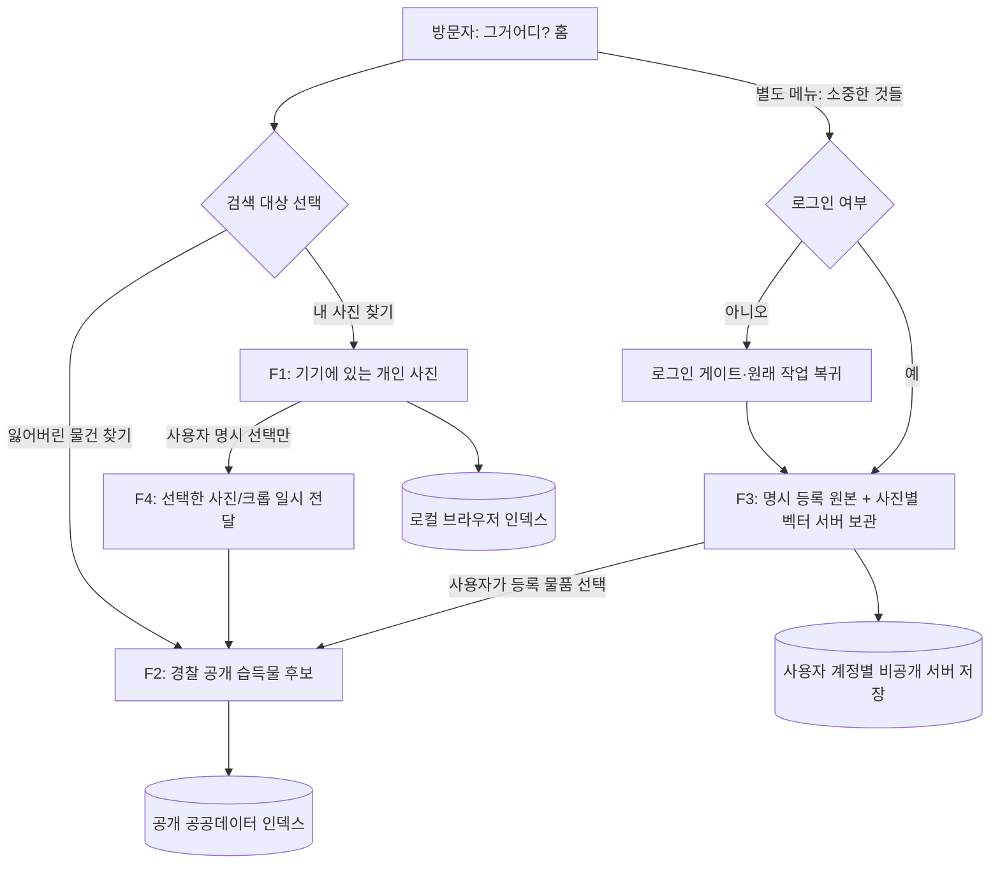
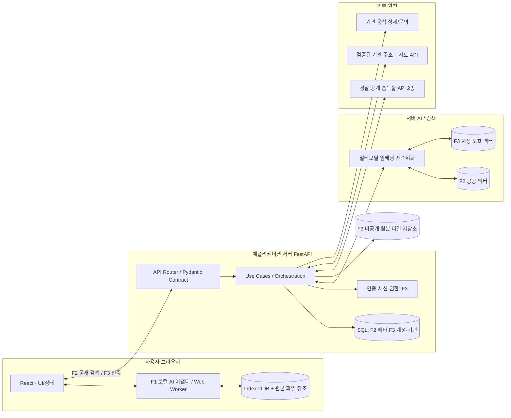
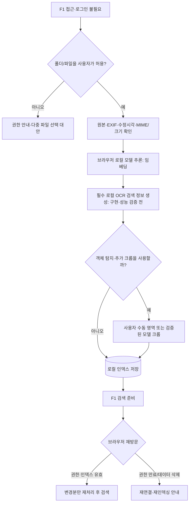
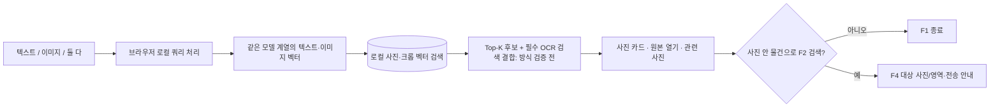
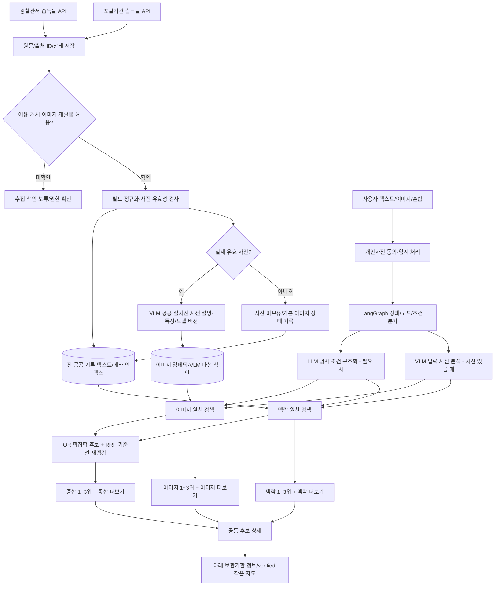
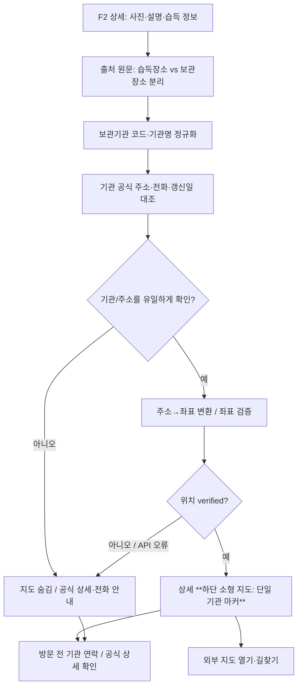
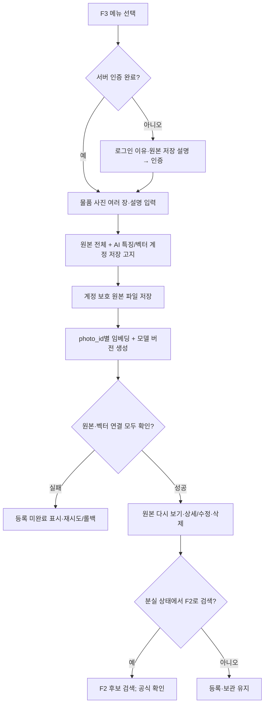
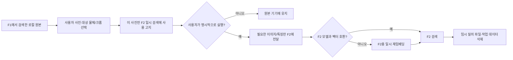
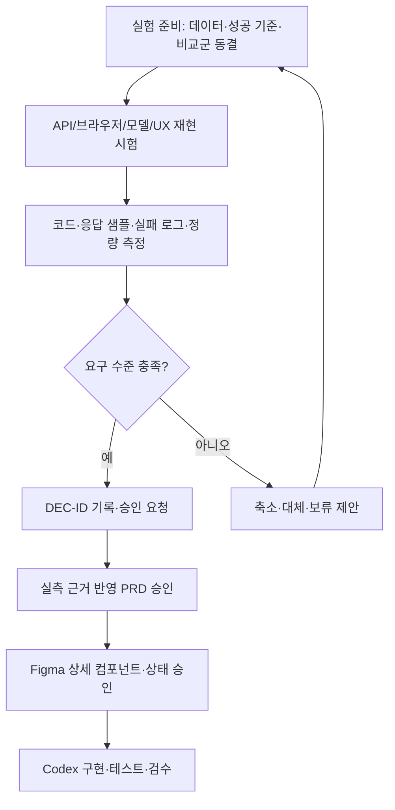

# 그거어디? — 전체 아키텍처 · 기능별 파이프라인 · 실패 분기

> 로컬 통합본: 2026-11-17 · 첨부 개정판과 최신 사용자 UI 지시를 병합. 변경·구현 상태는 `README_최신설계_및_작업순서.md` 참조.

> v1.2 / 2026-11-16 / **도표는 설계안(PROPOSED) + 승인된 데이터 정책(AGREED)**. 실제 구축·API 실연동·성능 검증 결과 아님.  
> 범위: F1 갤러리에서 사진 찾기 / F2 분실물 찾기(상세 **하단** 보조 지도) / F3 소중한 것들 / F4 선택 연계 / F5 설정·검색 상태.  
> 과거 PPT: [그거어디_파이프라인_리디자인_OLD내용_디자인 참고용.pptx](<../_backups/vision_search_planning_20261117_101824/before/그거어디_파이프라인_리디자인_OLD내용_디자인 참고용.pptx>) — 폴더 밖 백업에 보존한 이전 시각 자료다. 3채널/LLM/LangGraph 개정을 반영하지 않아 현행 정책 기준에서 제외한다. 최신 정책은 이 Markdown 및 00/05/06/08을 우선한다.

## 0. 읽는 법 및 필수 정책

- `[AGREED]`: 제품 요구로 합의됨. `[PROPOSED]`: 기술·구현 초안. `[EXPERIMENT]`: 성능/규정 미검증.
- 첫 홈은 **그거어디?** + 헤더 설명 **내 사진 · 내 물건 찾기**. 비로그인 채팅형 검색 입력과 **F1/F2 선택**. F3 진입 때만 로그인.
- F1 **로컬 원본/벡터**, F2 **공공 검색 인덱스**, F3 **계정 서버의 사용자가 등록한 원본 전체+사진별 벡터**. 세 저장 공간을 하나로 합치지 않음.
- F2 결과는 **종합(OR 재랭킹) / 이미지 / 맥락** 3채널, **각 3건 미리보기 + 독립 더보기**, 채널 간 중복 허용(채널 내부 중복 제거). 모든 결과는 **유사 후보**. 상세 **하단**에만 보관기관 정보/소형 지도; 지도는 **현 보관기관의 확인된 위치**이지 실제 물건의 GPS가 아님.
- 검증된 지도 위치가 없으면 **지도 없음** + 공식 출처·기관 문의. 잘못된 핀을 보여 주는 것보다 미표시가 낫다.

## 1. 서비스 전체 개요: 첫 화면에서 F1/F2/F3 분기

**저장 경계:** 위 다이어그램의 로컬·공공·계정 데이터 저장은 **논리적/권한적 분리**를 뜻한다. 같은 개발 PC·프로세스에서 실행해도 데이터 영역·접근·삭제는 독립적으로 관리한다.

## 2. 계층 아키텍처와 데이터 소유권

**금지:** UI가 직접 경찰 API 인증키를 보유 / AI 엔진이 사용자 계정 인증 판단 / F1 로컬 데이터가 F3에 자동 업로드 / F3 원본 공개 URL 노출 / 지도 API에 검색 질의·개인사진 전송.

## 3. F1 최초 인덱싱 및 비로그인 재방문

**핵심 계약:** 인증 없음, 원본 기기 잔존, IndexedDB 등 로컬 벡터 재사용 시나리오. `showDirectoryPicker()`/브라우저 AI의 실제 가능성은 `EXP-09/13/14` 전제. 서버 업로드는 F1 기본 경로가 아니다.

## 4. F1 사용자 검색: 텍스트 · 이미지 · 혼합

**UX:** 단순히 큰 LLM 답변이 아닌 이미지 카드 리스트. 오탐 후보는 ‘관련 사진’으로 표시하고, F1 원본 파일을 열 수 없는 경우 재연결/인덱스 정리 제공. F1 OCR 텍스트 검색은 필수 제품 요구이며 브라우저 모델·저장/검색 결합은 실험 후 결정.

## 5. F2 공공데이터 수집 + LangGraph 검색 → 3채널 결과 [최신]

**두 검색 원천 / 세 노출 채널:** 이미지 원천은 유효 실사진만, 맥락 원천은 사진 유무와 관계없는 공개 습득물 전체. 종합은 두 후보 집합의 **OR 융합**이며 이미지 없는 기록도 가능. `이미지/맥락` 각각 별도 순위를 유지하고 종합은 세 번째 독립 순위를 가진다.

**중복 정책 [AGREED]:** 채널 간 중복 허용, 동일 채널 내 중복 제거. 종합 7위·맥락 4위인 물건은 맥락 더보기의 **4위**에 남는다. 어느 채널에 먼저 노출됐는지는 다른 채널의 후보 필터에 쓰지 않는다. 각 채널 미리보기는 최대 3개이며 더보기는 4위 이후를 탐색한다.

**점수·오류:** LLM이 가중치를 주관적으로 생성하지 않도록 결정적 RRF 기준선으로 시작한다. AND 교집합/정규화 결합은 실험 비교군. VLM 또는 이미지 경로 실패 시 정상 맥락 결과와 `종합 일부 결과`를 표시할 수 있다. 사진 없음≠사진 유사도 0, 결과 없음≠API/모델 실패.

### 5.1 독립 AI 모듈 + LangGraph 연결의 책임

| 모듈 | 입력 → 출력 | 기본 실행 위치 | 채택/학습 상태 |
|---|---|---|---|
| M1 객체 탐지 | 이미지→bbox/label | F2 Python; F1 브라우저는 별도 PoC | YOLOE/대안·사전학습 후보, 미세조정 선행 불필요 |
| M2 수동/자동 크롭 | 이미지+bbox→선택 영역 이미지 | F1 브라우저/F2 서버 | 일반 처리 코드, 학습 불필요 |
| M3 이미지·텍스트 임베딩 | 이미지/문장→모델 버전별 벡터 | F1 웹 로컬/F2 서버 | 사전학습 모델 필수 후보 |
| M4 VLM | 이미지→구조화 특징·불확실성 | F2 서버/API | F2 이미지 맥락 이해 필수 기능, 모델 OPEN |
| M5 OCR | 이미지→글자·좌표·신뢰정보 | F1 브라우저 필수·F2 보강 후보 | 모델 OPEN, 실제 성능 검증 필요 |
| M6 LLM | 질의 문장→구조화 조건 | F2 서버 | 기존 모델 API 활용; 새 LLM 직접 훈련 아님 |
| M7 검색·랭킹 | 원천 검색 결과→3개 독립 랭킹 | F2 결정적 코드/F1 로컬 | BM25·벡터·RRF 후보, 학습/랭킹 검증 필요 |
| M8 공공 데이터 동기화 | 두 API→원문·파생 색인 갱신 | F2 서버 스케줄러 | 비-LLM 결정적 작업 |

**LangChain**은 LLM 호출·Structured Output·Pydantic 검증에, **LangGraph**는 노드 분기·병렬·타임아웃·부분 성공 조정에 쓰는 **설계 방향**이다. **MCP는 MVP에서 필요하지 않으며**, 일단 Python 함수/Adapter를 직접 호출한다. 단독 모델 PoC→공통 입출력 계약→LangGraph 통합 순서로 진행한다. **F1 개인 폴더/원본/벡터/OCR은 서버 LangGraph로 전송하지 않는다.**

## 6. F2 후보 상세: 주소/지도 **검증 분기**

**데이터 계약:** `found_place_raw`(습득 지점) ≠ `intake_place_raw`(접수처) ≠ `custody_place_raw`(보관기관). 지도는 **현 보관기관의 확인된 주소**만. 반환·이동·기관명 중복·지도 API 장애 시 임의 핀 금지. `EXP-22` 후 `DEC-LOC-01` 승인 필요.

### 지도 상태별 UI 처리

| 상태 | 작은 지도 | 보조 정보·복구 |
|---|---|---|
| `verified` | **있음** | 기관명·주소·전화·확인일, 외부 지도·길찾기·공식 링크 |
| `address_only` | 없음 | 주소·전화·공식 링크; 좌표 검증 안 됨 |
| `ambiguous` | 없음 | 동명 기관/여러 주소 → 공식 확인 문의 |
| `missing` | 없음 | 기관/주소 없음 → 공식 상세·조회 갱신 |
| `invalid` | 없음 | 지리정보 충돌 → 관리대상 검증 |
| `provider_error` | 없음 | 지도 API 실패·쿼터 → 정보 유지, 외부/문의 대안 |

**화면 범위:** `F2 리스트 카드 → F2 상세 본문 → 하단 보조 소형 지도`만. 검색 결과 전체 지도, 인근 지도 검색, GPS 실시간 위치추적 없음.

## 7. F3 소중한 것들: 원본 **전부**와 사진별 벡터

**데이터 소유자:** 계정 서버에 사용자가 **직접 선택 등록한 원본 사진 전체**와 **각 사진의 검색 벡터**를 함께 저장. F1 전체 갤러리는 절대 자동 저장 안 함. 계정 간 접근 차단, 백업·탈퇴·사진별 삭제 전파, 원본+벡터 실패 시 성공 허위표시 금지 (`EXP-16/21`).

## 8. F4 선택적 F1→F2 사진 전달 (프라이버시 경계)

**경계:** F4의 일시 전송이 F3 계정 보관 승인이 아니다. 서버에 개인 이미지를 장기 보관하지 않음. AI가 특정 물건을 자동으로 확정하지 않으며 수동 선택·취소 경로 필수 (`EXP-17`).

## 9. 에러·검증/결정 플로우

| 실험·결정 | 도표 연결 | 확인 실패 시 |
|---|---|---|
| `EXP-06/DEC-API-01` | §5 F2 데이터 수집 | 실제 데이터 색인 보류 |
| `EXP-01/13/14` | §3~4 F1 추론/인덱스 | 웹 플랫폼·로컬 방식 재설계 |
| `EXP-16/21` | §7 F3 보안/등록 | F3 공개 배포 차단 |
| `EXP-17` | §8 선택적 전달 | F1→F2 자동 전달 금지, 수동 입력 유지 |
| `EXP-22/DEC-LOC-01` | §6 F2 보조지도 | 기관 정보·공식 링크만 표시 |
| `EXP-23/DEC-BRAND-01` | §1 홈 브랜드 | 워드마크·설명 문구 개선, 상표 확정 보류 |

## 10. 도표·파일 간 추적 규칙

| PPT 페이지 | 대표 주제 | 관련 상세기획 FR/EXP |
|---|---|---|
| 1 | 서비스/브랜드 소개 | §0, POL-01~11, EXP-23 |
| 2 | 저장 경계·전체 서비스 | FR-HOME, FR-AUTH, NFR-LOCAL |
| 3 | F1 로컬 최초 인덱싱/재방문 | FR-GAL-01~09, EXP-09/13/14 |
| 4 | F1 검색과 F4 전달 | FR-COM, FR-GAL, EXP-17 |
| 5 | F2 두 원천 검색+3개 독립 결과 채널 (**PPT 미반영**) | FR-LOS-01~09, EXP-06 |
| 6 | **F2 개별 상세 하단 소형 지도** | FR-LOS-10~15, EXP-22 |
| 7 | F3 계정 원본+벡터 저장 | FR-VAL, EXP-16/21 |
| 8 | 시스템 계층·API/DB/AI 경계 | §2, API-01~10 |
| 9 | 실험→PRD→디자인→개발 게이트 | EXP-01~23(15 폐기), DEC-ID |

**주의:** **기존 PPT는 3중 결과/LLM/LangGraph 개정 이전 버전이므로** 새 Markdown과 1:1 대응하지 않는다. PPT는 과거 개요 참고용으로만 사용한다. 정확한 계약과 예외는 Markdown 원문을 기준으로 하며, 개발 전 서로 다른 문서의 `AGREED`/`PROPOSED` 상태를 다시 검수한다.
