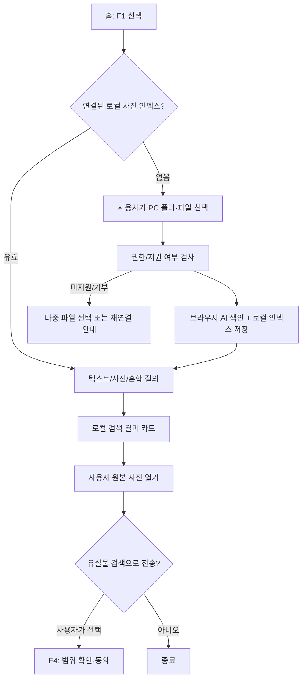

# 그거어디? — 페이지 구성 · 와이어프레임 · UI/UX 통합 설계

> 로컬 통합본: 2026-11-17 · 첨부 개정판과 최신 사용자 UI 지시를 병합. 변경·구현 상태는 `README_최신설계_및_작업순서.md` 참조.
> **최신 카피 기준:** `06_UI_최신_카피.md`. 사용자용 기능명은 `갤러리에서 사진 찾기 / 분실물 찾기`, 실제 F2 데이터 출처는 `경찰청 공개 습득물 정보`다. 두 검색 기능은 헤더 직하단 전환 영역과 모바일 메뉴에서 제공한다. 홈 복귀는 로고로 하고 로그인은 별도 계정 액션으로 유지한다.


> **문서 ID:** `UX-SSOT-05` · **버전:** v1.2 · **작성일:** 2026-11-16 · **상태:** Pre-PRD / 디자인 실행용 제안안  
> **적용 서비스:** 그거어디? — 내 사진 · 내 물건 찾기  
> **참조 원본:** `00_상세기획안_그거어디_개정.md`(제품·데이터·권한 정책), `01_Figma_디자인_실행가이드.md`(스타일·토큰·디자인 운영).  
> **본 문서의 책임:** 페이지 구조·정보 위계·화면별 구성·와이어프레임·상태/인터랙션·컴포넌트·반응형·Figma 프레임·개발 핸드오프. **UI 설계의 단일 기준 문서(Single Source of Truth)**로 관리한다.  
> **표기:** `[AGREED]` 제품 방향 합의 / `[PROPOSED]` 구현·배치 제안 / `[OPEN]` 검증·선택 대기 / `[DEMO]` 실제 API·AI 연동이 아닌 샘플 시안.  
> **핵심 최신 변경:** F2는 **종합 / 이미지 / 설명·조건(맥락)** 3개의 독립 결과 채널, 각 최대 3건 미리보기와 `더보기`, **채널 간 중복 허용**으로 전환한다. 3개 채널의 실제 품질·성능은 미검증이다.

---

**F2 입력·검색·결과 계약 [AGREED · 2026-11-16 최신]:** `자연어만 / 사진만 / 자연어+사진` 모두 **종합·이미지·맥락 3개 검색 결과 채널**을 지원한다. 검색 모집단은 F2 공개 습득물로 한정한다. `종합`은 이미지·맥락 경로 후보의 **OR 합집합**을 확보한 뒤 여러 근거로 재정렬하는 기본 탐색 채널이며, 사진 없는 기록도 포함 가능하다. `이미지`는 실제 유효 습득물 사진이 있는 기록을, `맥락`은 사진 유무와 관계없는 전체 공개 기록을 대상으로 한다. **각 채널은 독립된 정렬/페이지네이션을 유지하며, 동일 레코드의 채널 간 중복 노출을 허용한다. 같은 채널 내부의 중복 레코드는 제거한다.** 초기 UI는 **각 최대 3건 미리보기 + 해당 채널 더보기**(3+3+3)이며 실제 후보가 적으면 그만큼만 보여준다. 더보기에서 같은 채널의 4위 이후로 연속 탐색할 수 있고, 다른 채널에서 이미 봤다는 이유로 건너뛰지 않는다. 3건 수는 사용성 검증 후 변경 가능하다.

**AI·검색 경계 [AGREED: 목표 / OPEN: 구현 성능]:** 자연어만 입력해도 공개 유효 사진의 **VLM 사전 해석 맥락**과 텍스트↔이미지 임베딩으로 이미지 후보를 찾고, 사진만 입력해도 **VLM이 검색 설명·조건을 추출**해 맥락 검색을 수행한다. 자연어+사진은 두 단서를 함께 반영한다. LLM 질의 구조화·OCR·객체 탐지·크롭·임베딩은 독립 모듈이며, F2는 **LangChain+LangGraph 중심의 조건부 워크플로**를 설계 방향으로 채택한다(MCP는 MVP 불필요). 모델의 파인튜닝은 필수가 아니지만 **평가용 정답셋**은 반드시 만든다. 이미지·맥락 점수의 단순 평균이나 `동일 물건 확률` 표시 금지. RRF 등 결정적 랭킹 모듈을 비교 실험하고, 채널별 부분 오류·검색 상태는 분리한다. F1 로컬 개인정보·F3 등록 원본+사진별 벡터 계정 저장·F4 명시적 일시 전달 원칙은 변경하지 않는다.

## 0. 문서별 결정권과 변경 규칙

| 문서 | 무엇을 확정/정의하는가 | 이 문서와 관계 |
|---|---|---|
| `00_상세기획안_그거어디_개정.md` | 사용자 문제, 기능·비기능 요구, 권한/저장 정책, F1~F5 범위, 검증 가설 | 기능 범위·정책의 상위 근거. 충돌 시 상세기획안의 **AGREED 정책** 우선 |
| **`05_페이지구성_와이어프레임_UIUX_통합설계.md` (현재 문서)** | 사이트맵, 화면별 내용/행동/상태, 와이어프레임, 화면 ID, Figma 프레임·UX 인수 기준 | **화면 설계 관련 변경은 여기서 시작**. 레이아웃의 중복 상세 기술을 다른 문서에 늘리지 않음 |
| `01_Figma_디자인_실행가이드.md` | 비주얼 ID, 컬러/타입/간격, Figma 제작 단계·컴포넌트 운영 | 실제 와이어/화면 ID는 현재 문서 참조. 스타일 제안과 확정 디자인을 구별 |
| `02_확인_실험_결정_체크리스트.md` | 검증 게이트·실험·합격선·근거 | 이번 턴에서는 파일을 수정하지 않음. `EXP-05/06/19/22/24~28`의 테스트 케이스로 추적 |
| `04_파이프라인_아키텍처_및_흐름도.md` | 처리 경로/계층/데이터 연결 | **후속 업데이트 대상**. 이미지·맥락 이중 색인/검색을 실제 계약에 반영할 때 수정 |

**변경 순서:** 요구의 타당성 확인 → 상세기획안 FR 정책 반영 → **본 문서 화면/상태 수정** → Figma 가이드의 화면목록·컴포넌트 참조 갱신 → API/파이프라인 계약·테스트 수정. 새 기능이 생겼다고 기존 문서를 전부 다시 쓰지 않는다.

### 0.1 변경의 본질과 경계

- **[AGREED: 사용자 목표]** 공개 습득물에 실제 사진이 없는 경우에도 제목·설명·분류·색상·날짜·기관 등의 단서로 검색할 수 있어야 한다.
- **[AGREED: 목표 UX]** F2 검색 결과는 `종합 / 이미지 / 설명·조건` **세 섹션**, 각각 최대 **3건 미리보기+독립 더보기(4위 이후)**를 제공한다.
- **[AGREED: 검색·중복 정책]** 맥락 검색은 사진 유무 관계없이 전체 공개 습득물을 대상으로 한다. 종합 채널은 두 검색 경로의 후보 **OR 합집합**으로 구성해 재정렬한다. 채널마다 **독립적인 순위**가 있으며 **채널 간 동일 기록 중복 노출을 허용**, **동일 채널 내부에서만 기록 중복 제거**한다. 다른 채널에 보였다는 이유로 해당 후보를 제외하거나 더보기에서 건너뛰지 않는다.
- **[AGREED]** 이미지 섹션은 **실제로 유효한 물품 사진이 있는 기록만** 대상으로 삼는다. `이미지 준비중` 기본 그림, 404, 깨진 URL을 실제 사진으로 간주하지 않는다.
- **[AGREED: 기능 / OPEN: 구현]** 자연어→공공 사진의 VLM 맥락 비교, 입력 사진→VLM 설명·조건 추출은 필수다. 모델·BM25/임베딩/필터 조합·랭킹·임계값·배포·비용·지연은 PoC 뒤 결정한다. 매 질의마다 모든 이미지를 VLM으로 재분석할 필요는 없으며 사전 분석·색인·캐시·재비교를 검증한다.
- **[AGREED]** 각 결과는 어디까지나 **유사 후보**다. 서로 다른 점수 척도를 `일치 확률`로 합치거나 동일 물건이라고 단정하지 않는다.
- **[AGREED]** F2 결과 페이지는 **지도 중심 화면이 아니며**, 지도는 **개별 후보 상세 하단의 보관기관 보조 영역**에만 노출한다(검증 좌표 확보 시).

## 1. UX 원칙 · 사용자와 맺는 약속

1. **첫 화면은 검색, 인증은 선택:** `/`에서 F1·F2 이용 가능. 헤더 로그인은 별도. F3만 인증 필수.
2. **검색 범위 가시화:** `연결한 갤러리 전체`(F1) / `경찰 공개 습득물`(F2)을 입력과 결과 주변에 명시.
3. **텍스트만·이미지만·혼합 입력 지원:** F2 사진 없는 사용자는 텍스트만으로 검색. 첨부 이미지는 F2 서버 일시 처리, F1의 원본·인덱스는 기기 로컬.
4. **세 결과 기준을 구분:** `종합 추천 후보`(OR 융합), `사진 특징이 비슷한 후보`, `설명·조건이 유사한 후보`를 각각 독립 순위와 더보기로 제공.
5. **없거나 불확실한 값은 만들지 않음:** 이미지 없는 습득물에 가짜 썸네일 금지; API 누락 필드/가짜 기관·지도핀/확률 수치 금지.
6. **단계별 실패에 복구 행동 제공:** 이미지 검색만 실패해도 맥락 결과는 보여준다. 그 반대도 마찬가지.
7. **행동 전 데이터 경계 명시:** F1→F2는 선택 사진만 명시적으로 전달, F3는 선택 등록 원본과 벡터를 서버에 보관.
8. **모바일 웹의 한계를 안내:** PC 전체 폴더 선택과 모바일 갤러리 전체 자동 색인을 동일하게 보장하지 않음.

### 1.1 공통 카피/메시지 기준

| 상황 | 권장 문구(초안) | 피해야 할 표현 |
|---|---|---|
| 브랜드 | `그거어디?` / `내 사진 · 내 물건 찾기` | `실시간 위치추적` |
| F1 범위 | `접근을 허용한 갤러리에서 찾아요.` | `내 사진이 자동으로 클라우드에 저장돼요.` |
| F2 범위 | `공개 습득물 기록에서 비슷한 후보를 찾아요.` | `경찰청 공식 AI 검색 서비스` |
| F2 종합 그룹 | `종합해서 찾은 유사 후보` | `같은 물건일 확률 99%` |
| F2 이미지 그룹 | `사진 특징이 비슷한 습득물` | `내 물건과 98% 일치` |
| F2 맥락 그룹 | `설명·조건이 비슷한 습득물` | `사진이 없는 물건만 찾기`(실제 전체 대상이면 오해) |
| F2 사진 없는 카드 | `등록된 사진이 없어요.` | 실제처럼 보이는 임의 생성 사진 |
| F2 전혀 결과 없음 | `조건에 맞는 후보가 없어요. 검색어·기간·분류를 조정해 보세요.` | `분실물이 존재하지 않습니다.` |
| F2 상세 | `유사한 습득물 후보입니다. 동일한 물건인지 기관에 확인해 주세요.` | `찾았습니다`, `회수 확정` |
| 지도 오류 | `보관기관 위치가 확인되지 않아 지도를 표시하지 않았어요.` | 임의·추정 지도핀 |
| F3 등록 | `선택한 사진 원본과 AI 검색용 정보가 내 계정에 저장돼요.` | 저장하지 않는다는 허위 안내 |
| F4 선택 전달 | `선택한 사진만 유실물 검색에 일시적으로 사용해요.` | 폴더 전체 자동 전송 |

---

## 2. 전체 사이트맵 (IA) 및 페이지 라우팅

> **아래 URL과 페이지 코드는 Figma·개발 커뮤니케이션용 제안안.** 기존 상세기획안과 디자인 가이드의 라우트 표기가 일부 다르므로, **현재 문서의 라우트 이름을 화면 설계 기준으로 사용하되 최종 URL은 PRD에서 결정**한다. 정확한 API 경로는 포함하지 않는다. 아래 전체 보기 라우트의 PROPOSED는 URL 명칭·상세 구현을 뜻하며, 두 경로의 전체 보기 기능·후보 목록·복귀 자체는 필수다.

```text
/                                  HOME-01~05   비로그인 검색 홈 (F1/F2 스위치)
├─ /gallery                         F1-01~03    로컬 폴더 연결/색인 상태
│  ├─ /gallery/results               F1-04~07    개인 사진·필수 로컬 OCR 검색/수동 크롭
│  └─ /gallery/photo/:localId        F1-08       원본/세부 보기, F4 연계 CTA
├─ /lost-found                      F2-01~04    습득물 검색 입력/조건/상태
│  ├─ /lost-found/results            F2-05       종합/이미지/맥락 각 최대 3건 요약
│  ├─ /lost-found/results/combined   F2-05-A     종합 후보 더보기 [PROPOSED]
│  ├─ /lost-found/results/image      F2-05-I     이미지 후보 더보기 [PROPOSED]
│  ├─ /lost-found/results/context    F2-05-C     맥락 후보 더보기 [PROPOSED]
│  └─ /lost-found/item/:source/:id   F2-06       습득물 상세 + 하단 보관기관·소형 지도
├─ /valuables                       F3-01~02    인증 게이트/내 물품 목록
│  ├─ /valuables/new                 F3-03~04    물품·사진 등록/저장 확인
│  └─ /valuables/:id                 F3-05~08    상세/편집/삭제/분실 검색
├─ /auth/login                      AUTH-01      별도 로그인(또는 F3 인증 이동)
├─ /settings                        SET-01~03    F1 로컬 인덱스/개인 데이터·계정 설정
└─ /history                         HIS-01      저장 동의 정책 확정 시 조건부 [OPEN]

기능 간 이동:
F1-08 → F4-01~03(사진 선택·동의) → F2-01 / F2-05
F3-05 → 사진/물품 선택 → F2-01 / F2-05 (로그인 확인 및 사용자 명시 선택)
F2-05-A / F2-05-I / F2-05-C → F2-06 → 하단 F2-06-MAP 또는 F2-06-LOC-FALLBACK
```

### 2.1 전역 메뉴와 레이아웃

- **헤더:** 로고 `그거어디?`, 옆 짧은 기능 설명(모바일 압축), `갤러리에서 사진 찾기 / 분실물 찾기 / 소중한 것들 / 설정`, **별도 로그인/계정 버튼**.
- **모바일:** 고정 하단 내비게이션은 **디자인 후보**(이전 가이드상 상단 축약 내비와 비교 후 결정). F2 상세 화면의 외부 링크·스크롤과 충돌하지 않을 것. 로그인 액션을 햄버거 안에 숨겨 유실하지 않을 것.
- **검색 UI:** 홈 중심 채팅형 컴포저(긴 대화 기록 필수 아님), 선택 모드의 범위 라벨, 파일 첨부·조건 수정.
- **공통 정보:** `샘플/DEMO` 라벨, 검색 결과 데이터 출처, 마지막 데이터 확인 시각(확인 가능한 값만), 공식 사이트 연결, 개인정보 안내.
- **비로그인 F1/F2와 로그인 F3 경계:** UI·직접 URL 진입·서버 권한을 모두 구분.

## 3. 전체 화면·상태 인벤토리 (Figma/개발 공통)

> 기존 화면 ID는 최대한 유지하고 `F2-05-A` 종합 더보기 및 `F2-05-I/C` 독립 더보기를 추가한다. 상세 지도 ID도 유지한다.

| ID | 화면/목적 | 필수 콘텐츠·주요 행동 | 상태·오류 | 제작 |
|---|---|---|---|---|
| `HOME-01` | 첫 방문 비로그인 검색 홈 | 로고/설명, F1/F2 스위치, 채팅형 컴포저, 로그인 분리 | empty/typing | D0 |
| `HOME-02` | F1 선택(폴더 미연결) | `폴더 연결`, 기기 로컬 안내 | 권한 거부·모바일 미지원 | D0 |
| `HOME-03` | F2 텍스트 검색 | 공개 습득물 안내, 텍스트만 검색 | 입력 없음·API 예고 | D0 |
| `HOME-04` | 이미지 첨부·혼합 | 이미지 미리보기·제거·수동 crop(선택) | 포맷/크기 오류 | D0 |
| `HOME-05` | 검색 후 요약 | 사용자 입력 카드, 모드별 결과 본문, 재검색 | loading/partial | D1 |
| `F1-01` | PC 폴더 선택 | 사용자 선택 파일·로컬 저장 정보 | 권한 거부/호환 대체 | D0 |
| `F1-02` | 최초·증분 인덱싱 | 대상 장수·진행·실패수·중단/재시도 | 모델/메모리/저장소 오류 | D1 |
| `F1-03` | 재방문/재연결 | 인덱스 유효·권한 확인, 다시 색인 | 원본 이동·IndexedDB 삭제 | D1 |
| `F1-04~05` | 내 사진 검색 결과 | 사진·스크린샷 그리드, 날짜(확인 시), 필터 | no results/권한 없음 | D0 |
| `F1-06~07` | 수동 영역·필수 OCR / 자동 탐지(조건부) | 수동 영역·선택 box, 텍스트 힌트 | 탐지 없음/수정 | D1, 실험 후 |
| `F1-08` | 사진 상세 | 로컬 원본 확대, 메타, `이 물건으로 찾기` | 원본 열기 불가 | D1 |
| `F1-09~10` | 복구/로컬 설정 | 재연결·인덱스 삭제 | 공용 PC 안내 | D1 |
| `F2-01~04` | 습득물 입력·검색 조건 | 텍스트/사진/혼합, 분류·색상·기간·지역 | 설명 분석 실패·서버 지연 | D0/D1 |
| **`F2-05`** | **3중 결과 요약** | **종합/이미지/맥락 각 최대 3개 + 채널별 더보기** | 부분 성공/빈/실패 | **D0 개정 필수** |
| **`F2-05-A`** | **종합 더보기** | **OR 후보 재랭킹의 독립 순위·4위 이후 탐색** | 한 경로 실패 시 부분 결과 | **D0 개정 필수** |
| **`F2-05-I`** | 이미지 전체 보기 | 이미지 검색 전체 목록, 해당 경로 필터·정렬·페이지 | 사진 부족·중간 갱신 | D0 진입·목록·복귀 / D1 상세 상태 |
| **`F2-05-C`** | 맥락 전체 보기 | 텍스트/메타 전체 목록, 사진 없는 카드 포함 | 내용 빈약·중복 후보 | D0 진입·목록·복귀 / D1 상세 상태 |
| `F2-05-S1~S8` | 3중 노출·원천 2경로 검색 특수 상태 | 아래 7장의 케이스를 프레임화 | 부분 성공·전부 실패 포함 | D0 주요 4종/D1 전체 |
| **`F2-06`** | 개별 습득물 상세 | 물품·원문/출처·습득/접수, 동일물건 아님 | 공식 기록 변경·사진 없음 | **D0 필수** |
| **`F2-06-MAP`** | 상세 하단 보조 지도 | **검증된 현 보관기관** 주소/전화/작은 지도 | verified | D0 |
| `F2-06-LOC-FALLBACK` | 보관 위치 미확인 | 지도 없음, 원문·기관 문의/안내 | address_only/ambiguous/missing/provider_error | D0 |
| `F2-07~09` | 갱신/링크·전체 오류 | 수정 기록·공식 확인·재시도 | 소스 삭제/접근 실패 | D1 |
| `F3-01` | 소중한 것들 로그인 게이트 | 사진 원본+검색용 정보 계정 보관 설명 | 취소/실패·복귀 | D0 |
| `F3-02` | 물품 목록 | 내 등록 물품, 상태, 신규 등록 | 비어있음/세션 만료 | D1 |
| `F3-03~04` | 새 물품 등록·검토 | 원본 1~N, 특징 수정, 저장 고지 | 업로드/벡터 실패 | D0 |
| `F3-05~08` | 물품 상세/수정/삭제/F2 연계 | 원본 재열람·관리·물품상태 | IDOR·삭제 실패 | D1 |
| `F4-01~03` | F1→F2 사진 선택 전송 | 대상 사진/크롭, 일시 사용 고지, 동의/취소 | 원본 참조 상실·전송 실패 | D0 |
| `SET-01~03` | 로컬/계정 데이터 설정 | F1 로컬 삭제·재색인, F3 서버 저장/계정 | 삭제 확인·취소 | D1 |
| `HIS-01` | 검색 이력 후보 | 저장이 허용된 경우만, 출처/삭제 | 비저장 기본 | 차기/OPEN |

---

## 4. 핵심 사용자 플로우 (User Flow)

### 4.1 A — F1 PC 내 사진 검색 (로그인 없음)



핵심 UI 상태: 폴더 미연결, 인덱싱 n/N, 재방문 권한 재확인, 로컬 인덱스 재사용, 원본 이동·삭제 후 재연결. **원본 사진·임베딩 자동 서버 업로드 없음.**

### 4.2 B — F2 세 입력·VLM·두 검색 원천·세 결과 채널 (로그인 없음)

```mermaid
flowchart TD
  U[자연어 / 사진 / 혼합 입력] --> P[전송 동의·입력 검증]
  P --> G[LangGraph 조건분기·검색 상태 관리]
  G --> L[LLM 명시 조건 구조화 (필요시)]
  G --> V[VLM 입력 사진 특징 추출 (사진 있을 때)]
  O[공공 실사진 VLM 사전 분석 색인] --> IMG[이미지 검색: 유효 실사진만]
  L --> IMG
  V --> IMG
  L --> CTX[맥락 검색: 모든 공개 기록]
  V --> CTX
  IMG --> CMB[OR 후보 합집합 + 결정적 재랭킹]
  CTX --> CMB
  CMB --> R[종합 독립 순위 + 더보기]
  IMG --> RI[이미지 독립 순위 + 더보기]
  CTX --> RC[맥락 독립 순위 + 더보기]
  R --> DETAIL[후보 상세 + 하단 보관기관]
  RI --> DETAIL
  RC --> DETAIL
```

**데이터 정책:** 공공 기록 사진 없음은 이미지 경로 자격만 박탈; 맥락·종합 후보에는 포함 가능. 종합은 강제 AND가 아니라 OR 합집합으로 후보를 확보하고 점수 융합을 비교 실험한다. `종합/이미지/맥락`은 **노출 채널**이며, 서로 다른 3개 인공지능 모델이 아니다. 채널 간 중복 허용·채널 내 중복 제거. 각 채널 1~3개 + 더보기 4위 이후 고정 순위 유지. 부분 오류 시 종합에서 이용 가능한 경로만 활용하며 **'일부 검색 결과' 표시**. VLM 추정/공식 원문을 구분하고 외부 전송 고지/동의 이행. 문구·상태는 §6~7을 따른다.

### 4.3 C — F3 등록 및 F2 연결

`소중한 것들 선택 → 비로그인이라면 F3 로그인 게이트 → 로그인 후 원래 단계 복귀 → 물품 사진 1~다수 업로드/촬영 → 원본+사진별 AI 검색용 벡터 저장 안내 → 정보 수정/확인 → 서버 원본·벡터의 연결 성공 검증 → 등록 완료 → 분실 상태/사진 선택 → 명시적 F2 검색 → 세 채널 결과`.

- 실제 서버에서 **타인 계정의 원본/벡터 접근 차단**. F1의 다른 사진은 F3에 자동 저장 안 함.
- 등록 중 원본 성공·벡터 실패 등 부분 성공은 **완료** 표시 금지. 처리 중/재시도/정리 UX 제공.

### 4.4 D — F4 이미지 연계

`F1 사진 상세 → 검색할 대상 사진/크롭 선택 → F2에서 선택한 사진을 일시 처리한다는 명시적 안내 → 확인 → F2 질의 화면(이미지 미리보기+추가 설명 가능) → 검색 → F2-05 → 임시 질의 원본 처리 종료/삭제 규칙 적용`.

사용자가 취소하면 전송하지 않는다. **경찰 API에 개인 이미지를 자동 제출하지 않음.**

---

## 5. 와이어프레임 — 공통/홈/개인 갤러리

> 아래는 **레이아웃과 정보 위계를 보여주는 텍스트 와이어프레임**. 시각 디자인·간격값은 Figma 토큰에 따르고, 글자와 이미지 더미는 `DEMO`로 표시한다.

### WF-01: 데스크톱 홈 (1440px 기준, F2 선택 예시)

```text
[로고: 그거어디?]   내 사진 · 내 물건 찾기     [소중한 것들] [설정] [로그인]
[ 갤러리에서 사진 찾기 ] [ 분실물 찾기: 선택됨 ]

어떤 물건을 잃어버렸나요?
글이나 사진으로 비슷한 물건을 찾아요.

경찰청 공개 습득물 정보
┌────────────────────────────────────────────────────┐
│ 잃어버린 물건의 특징                               │
│ 예: 검정 가죽 지갑, 작은 금색 로고                  │
│                                                    │
│ [참고 사진 추가]                  [비슷한 물건 찾기] │
└────────────────────────────────────────────────────┘
AI 검색은 잘못 찾거나 놓칠 수 있어요.
```

**행동:** 모드별 글·참고 사진 초안을 분리해 유지하고 다른 모드로 자동 전달하지 않음; 빈 입력 검색 차단, 키보드 Enter/IME 조합 오작동 방지, F1 전환 시 로컬 연결 상태 확인.

### WF-02: 모바일 홈 (390px 기준)

```text
[그거어디?: 로고/홈]             [로그인] [메뉴]
[갤러리에서 사진 찾기] [분실물 찾기: 선택됨]

어떤 물건을 잃어버렸나요?
글이나 사진으로 비슷한 물건을 찾아요.

경찰청 공개 습득물 정보
┌──────────────────────────────┐
│ 잃어버린 물건의 특징         │
│                              │
│ [참고 사진 추가]   [찾기]     │
└──────────────────────────────┘
AI 검색은 잘못 찾거나 놓칠 수 있어요.
```

**모바일 한계:** 웹에서 스마트폰 갤러리 전체를 자동으로 색인·상시 감시하는 기능은 제공한다고 가정하지 않는다. 사진 선택기에서 사용자가 고른 이미지에만 접근한다.

### WF-03: F1 폴더 연결·검색 결과

```text
┌─────────────────────────────────────────────────────────────────┐
│ 갤러리에서 사진 찾기   범위: 내가 허용한 기기의 폴더/파일                │
│ [폴더 연결] [이미지 여러 장 선택]       상태: 인덱스 1,240장     │
│ [로컬에 보관] [최근 변경분 확인] [연결 재확인]                  │
│ ┌──────────────────────────────────────────────────────┐        │
│ │ 검색: '여행 때 들었던 검정 가방'              [검색→] │        │
│ └──────────────────────────────────────────────────────┘        │
│ [필터: 날짜/파일/장면(검증 후)]    [그리드/목록]                 │
│ [개인 사진] [개인 사진] [업무 스크린샷] [개인 사진]              │
│  사진 선택 → 원본 열기 / '이 물건으로 유실물 찾기'               │
│ [권한 만료 시: 해당 폴더 다시 연결]                               │
└─────────────────────────────────────────────────────────────────┘
```

---

## 6. F2 핵심 — 종합·이미지·맥락 3개 채널 [최신 합의]

### 6.1 결과의 목적과 의미

**사용자 목표:** 세 가지 탐색 관점에서 **유사도가 높은 후보를 빠르게 찾고, 각 기준별 더보기로 계속 탐색**한다. 순위를 보여주기 위한 순위표가 목적이 아니다. **한 후보가 종합 7위·맥락 4위라면 맥락 더보기에서 4위로 나타나야 하므로** 세 채널을 전역 중복 제거하면 안 된다.

| 채널 | 후보 집합·주요 신호 | 사진 없는 기록 | 독립 더보기 |
|---|---|---|---|
| **종합** `F2-05-A` | 이미지·맥락 후보의 **OR 합집합 → RRF 등 융합 순위** | **포함 가능**(맥락 근거) | 종합 4위 이후 |
| **이미지** `F2-05-I` | **유효 실제 습득물 사진 보유 기록만**. 사진-사진/텍스트-사진/시각 설명 비교 | 제외 | 이미지 4위 이후 |
| **맥락** `F2-05-C` | 전체 공개 기록의 물품명·설명·색상·분류·확인된 조건·VLM/OCR 파생 근거 | **포함** | 맥락 4위 이후 |

- **채널 간 중복 허용 [AGREED]:** A가 종합·이미지·맥락에 모두 등장해도 정상이다. 사용자가 한 채널을 계속 펼쳐보는 동안 다른 채널에서 보였다는 이유로 A를 누락시키지 않는다.
- **채널 내 중복 제거 [AGREED]:** 동일 canonical item ID가 한 채널에서 중복 페이지 또는 중복 카드로 표시되지 않게 한다. API 공급원 사이 같은 실물 병합은 실제 식별 근거가 있을 때만 처리한다.
- **미리보기 [PROPOSED]:** 각 최대 3건, 총 최대 9장 노출(중복을 포함한 카드 수) + 채널별 `더보기`. 후보가 적거나 품질 기준 아래면 0~2건도 허용. 3건/5건/탭 vs 세로 섹션은 사용성 비교 전 최종 고정 금지.
- **독립 검색 순위:** 종합/이미지/맥락을 각각 1위부터 정렬한다. 다른 채널 점수와 단순 비교하거나 '실제 동일 확률'로 노출하지 않는다.
- **검색 모집단:** F2 공공 습득물만. F1 사용자 개인 사진과 섞지 않는다.

### 6.2 WF-04 데스크톱 — 3+3+3 예시

```text
┌──────────────────────────────────────────────────────────────────────────────┐
│ [검색 수정]  검정 카드지갑 + 노란 장식       [분류] [기간] [지역]              │
│ 검색 범위: 경찰청 공개 습득물 정보 · 유사 후보이며 동일 물건 확정 아님      │
├──────────────────────────────────────────────────────────────────────────────┤
│ 종합해서 찾은 유사 후보                               [종합 후보 더보기 →] │
│ 사진·설명 등 이용 가능한 단서를 합쳐 추천해요.                             │
│ [ A 사진 카드 ]    [ B 사진 카드 ]    [ C 사진 없음/텍스트 카드 ]           │
├──────────────────────────────────────────────────────────────────────────────┤
│ 사진 특징이 비슷한 후보                               [사진 후보 더보기 →] │
│ 실제 사진이 있는 습득물만 비교해요.                                      │
│ [ A 사진 카드 ]    [ D 사진 카드 ]    [ E 사진 카드 ]                       │
├──────────────────────────────────────────────────────────────────────────────┤
│ 설명·조건이 비슷한 후보                           [설명·조건 더보기 →]     │
│ 사진이 없는 물품 기록도 포함해요.                                         │
│ [ C 텍스트 카드 ]  [ F 텍스트 카드 ]  [ G 사진 카드 ]                       │
└──────────────────────────────────────────────────────────────────────────────┘
[DEMO] A/C가 둘 이상의 섹션에 등장하는 것이 의도된 동작.
```

### 6.3 WF-05 모바일 — 3개씩 미리보기

```text
┌────────────────────────────────┐
│ [←] 분실물 찾기       [수정]  │
│ 검은색 카드지갑               │
│ [분류] [색상] [기간] [지역]   │
├────────────────────────────────┤
│ 종합해서 찾은 유사 후보      │
│ [A] [B] [C]  (3건 이내)      │
│ [종합 후보 더보기 →]          │
├────────────────────────────────┤
│ 사진 특징이 비슷한 후보      │
│ [A] [D] [E] (3건 이내)       │
│ [사진 후보 더보기 →]          │
├────────────────────────────────┤
│ 설명·조건이 비슷한 후보      │
│ [C] [F] [G] (사진 없음 포함) │
│ [설명·조건 더보기 →]          │
│ ※ 후보는 중복 등장할 수 있어요.│
└────────────────────────────────┘
```

**모바일 UI 검증:** 360/390px에서 가로 넘침·세 채널 시각 구분·독립 더보기 가시성 확인. 중복 카드를 숨기는 `이미 본 물건 제외` 기능은 기본 비활성·MVP 제외(도입 시 개인별 본 기록 추적·정확도 문제 별도 검토).

### 6.4 세 가지 입력에 따른 각 채널의 계산

| 입력 | 이미지 검색 원천 | 맥락 검색 원천 | 종합 채널 |
|---|---|---|---|
| **자연어만** | 사용자 자연어↔공공 실사진의 VLM 사전 설명/멀티모달 임베딩 관련도 | 자연어·LLM 구조화 조건↔공공 제목/설명/분류/색상 | 이미지+맥락 OR 융합 |
| **사진만** | 사진(또는 사용자 선택 크롭)↔공공 실사진 특징 비교 | 입력 사진을 VLM으로 설명·조건화→텍스트/메타 검색 | 이미지+맥락 OR 융합 |
| **자연어+사진** | 사진 유사도 + 자연어↔공공 실사진의 관련도 반영 | 사용자 명시 문장 + VLM 시각 단서로 텍스트/조건 검색 | 양쪽 근거를 이용한 OR 융합·재랭킹 |

- **VLM 필수 목표:** 자연어만으로도 사전 VLM이 읽은 공공 이미지 맥락 활용, 사진만으로도 VLM 설명/조건 검색. 외부 전송 필요 시 동의/처리 규칙 충족. 대규모 실사진 VLM 전수 재호출은 요구하지 않으며 사전 색인·캐시를 활용할 수 있다.
- **LLM 역할:** 입력 의도·조건·제외/우선 필터를 구조화하는 제한된 작업. 사용자 명시 단서는 VLM 추정보다 우선하며, 충돌 시 확인·수정 UI 제공.
- **YOLOE 등 검출/크롭, OCR:** 독립 모듈로 시험. 한 사물만 자동 탐지된다고 보장하지 않으며 수동 크롭 대안 유지. F1 OCR은 로컬 검색 제품 요구; F2 공개 이미지 OCR은 보완 후보.
- **AND vs OR:** 기본 모집단 확보는 **OR**. 두 신호 모두 강한 후보의 재랭킹 우대는 검증 후 결정. `이미지 없음`을 이미지 유사도 0점으로 단정하지 않는다. 반대·누락된 메타정보에 강제 AND를 남발하지 않는다.

### 6.5 중복·랭킹·페이지네이션 [AGREED/OPEN]

1. 같은 검색 세션에서 각 채널의 전체 결과와 정렬을 `query_hash + filter_version + index_snapshot + channel + cursor` 기준으로 고정·재현하도록 설계한다(실제 계약은 검증).
2. 첫 미리보기는 해당 채널 순위 **1~3위**. `더보기`는 **동일 채널 4위 이후**로 탐색하거나 전체 목록에서 1~3위를 유지한 상태로 이어보기를 제공한다. 4위 이후를 건너뛰지 않는다.
3. 채널 간 동일 기록 중복은 **허용**. 같은 `source + item ID`의 채널 내부 중복은 **제거**. 이전 채널 노출 여부를 다른 채널 검색 API 필터로 전달하지 않는다.
4. 종합 순위와 이미지/맥락 순위를 직접 결합하거나 평균 내지 않는다. **원천별 정렬 결과를 RRF로 융합**하는 기준선을 먼저 만들고, 정규화/가중/보너스 대안을 평가셋으로 비교한다.
5. 실물 사진 없는 기록은 **이미지 채널 제외·맥락/종합 포함 가능**. 일반 공개 기록만으로 종합 후보가 되는 것이 실패가 아니다.
6. 중복 API 원천이 같은 실물인지 확실하지 않으면 임의 병합하지 않는다. 검증된 중복 레코드는 각 채널 내부에서 canonical ID로 통합할 수 있다.
7. 필터·검색어 변경 시 세 채널 모두 새 `request_id`로 재계산하고 오래된 응답이 현재 화면을 덮어쓰지 않게 한다. 소스 데이터가 갱신되어 순위가 바뀌면 만료·재검색 안내.
8. 첫 화면 카드 3개·세로 나열·종합을 우선 배치할지 탭으로 둘지는 `EXP-25` 사용성 비교를 통해 결정.
9. 지역 필터가 습득지역인지 보관기관 지역인지 명시한다. 두 지역을 같은 필드나 지도 위치로 혼동하지 않는다.

### 6.6 카드/상태 정보

- **종합 `FoundCombinedResultCard`:** 실제 사진 있으면 그 사진, 없으면 `등록된 사진 없음`; 공식 제목/출처/일자(있을 때) + `사진 특징 관련`, `설명·조건 관련`, `설명 근거 중심` 등 **실제 확보한 근거만** 표시. 종합에서 두 근거를 모두 가진 후보만 있는 것은 아님.
- **이미지 `FoundImageResultCard`:** 실제 검증 사진 필수. 제목·습득일·공식 출처와 시각 근거 표시.
- **맥락 `FoundContextResultCard`:** 사진 유무 무관. 확인된 제목·색상·분류 등과 텍스트 관련 근거 제공. 사진이 없으면 사진 생성 금지.
- 썸네일은 물건 전체가 잘리지 않게 표시하고, 이미지 오류를 무한 스켈레톤으로 숨기지 않는다.
- **공통** `ResultSectionStatus`: `loading/success/empty/error/partial/needs_confirmation`을 채널별로 구분. 출처 자료와 VLM 추정 설명은 혼동하지 않는다.

### 6.7 WF-06 각 채널 전용 더보기

```text
[← F2 결과 요약]  [종합 후보 더보기 / 사진 후보 더보기 / 설명·조건 더보기]
  기존 검색어·첨부·필터 표시        [조건 수정]
  선택한 채널의 독립 관련도 순위: 1, 2, 3 / 4, 5, 6 ...
  [결과 카드 목록] 
  [더 불러오기] 또는 [다음 페이지]
  ※ 다른 채널에 나왔던 후보도 같은 채널 순위대로 나옵니다.
```

**직접 진입·복귀:** 새 탭·뒤로가기·직접 URL 진입에서도 선택 채널과 유효한 질의·필터를 복원하거나, 원본/세션 참조가 없으면 재입력·재연결 경로를 제공한다.

**복귀:** 특정 채널 더보기→후보 상세→원래 채널/스크롤 복귀. `종합 7위, 맥락 4위` 레코드를 맥락 4위에서 찾을 수 있어야 한다. 각 채널 목록이 다른 채널의 시청·노출 기록에 의해 변경되지 않는다.

---

## 7. F2 상태별 UI — 세 채널/두 검색 원천 (F2-05-S1~S8)

| 상태 | 이미지 원천 | 맥락 원천 | 종합 채널 | 이미지/맥락 채널 | 사용자 행동 |
|---|---|---|---|---|---|
| S1 전체 성공 | 정상 | 정상 | OR 종합 정상 | 독립 랭킹 정상 | 각 채널 더보기 |
| S2 이미지 0건 | 정상 0 | 정상 | 맥락 근거만으로 종합 가능 | 이미지 0/맥락 정상 | 설명·조건 더보기 |
| S3 맥락 0건 | 정상 | 정상 0 | 이미지 근거만으로 종합 가능 | 이미지 정상/맥락 0 | 사진 더보기 |
| S4 모두 0건 | 정상 0 | 정상 0 | 0건 | 각 0건 | 조건 완화/공식 링크 |
| S5 이미지 실패 | 오류 | 정상 | **일부 결과** 표시 가능 | 이미지 오류/맥락 정상 | 이미지 재시도 |
| S6 맥락 실패 | 정상 | 오류 | **일부 결과** 표시 가능 | 이미지 정상/맥락 오류 | 맥락 재시도 |
| S7 VLM 해석/동의 미완료 | 불확실/보류 | 불확실/보류 | 사용 가능 단서만, 상태를 명시 | 에러/확인 필요 | 동의·재시도·특징 수정 |
| S8 원천 변경·삭제 | 유효성 검토 | 유효성 검토 | `stale` 경고·재검색 | 원본 링크 확인 | 공식 조회·문의 |

- **상태·정보:** 데이터가 없어서 0건인 것과 모델/API 실패한 것은 다르게 표시. 검색 미완료를 0건 완료로 표현하지 않는다. 과거 요청 결과를 새 질의 결과로 표시하지 않는다.
- **사진 누락:** 유효 사진 없는 후보는 이미지 채널에서 제외, 종합·맥락에서는 제목·확인된 필드만 제공. 사진이 없는 레코드도 중요한 검색 대상이다.
- **WF-07 모바일 부분 실패:** 종합에 `일부 결과` 안내, 이미지에는 `사진 비교를 완료하지 못했어요 / 다시 시도`, 맥락에는 정상 카드 및 독립 `설명·조건 더보기`를 표시한다.

---

## 8. F2 개별 상세 + 하단 보관기관 소형 지도

### WF-08: 상세 페이지 (데스크톱·모바일 모두 위계 동일)

```text
┌────────────────────────────────────────────────────────────────────┐
│ [← 검색 결과]                                      [공식 상세 확인]│
│                                                                    │
│   [물품 사진 / 등록 사진 없음]   물품명 · 유사 후보 안내            │
│                                 분류/색상(원문에 있을 때)          │
│                                 습득일·관리번호·출처              │
│                                 습득 장소(있는 경우)              │
│                                 접수 기관(있는 경우)              │
│                                                                    │
│ 물품 설명/특징 (공공 API 원문, 없는 항목 추정 금지)                │
│ ※ 동일 실물인지 확정할 수 없으며 공식 기록으로 확인해야 함        │
│ ────────────────────────────────────────────────────────────────   │
│ 보관기관 및 위치                 ← 상세 페이지 하단 보조 섹션     │
│ [기관명] [공식 확인 주소] [전화] [정보 확인일]                     │
│ ┌────────────────────────────────────────────┐                     │
│ │ 검증된 보관기관 주소의 소형 지도: 1개 마커 │ (verified만)        │
│ └────────────────────────────────────────────┘                     │
│ [지도에서 보기] [외부 길찾기] [전화] [공식 상세 확인]              │
│ 방문 전 해당 물건의 보관 여부를 기관에 확인하세요.                │
└────────────────────────────────────────────────────────────────────┘

주소/좌표/기관 정보가 미확인·다의적이면 지도 블록 자체를 렌더링하지 않음.
대신 확인된 정보와 공식 링크/문의 CTA만 표시.
```

**주소·좌표 판정:** `verified`일 때만 지도·마커. `address_only`, `ambiguous`, `missing`, `invalid`, `provider_error`이면 지도 숨김. API 원문의 `습득 장소`/`접수 장소`를 **현재 보관기관 주소로 사용 금지**. 기관의 실시간 물건 위치 GPS가 아니다.

**상세 접근:** 이미지 TOP/맥락 TOP/전체 보기 모두 같은 상세 페이지를 열며, 원래 검색 결과 경로로 돌아갈 수 있도록 복귀 맥락 유지. 출처/마지막 확인 시간/불확실성 고지 표시. 특정 물건에 등록 사진이 없는 경우에도 상세 페이지 자체는 이용 가능해야 한다.

---

## 9. F3·F4·설정 와이어프레임

### WF-09: F3 소중한 것들 — 로그인 게이트 및 등록

```text
┌────────────────────────────────────────────────────────────────┐
│ 소중한 것들                                  [로그인/내 계정] │
│ 비로그인:                                                     │
│   중요한 물건의 사진을 등록하고 다시 찾아볼 수 있어요.        │
│   등록 사진 원본과 AI 검색용 정보는 내 계정 서버에 저장돼요.  │
│   [로그인하고 계속하기]  [돌아가기]                        │
│                                                                │
│ 로그인 후:                                                     │
│   [물품명/별칭] [분류/색상] [사진 원본 1~N장 미리보기]      │
│   [사진 추가/삭제] [특징 수정] [등록 정보 확인]              │
│   원본과 검색용 벡터를 모두 저장합니다.                       │
│   [저장하기]                                                 │
│   진행: 원본 저장 → 벡터 생성 → 연결 무결성 → 완료            │
│   오류: 실패 원인·재시도/취소, 완료로 오표시 금지              │
└────────────────────────────────────────────────────────────────┘
```

### WF-10: F4 F1→F2 일시 전달

```text
┌───────────────────────────────────────────────────────┐
│ 이 사진으로 습득물 찾기                                │
│ [선택 사진 원본/선택한 영역 미리보기]                   │
│                                                       │
│ [ ] 선택한 사진/영역만 F2 검색에 일시적으로 사용돼요.  │
│     소중한 것들(F3)에 자동 저장되지 않습니다.          │
│                                                       │
│ [취소]                               [이 사진으로 검색]│
└───────────────────────────────────────────────────────┘
```

**체크박스 강제 여부는 카피·UX 검증 이후 결정**할 수 있지만, 명시적 사용자 행동과 서버 전송·비영구 처리 고지는 필수다.

### WF-11: 설정 (로컬 vs 서버 저장 분리)

```text
┌───────────────────────────────────────────────────────────────┐
│ 설정                                                          │
│ [갤러리에서 사진 찾기: 이 브라우저의 로컬 인덱스]                     │
│    사용 공간·최근 확인 · [인덱스 삭제] [폴더 재연결]          │
│    ※ 공용 PC에서는 브라우저 데이터가 남을 수 있어요.         │
│                                                               │
│ [소중한 것들: 로그인 계정의 등록 원본·AI 검색 정보]          │
│    등록 물품 관리 · [계정 데이터 안내] [삭제/탈퇴 정보]       │
│                                                               │
│ [공개 습득물 검색: 개인 질의 사진 장기 보관 없음(기본)]       │
└───────────────────────────────────────────────────────────────┘
```

---

## 10. 검색·화면 상태 매트릭스 (전체)

| 영역 | 상태 | 사용자에게 반드시 보일 것 | 금지·검증 |
|---|---|---|---|
| 홈/공통 | 입력 없음 | 검색 대상과 사용법, 비활성/안내 CTA | 무조건 AI 답변 시연 금지 |
| 공통 이미지 | 파일 선택/제거 | 썸네일·첨부 수·업로드 전 동작 | 자동 전체 폴더 업로드 금지 |
| F1 | 폴더 미연결 | 연결 CTA, 권한 요청 시점 | 첫 방문 강제 권한 팝업 금지 |
| F1 | 로컬 색인/재방문 | 진행·실패/재사용/재연결 | 실제 처리량 없는 허위 진행률 금지 |
| F1 | 검색 결과/빈 결과 | 로컬 원본·재검색/필터 수정 | F3 계정 저장으로 혼동 금지 |
| F2 | 이미지/맥락 두 검색 원천→세 결과 채널 | 종합/이미지/맥락 각 3개·독립 더보기, 채널 간 중복 허용 | 맥락을 사진 없는 건으로만 제한하거나 채널 간 후보를 숨기는 실수 금지 |
| F2 | 공공 기록에 사진 없음·텍스트 있음 | 해당 기록을 맥락 검색에 유지. 사용자 사진 미첨부와 구별 | 텍스트만 입력했다는 이유로 이미지 검색을 생략하지 않음 |
| F2 | 텍스트 필드 결핍 | 실제 있는 제목/분류 등만 표시 | VLM/LLM으로 원문 사실 조작 금지 |
| F2 | 일부 검색 오류 | 정상 경로 결과 유지, 해당 경로만 재시도 | 성공 경로까지 화면 비우기 금지 |
| F2 | 데이터 변경/지연 | 확인 가능한 동기화·원문 정보, 재확인 | 실시간 상태로 단정 금지 |
| F2 상세 | 보관기관 검증/미검증 | verified 지도, 그 외 공식 링크/문의 | 습득 장소를 보관 장소로 지도에 표시 금지 |
| F3 | 로그인 필요/만료 | 이유·복귀·취소, 로그인 전 검색 계속 | F1/F2 인증 차단 금지 |
| F3 | 원본/벡터 부분 실패 | 처리 상태와 재시도/정리 | 저장 완료 오표시 금지 |
| F4 | 임시 전달 | 선택 대상/동의/취소/실패 복구 | 경찰 API 직접 원본 전송 암시 금지 |
| 설정 | 로컬/서버 삭제 | 각각의 삭제 범위·재생성/복구 경계 | 다른 저장소까지 자동 삭제되었다는 주장 금지 |

## 11. UI 컴포넌트 명세 및 Figma 라이브러리

| 그룹 | 컴포넌트 | 필수 variants / 데이터·상태 계약 |
|---|---|---|
| 브랜드 | `BrandWordmark`, `BrandDescriptor` | desktop/mobile, narrow/expanded, 검증 전 작업 로고 |
| 전역 | `GlobalHeader`, `MobileNavigation`, `AccountAction` | guest/auth, active route, focus, 360px 대응 |
| 검색 | `SearchModeSwitch`, `ImageTextComposer`, `AttachmentChip` | F1/F2, empty/typing/image/mixed/error/loading |
| 검색 | `SearchFilterBar`, `SearchQuerySummary`, `SearchScopeNotice` | 분류·색상·기간·지역(지원 필드), 변경/해제·범위 라벨 |
| F1 | `LocalFolderPicker`, `IndexProgress`, `GalleryResultCard` | 브라우저 권한/진행/권한 만료, thumb 원본 출처 |
| F1 | `PhotoViewer`, `CropSelector`, `OCRHint` | 선택 영역, 수동 대안, 원본 열기 실패 |
| **F2 결과** | **`TripleResultSection`** | **combined / image / context**; loading / success / empty / error / partial |
| **F2 결과** | **`FoundCombinedResultCard`** | 이미지 유무, 결합 근거/단일 경로 근거, 원문과 파생 구분 |
| **F2 결과** | **`FoundImageResultCard`** | actual-photo-only, thumb loading/error, record stale |
| **F2 결과** | **`FoundContextResultCard`** | with-photo / no-photo / metadata-thin, match-reason(s) |
| **F2 결과** | **`NoPhotoThumbnail`** | 텍스트 `등록된 사진 없음`, 아이콘, 가짜 이미지 금지 |
| **F2 결과** | **`ResultSectionMoreLink`** | image / context; 건수/전체 보기 활성·비활성 |
| **F2 결과** | **`ResultSectionStatus`** | zero / loading / api-error / model-error / interpretation-error / consent-required |
| F2 상세 | `FoundItemFacts`, `SimilarityNotice`, `OfficialSourceLink` | 실제 출처, 날짜 없을 때 숨김, 상태 변경 |
| F2 위치 | `CustodyInstitutionCard`, `CustodyMiniMap`, `LocationFallback` | verified/ambiguous/missing/address_only/provider_error |
| F3 | `AuthGate`, `ValuableCard`, `OriginalUploadList`, `StorageDisclosure` | auth/upload/vector-processing/partial-failure |
| F4 | `TransferConsent`, `TransferPreview` | pending/confirmed/cancelled/error, 선택 원본/크롭 |
| 공통 | `Button`, `TextField`, `Skeleton`, `InlineError`, `EmptyState`, `Toast` | normal/focus/disabled/loading/error, 스크린리더 상태 |

**컴포넌트 규칙:** Figma Auto Layout/변수·Variants를 가능한 범위에서 적용. `FoundImageResultCard`와 `FoundContextResultCard`는 목적·정보 위계가 다르므로 **공유 기초 컴포넌트만 재사용**하고 카드 전체를 억지로 하나로 합치지 않는다. 모바일에서 내용이 잘리면 상세로 유도하되 필수 출처·사진 없음 표시는 유지.

## 12. 반응형·접근성 기준 (Figma 우선 실험안)

| 범주 | 데스크톱 | 태블릿 | 모바일 |
|---|---|---|---|
| 검수 폭 | 1440px(메인) / 1280px | 768px | 390px·360px |
| 공통 내비 | 전체 헤더·별도 로그인 | 축약 메뉴·별도 계정 액션 | 로고/계정 유지, 하단/햄버거 A/B |
| 검색 컴포저 | 중앙 680~840px 후보 | 가용 폭 내 100% | 가로 넘침 없는 100% |
| 이미지 결과 | 컨테이너 폭에 따라 3~5열 | 2~3열 | 기본 2열 또는 한 장씩 스크롤안 비교 |
| 맥락 결과 | 가로 세부정보 카드 리스트 | 카드/스택 | 세로 카드 리스트, 사진없음 텍스트 명시 |
| 필터 | 일부 인라인+확장 | 수평 스크롤/접힘 | 칩+전체 조건 패널 후보 |
| F2 상세 | 사진/사실 2열 가능 + **아래 지도** | 순서 위계 유지 | 사진→사실→공지→**맨 아래 기관/지도** |
| F3 등록 | 폼·원본 목록 2열 가능 | 1열 우선 | 업로드·저장 동의가 키보드 아래 숨지 않게 |

- 색상·타입·간격: 01과 현재 프론트엔드의 **뉴트럴/흑연/옐로** 토큰을 상속한다. 07의 주황색은 과거 Figma 제작 이력이다. 칼라만으로 이미지/맥락을 구분하지 않음.
- 사용자에게 보이는 주요 탭/버튼은 **44×44px 이상** 터치 영역 권장, 일반 텍스트 WCAG AA 4.5:1 목표. 키보드 포커스·상태 알림·실제 텍스트 대체정보.
- 종합/이미지/맥락 3건 미리보기를 가로 캐러셀로 구현한다면 키보드 접근·스크롤 인지·전체 결과 개수를 실험. D0에서는 **명시적 그리드**를 우선 와이어프레임으로 사용.
- 장문 제목·한국어 줄바꿈·작은 360px 화면·사진 없는 결과가 연속 나오는 상황을 실제 Figma 프레임으로 검수.

## 13. 제안 API/UI 데이터 계약 (아직 구현·검증 전)

> 아래는 **UX가 필요로 하는 최소 데이터 필드의 예시**. 실제 API-01/02와 FastAPI 엔드포인트의 확정 계약이 아니다. **공공 원문 필드는 확인된 API 응답에 매핑하고, VLM 파생 필드는 별도 출처·모델·버전·처리 상태로 관리한다.**

```ts
// 제안 타입. API 필드 이름·유효성은 G0 실호출 후 확정.
type SearchMode = "gallery" | "lost-found";
type ResultChannel = "combined" | "image" | "context";
// partial: 종합 결과가 정상 원천만 사용했음을 사용자에게 표시
type SectionStatus = "idle" | "loading" | "success" | "partial" | "empty" | "error" | "needs_confirmation";
type InputType = "text" | "image" | "mixed";
type VisualFeature = { text: string; source: "query_image_vlm" | "public_image_vlm"; uncertain: boolean };

type FoundItemCandidate = {
  key: string;               // source + stable item id, 계약 검증 후
  source: string;            // 경찰관서/포털기관 등
  title?: string;
  description?: string | null;
  category?: string | null;
  color?: string | null;
  foundAt?: string | null;
  foundPlace?: string | null;
  custodyName?: string | null;   // 공식 확인된 정보만
  officialUrl?: string | null;
  photoStatus: "verified_photo" | "no_photo" | "invalid" | "unknown";
  photoUrl?: string | null;      // 공공 이미지 사용권·접근성 검토 후
  matchedFields?: string[];     // 실제 존재하고 검색된 필드만
  recordUpdatedAt?: string | null;
  derivedVisualDescription?: string | null; // VLM 파생 설명, 공식 description 덮어쓰기 금지
  visualAnalysis?: { status: "pending" | "success" | "failed"; modelId: string; promptVersion: string; imageVersion: string; processedAt?: string };
};

type SearchSection = {
  channel: ResultChannel;
  status: SectionStatus;
  items: FoundItemCandidate[];  // 요약 화면에서는 채널당 최대 3(설계 제안)
  hasMore?: boolean;
  nextCursor?: string | null;   // 채널별 독립 커서, 전체 보기 계약 검증 전
  querySnapshot?: string | null; // 갱신 시 순위가 달라지는 위험 분리
  message?: string | null;
  errorCode?: "vlm_error" | "timeout" | "interpretation_uncertain" | "consent_required" | "source_error";
};

type LostFoundSearchView = {
  requestId: string;
  inputType: InputType;
  queryFeatures?: VisualFeature[]; // 요청 범위 임시 데이터
  querySummary: string;
  filterSummary: string[];
  dataCheckedAt?: string | null;
  sections: { combined: SearchSection; image: SearchSection; context: SearchSection };
  isDemo: boolean;
};
```

**공공 데이터 수집 방향:** API-01/02 각각에서 `원문 물품명·분류·색상·설명·일시·기관/장소·이미지`를 확보 가능한 만큼 보관하고, **이미지 유효성**과 **텍스트·메타데이터 유효성**을 **별도 품질 지표**로 추적한다. 실제 사진에 대해서만 이미지 임베딩을 만들며, 사진 없는 기록도 제목/조건 인덱스를 통해 검색 가능해야 한다. 신규·수정·반환·삭제 변경을 주기 점검하는 서버 동기화는 G0에서 주기·가능 여부를 검증한다. 검증 전 6시간 같은 특정 주기를 확정하지 않는다.

**개인 사진 경계:** F2 질의 첨부 사진은 사용자 선택 후 자체 서버 검색에 일시 처리하는 범위를 명시. 외부 VLM 전송은 별도 동의·약관·보존정책 확인 전 사용을 확정하지 않음. 조회용 개인 원본을 경찰 API로 자동 제출하지 않는다.

## 14. Figma 제작 작업 지시 (D0 → D1)

### D0 — 현재 바로 가능한 탐색

1. **`Brand/Direction`**: 최신 사용자 지시에 따라 새 Design 작업본의 단일 브랜드·시각 방향을 사용한다. 과거 복수 시안 수량은 이번 제작 요구가 아니다. 상표·사용자 검증은 미완료이며 카피는 06을 먼저 적용한다.
2. **`HOME`**: 데스크톱 1440×900 / 모바일 390×844에서 F1/F2 모드, 텍스트만·사진 첨부·혼합 입력 상태.
3. **`F2/Results/Triple`**: **세 입력 모두 종합/이미지/맥락 3개 채널·각 최대 3개·독립 더보기 진입·복귀** 정상, `사진 없는 맥락 카드`, 이미지 결과 0/맥락 정상, 이미지 오류/맥락 정상 등 D0 핵심 4개 상태.
4. **`F2/Detail`**: 실제로는 샘플 데이터 표시, 상세 하단 `보관기관 및 위치`의 verified 지도 컨셉과 지도 없는 대체 상태.
5. **`F1/Gallery`**, **`F3/Auth`**, **`F4/Transfer`**의 필수 사용자 흐름 와이어를 연결한다.
6. 모든 화면에 `DEMO/PROPOSED/AGREED` 상태를 구분해 두고, API 실연동 없는 가짜 물품 데이터를 공식처럼 보여주지 않는다.

### D1 — PRD 및 기술 검증 후 확정

1. 데이터 계약·지원 필터·이미지 유효성 정책 확정 후 F2 검색 경로/전체 보기/중복·페이지네이션 확정.
2. **VLM 필수 양방향 해석과 세 입력×두 경로를 먼저 검증**하고 디자인 토큰·컴포넌트 variants, 데스크톱/모바일 전체 화면, 포커스·오류·빈/부분 성공 상태.
3. F1 로컬 권한·인덱스 재연결, F3 서버 원본/벡터 동시 저장 실패, F4 전송 동의·취소 등 미세 UX.
4. Figma 프로토타입을 검색 홈 → F1/F2 → `3개 미리보기/채널별 더보기` → 상세/지도, F3 로그인/등록, F4 연계로 연결.
5. 화면별 프레임 링크·상태·데이터 출처·API/권한 의존성·필수 테스트를 개발에 인계한다.

**권장 Figma 페이지:** `00_Brief`, `01_IA_Flows`, `02_DesignSystem`, `03_Desktop`, `04_Mobile`, `05_States`, `06_Prototype`, `07_Decisions`. 계정/툴 제한 시 합쳐도 됨.

### 14.1 컴포넌트/프레임 명명

- `Page/F2/Results/Dual/Desktop/Default`
- `Page/F2/Results/Dual/Mobile/ImageEmptyContextSuccess`
- `Page/F2/Results/Dual/Mobile/ImageErrorContextSuccess`
- `Page/F2/Results/More/Image/Desktop`
- `Page/F2/Results/More/Context/Mobile`
- `Page/F2/Detail/Desktop/VerifiedMiniMap`
- `Page/F2/Detail/Mobile/LocationFallback`
- `Component/Result/FoundImageResultCard/Default`
- `Component/Result/FoundContextResultCard/NoPhoto`
- `Component/Result/TripleResultSection/Loading`

## 15. 사용성 검증·수용 기준 (증거 필요)

| 테스트 | 수행 과업 | 합격 기준/관측 항목 | 근거 ID |
|---|---|---|---|
| 두 모드 구분 | 홈에서 내 사진 vs 유실물 검색 선택 | 잘못된 모드 선택/첫 성공 시간 측정 | EXP-11/18/19 |
| 사진 없는 물건 찾기 | 텍스트만 입력해 사진 없는 후보 상세까지 접근 | **이미지 없는 레코드가 맥락 검색에서 사라지지 않음** | EXP-06/05/19 |
| 세 채널 이해 | 결과 제목만 보고 종합/이미지/설명을 구별 | OR 종합의 의미·동일물건 오인율 | EXP-11/19/25 |
| 채널 간 중복 허용 | 종합 7위·맥락 4위 후보가 맥락 더보기 4위에 등장 | **다른 채널 노출로 인한 후보 누락 0 / 채널 내부 중복 0** | EXP-25 |
| 세 입력×세 결과 | 세 입력의 필수 VLM 해석·이미지/맥락 검색·OR 종합 | 세 채널 독립 순위·더보기·오류 복구 | EXP-01/08/19/24/25 |
| 부분 실패 | 이미지 오류인데 맥락 정상인 상황 | 사용자가 맥락 상세까지 계속 갈 수 있음 | EXP-19 |
| 빈 결과 | 후보 0~4건·이미지 없음 | 정확한 개수·권장 수정, 억지 3건 없음 | EXP-05/19 |
| 지도 위치 | 습득장소 vs 보관기관 주소 | 잘못된 핀을 표시하지 않음, 공식 확인 동선 | EXP-22 |
| 데이터 품질 | API별 사진 유효률·기본 이미지·제목/설명 채움률 | 계측값 확보 전 기능 성능 확정 금지 | EXP-06 |
| 보안·저장 | F1 로컬·F3 서버·F4 일시 전달 | 사용자가 각 저장 범위를 구분하고 이해 | EXP-16/17/20/21 |
| 모바일 사용 | 360/390px 키보드·필터·다중 카드 | 가로 넘침/누락 링크/가려진 버튼 없음 | EXP-18/19 |

**실험 선등록 필요:** `담당·환경·입력 표본·정답·비교군·지표·합격선·종료조건`을 먼저 등록해야 한다. 이 문서가 테스트 완료를 의미하지 않는다.

### 15.0-A 필수 입력·결과·오류 교차 검수

- [ ] 자연어만 / 사진만 / 자연어+사진에서 각각 `종합 / 이미지 / 맥락` 3개의 결과 채널이 표시된다.
- [ ] VLM 사전 공공 사진 설명과 입력 사진 특징 추출을 정상·실패·동의 미완료별로 검증한다.
- [ ] 각 채널 0/1/2/3/4건 이상에 최대 3건 미리보기·**4위 이후 독립 더보기**가 동작한다.
- [ ] 종합은 **OR 후보 합집합**이라서 사진 없는 기록도 포함할 수 있다.
- [ ] 종합 7위·맥락 4위인 동일 기록이 **맥락 4위에 여전히 표시**된다. 다른 채널 노출로 목록에서 제거되지 않는다.
- [ ] 채널 간 중복 허용 / 채널 내부 중복 0 / 결과 상세 뒤로가기 시 채널·위치 복귀.
- [ ] VLM·LLM 추정과 공식 원문 출처 구별, 사진 없는 공개 기록의 정상 카드.
- [ ] F1 로컬 원본·OCR·벡터 무단 전송 없음, F3 계정 저장·F4 일시 전달 경계 유지.

### 15.1 디자인 수용 체크리스트

- [ ] 브랜드명 `그거어디?`와 설명 `내 사진 · 내 물건 찾기`를 사용하고 GPS 추적 오인을 줄인다.
- [ ] F1·F2는 로그인 없이 접근되며 F3에서만 인증을 요구한다.
- [ ] F2 결과는 **종합/이미지/맥락 각 최대 3개 + 독립 더보기**를 명확히 구별한다.
- [ ] **사진 없는 습득물**도 종합·맥락 후보 카드·상세에 표시될 수 있다.
- [ ] 맥락 검색은 **사진 있는 기록을 제외하지 않으며**, 세 채널 **서로 중복 등장해도 정상**이다.
- [ ] 종합/이미지/맥락 세 채널의 빈·오류·부분 성공 상태가 독립적으로 동작한다.
- [ ] 모든 카드에 공식 출처로 가는 경로가 있고 불확실성 고지가 있다(출처가 실제 있는 경우).
- [ ] 맥락 결과에 근거 없는 제목·설명·사진 또는 `동일물건 확률`을 만들지 않는다.
- [ ] F2 더보기는 해당 채널의 독립 순위(4위 이후)로 이동하고, 다시 요약으로 돌아갈 수 있다.
- [ ] F2 상세 하단의 **보관기관 및 위치** 영역에서 verified 시에만 소형 지도 1개를 표시한다.
- [ ] F1 사진은 로컬, F3 등록 원본+사진별 벡터는 계정 서버, F4는 선택 후 일시 전달로 정확히 구분한다.
- [ ] 360/390/768/1440px에서 제목·카드·필터·전체 보기·지도 안내가 잘리거나 숨지 않는다.
- [ ] Figma 프레임별 `frame_id/route/goal/FR-ID/state/data_contract/demo_status`가 남는다.

### 15.2 최신 카피 적용

사용자용 문장은 `06_UI_최신_카피.md`가 기준이다. 기본 입력 안내는 “글만 적거나 사진만 추가해도 검색할 수 있어요. 함께 입력해도 좋아요.”다. 정상 상태에서 설명 추가/사진 첨부를 다른 검색 경로의 필수 조건으로 안내하지 않는다. “사진에서 검색 특징을 읽지 못했어요.”는 실제 VLM 해석 실패에만 쓴다. 결과 링크는 “종합 후보 더보기 / 사진 특징 후보 더보기 / 설명·조건 후보 더보기”로 통일한다.

## 16. 결정 대기 및 후속 작업

| 우선순위 | 미결정 항목 | 선행 확인·판정 방식 | 현재 상태 |
|---|---|---|---|
| **P0** | API-01/02의 실제 사진 유효률·설명/제목/분류 채움률 | 실제 활용신청 키로 샘플 수집·필드 계측 | **OPEN / G0 미통과** |
| **P0** | 필수 VLM 양방향 해석의 모델·한국어 품질·정확도·비용·지연 | EXP-01/08/24로 자연어→공공 사진 맥락 비교와 입력 사진→자동 설명·조건을 검증 | **요구 AGREED / 구체 구현 OPEN** |
| **P0** | 맥락 검색의 키워드/텍스트 임베딩·필터 조합 | 고정 샘플, 리콜·정답 누락 측정 | **OPEN** |
| **P0** | 세 채널 독립 랭킹·채널 간 중복 허용 / 3건+더보기 계약 | 합의됨; 구현·랭킹·동기화는 EXP-25 검증 | **UX AGREED / 구현 OPEN** |
| P0 | 유실물 반환·삭제/변경의 정기 동기화 | API-01/02 제공 범위·정책·실호출 | **OPEN** |
| P0 | 현재 보관기관 주소·좌표 연결 | EXP-22 기관 기준 검증 | **OPEN** |
| P1 | 모바일 섹션 A 그리드 vs 캐러셀 | 스크롤/전체 결과 인지/터치 사용성 테스트 | **PROPOSED** |
| P1 | 섹션별 정렬/필터/페이지네이션 방식 | 데이터량·API·UX 검증 | **OPEN** |
| P1 | Figma 최종 토큰/프레임·상태 확정 | EXP-18/19/20/23, PRD 승인 | **OPEN** |
| P1 | F3 계정·저장 운영 인계 | EXP-16/21, 보안/삭제/백업 검증 | **OPEN** |

**문서 동기화 v1.2:** 2026-11-16에 첨부된 **00~07 Markdown 파일을 개정 패키지로 동기화**했다. Figma 실제 파일은 수정하지 않았으며 `07`은 이전의 5+5 시안 **제작 이력**이다. PPT 또한 본 요청에서 변경하지 않았다.

---

**최종 적용 판단:** **세 입력 모두 필수 VLM 양방향 해석·세 채널 독립 순위/각 더보기·영역 간 중복 허용·사진 없는 맥락/종합 후보 유지는 합의된 제품 요구**, 구체 랭킹 알고리즘·식별 근거에 따른 원천 간 레코드 병합·모델·필터·데이터 품질·갱신 주기는 **실험 후 확정할 구현 선택**이다. 따라서 지금 Figma에서 실제 레이어·화면을 그릴 수 있지만, `DEMO/PROPOSED`를 유지한 채 검증 전에 결과 품질이나 실 API 연동을 주장하지 않는다.

## 병합 보완 — 종합 부분 결과와 오류 경계

한 원천 오류+다른 원천 정상 0건은 전체 정상 0건으로 처리하지 않는다. 양쪽 오류이면 종합도 오류다. 정상 후보를 제공할 수 있을 때만 일부 근거의 `partial` 결과를 표시한다. EXP-24/28에서 이를 별도 회귀 사례로 검증한다.
